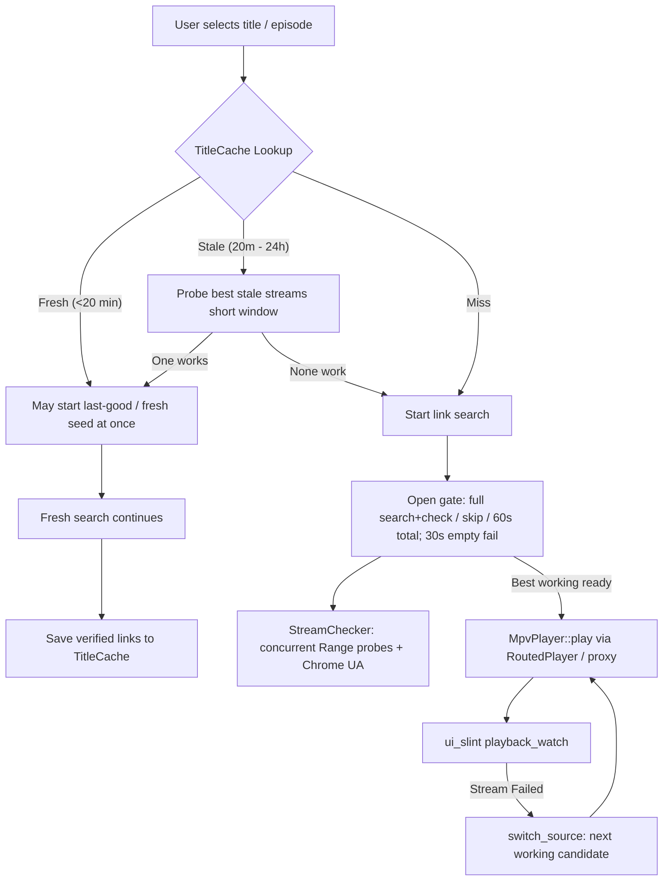

# AGENTS.md — Developer & AI Agent Codebase Guide

This document is the architectural index for **`cloudstream-desktop-unofficial`** (native Slint UI CloudStream Rust rewrite). Product builds ship `cloudstream` from `app_shell` + `ui_slint` — **no WebView / Tauri chrome**. The former `desktop_tauri` tree lives under `archive/desktop_tauri/` as reference only (not a workspace member). `crates/ui_app` (egui) remains in-tree as a reference shell only. When this file and the code differ, the code wins.

---

## Table of Contents

1. [Architecture & Workspace Overview](#1-architecture--workspace-overview)
2. [Crate & Package Map](#2-crate--package-map)
   - [Chunk 1: Foundational Models & Trait Contracts](#chunk-1-foundational-models--trait-contracts)
   - [Chunk 2: Persistence & Cache Infrastructure](#chunk-2-persistence--cache-infrastructure)
   - [Chunk 3: Extension Subsystem & Sidecar Protocol](#chunk-3-extension-subsystem--sidecar-protocol)
   - [Chunk 4: Video Player Engine (libmpv)](#chunk-4-video-player-engine-libmpv)
   - [Chunk 5: Application Services Layer](#chunk-5-application-services-layer)
   - [Chunk 6: Shells & UI Frontends](#chunk-6-shells--ui-frontends)
   - [Chunk 7: Scripts, Tooling & External Repositories](#chunk-7-scripts-tooling--external-repositories)
3. [Subsystem Lifecycles & Data Flow Diagrams](#3-subsystem-lifecycles--data-flow-diagrams)
   - [Extension Execution & Crash Recovery](#extension-execution--crash-recovery)
   - [Video Stream Resolution, Open Gate & Fallback](#video-stream-resolution-open-gate--fallback)
   - [Subtitle Ingestion & Local Normalization](#subtitle-ingestion--local-normalization)
4. [Archived Tauri IPC (reference)](#4-archived-tauri-ipc-reference)
5. [Code Navigation Guide ("Where is X?")](#5-code-navigation-guide-where-is-x)
6. [Step-by-Step Modification Recipes ("How do I do X?")](#6-step-by-step-modification-recipes-how-do-i-do-x)
   - [Recipe 1: Adding a Slint UI callback / bridge hook](#recipe-1-adding-a-slint-ui-callback--bridge-hook)
   - [Recipe 2: Changing a Slint layout or screen](#recipe-2-changing-a-slint-layout-or-screen)
   - [Recipe 3: Adding or updating an Application Service](#recipe-3-adding-or-updating-an-application-service)
   - [Recipe 4: Adding a database migration and store method](#recipe-4-adding-a-database-migration-and-store-method)
   - [Recipe 5: Modifying stream checking or playback fallback](#recipe-5-modifying-stream-checking-or-playback-fallback)
   - [Recipe 6: Writing concurrent code and mandatory race tests](#recipe-6-writing-concurrent-code-and-mandatory-race-tests)
7. [Invariants, Quality Gates & Project Rules (RULES.md)](#7-invariants-quality-gates--project-rules-rulesmd)
8. [Developer Commands & Environment Variables](#8-developer-commands--environment-variables)

---

## 1. Architecture & Workspace Overview

`cloudstream-rs` is a high-performance desktop rewrite of **CloudStream** (the Android streaming application).

### Core Pillars
- **Extension Parity**: Runs real CloudStream `.cs3` plugins via out-of-process JVM sidecars (`sidecar/cs-sidecar`, one process per plugin) executing converted DEX bytecode against Android stubs behind the `ProviderGateway` trait.
- **Player Backend**: `libmpv` is the sole video player engine, loaded dynamically at runtime (`libmpv-2.dll` on Windows, `.so.2` on Linux, `.dylib` on macOS).
- **Decoupled One-Way Flow**: `ui -> services -> traits <- implementations`. Concrete implementations are only wired in `app_shell`.
- **Fault-Tolerant Resilience**: No unhandled panics (`unwrap`, `expect`, `panic!`, `indexing_slicing` denied). Fallible paths have explicit fallbacks or structured errors.
- **Application Frontend (this fork)**: `app_shell` / `ui_slint` — native desktop shell with a retained-mode Slint GUI and embedded mpv textures. Product builds (AppImage / Windows installer / portable) ship the `cloudstream` binary from `app_shell`.
- **Shell-agnostic playback open**: `playback_session` searches and HTTP-checks streams (`open_with` / `run_open`), waits for a full search+check (or skip / 60s total cap; 30s empty fail), then plays the **best** working stream by `link_rank`; fresh `title_cache` seeds can start at once; wired from `ui_slint`.
- **Cloudflare without WebView**: `cloudflare_bridge` watches `<data>/sidecar/cloudflare`, and after allow-host runs `cloudstream-verify` (`cloudflare_window`) which writes the cookie/result files; the Slint confirm banner (`ui/cloudflare_banner.slint`) calls `WatchHandle::allow` / `decline`.
- **Legacy reference**: `archive/desktop_tauri` (former Tauri + React shell) is kept for porting remaining features; it is **not** a workspace member.

---

## 2. Crate & Package Map

### Chunk 1: Foundational Models & Trait Contracts

#### `crates/core_model`
- **Location**: `crates/core_model/`
- **Dependencies**: `serde`
- **Responsibility**: Pure domain types shared across the workspace. Zero I/O, zero network, fast compilation.
- **Public Types**:
  - `Bookmark`: `provider`, `url`, `name`, `poster_url`, `media_type`, `added_at_ms: i64`.
  - `DiscoveredRepository`: `name`, `url`, `icon_url: Option<String>`.
  - `HomePage`: `items: Vec<HomePageSection>`, `has_next: bool`.
  - `HomePageSection`: `name: String`, `list: Vec<SearchResult>`, `is_horizontal_images: bool`.
  - `InstalledExtension`: `file_name`, `internal_name`, `repository_url: Option<String>`, `version: i64`, `trusted: bool`, `icon_url: Option<String>`, `installed_at_ms: i64` (0 when unknown / pre-migration), `declared_types: Option<Vec<String>>` (the listing's `tvTypes`; `None` = unknown, pre-migration).
  - `LinkSearchCursor`: `links: usize`, `subtitles: usize`.
  - `LinkSearchUpdate`: `links: Vec<PlayableLink>`, `subtitles: Vec<SubtitleTrack>`, `done: bool`, `success: bool`, `failure: Option<String>`, `next_link: usize`, `next_subtitle: usize`, `cursor() -> LinkSearchCursor`.
  - `LoadDetails`: Title `name`, `url`, `api_name`, `media_type: Option<String>`, `data_url`, `poster_url`, `year`, `plot`, `tags: Option<Vec<String>>`, `episodes: Vec<EpisodeInfo>`, `background_poster_url`, `rating: Option<i32>`, `duration: Option<i32>`, `actors: Vec<CastMember>`, `sync_data: BTreeMap<String, String>`, `unique_url: Option<String>`.
  - `EpisodeInfo`: `data: String` (provider payload), `name: Option<String>`, `season: Option<i32>`, `episode: Option<i32>`, `poster_url: Option<String>`, `description: Option<String>`.
  - `CastMember`: `name: String`, `image: Option<String>`, `role: Option<String>`.
  - `PlayableLink`: `source`, `name`, `url`, `referer: String`, `quality: i32`, `headers: HashMap<String, String>`, `link_type` (`VIDEO`/`M3U8`/`DASH`/`TORRENT`/`MAGNET`), optional ClearKey `kid`/`key`.
  - `PlayableLinks`: `success: bool`, `links: Vec<PlayableLink>`, `subtitles: Vec<SubtitleTrack>`.
  - `SubtitleTrack`: Provider subtitle item (`lang: String`, `url: String`, `headers: Option<HashMap<String, String>>`).
  - `PluginListing`: `name`, `internal_name`, `version: i64`, `authors: Vec<String>`, `description: Option<String>`, `url: String`, `icon_url: Option<String>`, `file_size: Option<u64>`, `status: Option<i32>`, `language: Option<String>`, `tv_types: Vec<String>` (`null` lists read as empty; before, one `"tvTypes": null` made the whole plugin list unreadable).
  - `ProviderInfo`: `name: String`, `main_url: String`, `lang: String`, `types: Vec<String>`, `has_main_page: bool`, `main_page: Vec<MainPageEntry>`.
  - `MainPageEntry`: `name: String`, `data: String`, `horizontal_images: bool`.
  - `RepositoryEntry`: `url: String`, `name: String`, `added_at_ms: i64`, `icon_url: Option<String>`.
  - `SearchResult`: `name`, `url`, `poster_url`, `poster_headers: Option<HashMap<String, String>>`, `api_name`, `media_type`, `year: Option<i32>`.
  - `SearchPage`: `items: Vec<SearchResult>`, `has_next: bool`.
  - `WatchProgress`: `provider`, `media_key`, `title`, `detail_url`, `poster_url`, `position_ms: i64`, `duration_ms: i64`, `updated_at_ms: i64`, `season: Option<i32>`, `episode: Option<i32>`, `fraction_watched() -> f32`.
  - `ResumePointer`: `provider: String`, `detail_url: String`, `media_key: String`, `title: String`, `poster_url: Option<String>`, `season: Option<i32>`, `episode: Option<i32>`, `updated_at_ms: i64`.
  - `stable_key(text: &str) -> String`: Deterministic 32-character hex hash (128-bit FNV) for safe file/cache keys.
  - `redact_url(url: &str) -> String`: `host#fingerprint` of a stream address for logs (no path, query, credentials or port). Used by `player_mpv` (and the archived Tauri shell) wherever an address is logged. Also see `DEFAULT_STREAM_USER_AGENT` (Chrome desktop string shared with stream checks / stream proxy).

#### `crates/extension_api`
- **Location**: `crates/extension_api/`
- **Dependencies**: `core_model`, `thiserror`
- **Responsibility**: Trait definitions and error types between the app core and extension runtimes.
- **Trait `ProviderGateway: Send + Sync`**:
  - `load_extension(path: &Path, trusted: bool) -> Result<Vec<ProviderInfo>, GatewayError>`
  - `unload_extension(path: &Path) -> Result<(), GatewayError>`: drops a loaded plugin so uninstall+reinstall registers providers again without restarting
  - `search(provider: &str, query: &str, page: u32) -> Result<SearchPage, GatewayError>`
  - `main_page(provider: &str, page: u32, entry: &MainPageEntry) -> Result<Option<HomePage>, GatewayError>`
  - `load(provider: &str, url: &str) -> Result<Option<LoadDetails>, GatewayError>`
  - `load_links(provider: &str, data: &str) -> Result<PlayableLinks, GatewayError>`
  - `start_link_search(provider: &str, data: &str) -> Result<String, GatewayError>`
  - `poll_link_search(id: &str, cursor: LinkSearchCursor, wait: Duration) -> Result<LinkSearchUpdate, GatewayError>`
  - `cancel_link_search(id: &str) -> Result<(), GatewayError>`
  - `extract(url: &str, referer: Option<&str>) -> Result<PlayableLinks, GatewayError>`
  - `take_added_repositories() -> Result<Vec<DiscoveredRepository>, GatewayError>`
  - `extend_call_deadline(extra: Duration)`
  - `shutdown()`
  - `set_debug_logging(enabled: bool) -> Result<(), GatewayError>`
  - `set_resident_worker_limit(limit: Option<usize>)`
- **Error `GatewayError`**:
  - `Unavailable(String)`: Runtime not started or missing.
  - `Timeout { method: String, seconds: u64 }`: Call deadline exceeded.
  - `Transport(String)`: Process crash, closed pipe, or I/O failure.
  - `Remote { kind: String, message: String }`: Extension or runtime exception.
  - `SecurityBlocked { bypassable: bool, violations: Vec<String>, message: String }`: Plugin refused by `PluginSecurityVerifier` (`PluginSecurityBlockedException` / `RequiresPermissionException`, `bypassable = true`) or `SafePluginClassLoader` (`PluginSecurityDeniedException`, `bypassable = false`). Plain `SecurityException` (such as `ExtensionPathJail`) stays `Remote`.
  - `Decode { method: String, reason: String }`: Reply schema mismatch.

#### `crates/player_api`
- **Location**: `crates/player_api/`
- **Dependencies**: `thiserror`
- **Responsibility**: Decoupled player contract between application services and video player engines.
- **Trait `VideoPlayer: Send + Sync`**:
  - `play(request: &PlaybackRequest) -> Result<(), PlayerError>`
  - `set_paused(paused: bool) -> Result<(), PlayerError>`
  - `seek_to(position_ms: i64) -> Result<(), PlayerError>`
  - `stop() -> Result<(), PlayerError>`
  - `set_volume(percent: u8) -> Result<(), PlayerError>`
  - `set_cache_limits(limits: CacheLimits) -> Result<(), PlayerError>` (bytes kept ahead of / behind the playing position)
  - `status() -> PlaybackStatus`
  - `tracks() -> Vec<MediaTrack>`
  - `select_track(kind: TrackKind, id: Option<i64>) -> Result<(), PlayerError>`
  - `add_subtitles(subtitles: &[SubtitleSource])`
  - `pending_subtitles() -> usize`
  - `set_preferred_audio(language: Option<Language>)`
  - `set_preferred_subtitles(languages: &[Language])`
  - `set_verbose_log(enabled: bool)`
  - `chapters() -> Vec<Chapter>`
  - `is_embedded() -> bool`
  - `set_surface_size(width: u32, height: u32)`
  - `latest_frame(last_seen_serial: u64) -> Option<Arc<VideoFrame>>`
- **Types**:
  - `TrackKind`: Enum with `Audio`, `Subtitle`. `MediaTrack`: `id: i64`, `kind: TrackKind`, `language: Option<String>`, `title: Option<String>`, `selected: bool`.
  - `SubtitleSource`: Local file path/URL (`url: String`) and language label (`language: String`) for external subtitle attachment.
  - `PlaybackRequest`: Title, URL, `kind` (`StreamKind`: `Unknown`, `Video`, `Hls`, `Dash`, from the provider's link type by `build_request`), referer, custom HTTP headers, start position in ms, initial subtitles, and optional ClearKey DRM (`clear_key: Option<String>`).
  - `PlaybackStatus`: State (`PlaybackState`: `Idle`, `Loading`, `Playing`, `Paused`, `Ended`, `Failed(String)`), `position_ms: i64`, `duration_ms: i64`, `has_video: bool`, `buffered_ms: i64`, `is_buffering: bool`, `buffer_percent: Option<u32>`.
  - `CacheLimits`: `ahead_bytes: u64`, `behind_bytes: u64`.
  - `Chapter`: `title: String`, `start_ms: i64`.
  - `Language`: ISO 639-1 / 639-2 codes, with helpers `all_languages()`, `find_language()`, `describe_languages()`, and `ENGLISH`.
  - `VideoFrame`: Width, height, monotonically increasing `serial: u64`, and RGBA byte buffer.
  - `PlayerError`: `Unavailable(String)`, `Command { command: String, reason: String }`.

---

### Chunk 2: Persistence & Cache Infrastructure

#### `crates/storage`
- **Location**: `crates/storage/`
- **Dependencies**: `core_model`, `rusqlite = "0.41"`, `thiserror`, `tracing`
- **Database Path**: `<data_dir>/cloudstream.db` (enables SQLite WAL mode).
- **Schema Migrations (`schema_migrations.rs`)**:
  - *Version 1*:
    - `settings`: `(key TEXT PRIMARY KEY, value TEXT NOT NULL)`
    - `repositories`: `(url TEXT PRIMARY KEY, name TEXT NOT NULL, added_at INTEGER NOT NULL)`
    - `installed_extensions`: `(file_name TEXT PRIMARY KEY, internal_name TEXT NOT NULL, repository_url TEXT, version INTEGER NOT NULL, trusted INTEGER NOT NULL)`
    - `bookmarks`: `(provider TEXT NOT NULL, url TEXT NOT NULL, name TEXT NOT NULL, poster_url TEXT, media_type TEXT, added_at INTEGER NOT NULL, PRIMARY KEY (provider, url))`
    - `watch_progress`: `(provider TEXT NOT NULL, media_key TEXT NOT NULL, title TEXT NOT NULL, detail_url TEXT NOT NULL, poster_url TEXT, position_ms INTEGER NOT NULL, duration_ms INTEGER NOT NULL, updated_at INTEGER NOT NULL, PRIMARY KEY (provider, media_key))`
  - *Version 2*:
    - `ALTER TABLE repositories ADD COLUMN icon_url TEXT;`
    - `ALTER TABLE installed_extensions ADD COLUMN icon_url TEXT;`
  - *Version 3*:
    - `CREATE TABLE resume_pointers (provider TEXT NOT NULL, detail_url TEXT NOT NULL, media_key TEXT NOT NULL, title TEXT NOT NULL, poster_url TEXT, season INTEGER, episode INTEGER, updated_at INTEGER NOT NULL, PRIMARY KEY (provider, detail_url));`
    - Migrates latest watched episode per show from `watch_progress` into `resume_pointers`.
  - *Version 4*:
    - `ALTER TABLE installed_extensions ADD COLUMN installed_at INTEGER NOT NULL DEFAULT 0;`
  - *Version 5*:
    - `ALTER TABLE installed_extensions ADD COLUMN declared_types TEXT;` (JSON array of the listing's `tvTypes`; NULL = unknown).
- **Stores**:
  - `SettingsStore`: `get(key)`, `set(key, value)`.
  - `RepositoryStore`: `add(entry)`, `list()`, `set_icon(url, icon)`, `remove(url)`.
  - `InstalledExtensionStore`: `upsert(ext)` (keeps known `declared_types` when the update has none), `list()`, `set_icon_if_missing(internal_name, icon)`, `set_declared_types_if_missing(file_name, types)`, `remove(file_name)`.
  - `BookmarkStore`: `add(bookmark)`, `remove(provider, url)`, `contains(provider, url)`, `list()`.
  - `WatchProgressStore`: `save(progress)`, `get(provider, media_key)`, `recent(limit)`, `for_show(provider, detail_url)`, `remove(provider, media_key)`, `episodes_for_show(provider, detail_url)`, `remove_for_show(provider, detail_url)`, `all_media_keys()`, `clear()`.
  - `ResumeStore`: `save(pointer)`, `get(provider, detail_url)`, `remove(provider, detail_url)`, `recent(limit)`, `all()`, `clear()`.
  - All stores wrap queries over `Arc<Database>`.
- **Error**: `StorageError` (`Io { path, source }`, `Sql { operation, source }`).
- **Clock Rule**: Callers pass timestamps explicitly; stores do not query the system clock directly.

#### `crates/subtitle_store`
- **Location**: `crates/subtitle_store/`
- **Dependencies**: `core_model`, `flate2 = "1"`, `serde`, `serde_json`, `thiserror`, `tracing`, `ureq = "3"`
- **Storage Location**: `<data_dir>/subtitles/files/<stable_key>.<ext>` and per-title lists in `<data_dir>/subtitles/titles/<stable_key>.jsonl` (default retention: 7 days).
- **Modules & Types**:
  - `normalize_subtitle.rs`: `normalize_subtitle(bytes) -> Result<NormalizedSubtitle, NormalizeError>`. Unpacks `.zip` archives, decompresses `.gz` streams, strips UTF-8 BOM, decodes UTF-16 LE/BE and Windows-1252 to UTF-8, rejects HTML error/challenge responses, parses SRT/VTT/ASS.
  - `hls_subtitles.rs`: `flatten_playlist(text, base_url, fetcher)` flattens segmented M3U8 subtitle playlists into a unified WebVTT stream.
  - `subtitle_cache.rs` & `subtitle_cache_keep.rs`: `SubtitleCache::new(dir, ttl)` manages on-disk storage with TTL pruning (`prune() -> usize`) and single-title retention (`keep_only_title`, `remember_for_title`, `cached_for_title`, `discard_unclaimed`). Stores files as `<dir>/files/<stable_key>.<ext>` using `core_model::stable_key` (16-char FNV hex).
  - `subtitle_fetcher.rs`: Trait `SubtitleFetcher` and `UreqSubtitleFetcher` enforcing size limits and provider request headers.
  - `subtitle_loader.rs`: `SubtitleLoader` coordinates cache lookup -> HTTP fetch -> normalize -> disk save. `LoadOptions` (default 3 attempts, 400ms exponential backoff).
  - `subtitle_prefetch.rs`: `SubtitlePrefetch` multi-threaded background fetcher prioritizing tracks matching the user's preferred language rankings (`LanguageRank`), stoppable via `KeepGoing`. Ranks of `SKIP_DOWNLOAD_RANK` are not queued. In `ui_slint::bridge::subtitle_delivery`, preferred languages rank `0..preferred.len()` (up to `MAX_PREFERRED_EXTERNAL = 12` files) and other languages rank `preferred.len()` (up to `MAX_OTHER_EXTERNAL = 12`, at most 2 per language).

#### `crates/poster_artwork`
- **Location**: `crates/poster_artwork/` (README lists every part)
- **Dependencies**: `core_model`, `image` (JPEG/PNG/WebP/GIF), `thiserror`, `tracing`, `ureq = "3"`
- **Responsibility**: Poster images for the UI, never on the UI thread. `poster_address` rewrites TMDB `original` (and widths over 500) to `w342`, adds `https:` to `//host` addresses and percent-encodes; `UreqArtworkFetcher` (10 s, browser UA, Referer = the provider's site, 12 MB cap); `decode_artwork_to` shrinks to 360 px wide (`ArtworkSize::Full`, hero and details) or 240 px (`ArtworkSize::Tile`, row and grid tiles; `request_sized` with an `ArtworkRequest`); `DiskCache` keeps downloads in `<data>/artwork/` (14 days, 256 MB); `ArtworkLoader` (6 workers, newest first, one download per address, small LRU memory budget (16 MiB, set in `app_shell`), exactly one answer per request). The UI keeps the tiles itself: `ui_slint::bridge::image_store::ImageStore` (one buffer per address, pinned per screen, evicted least recently used under `poster_limits::IMAGE_STORE_BYTES`). Built in `app_shell::service_wiring::build_artwork`, handed to the UI as `UiServices::artwork`.

#### `crates/title_cache`
- **Location**: `crates/title_cache/`
- **Dependencies**: `core_model`, `serde`, `serde_json`, `thiserror`, `tracing`
- **Storage Location**: `<data_dir>/sources/<hash of provider+media_key>.json`
- **Limits (`cache_limits.rs`)**:
  - `fresh_for`: 20 minutes (links tried immediately without re-searching).
  - `keep_for`: 24 hours (best 3 links tested with 3s probe timeout).
  - `max_titles`: 50 entries (LRU eviction).
  - `max_links`: 200 links.
  - `max_file_bytes`: 1 MB.
- **Provider switch**: `TitleCache::invalidate_now()` / `set_valid_from(secs)` make every save from before that time unusable (`Miss::Invalidated`, file removed by the next `prune`, counted in `PruneReport::invalidated`). In the Slint product, `ui_slint::bridge::catalog_callbacks` calls `TitleCache::invalidate_now()` and `SettingsService::set_sources_valid_from` when the viewer picks a different provider, and `app_shell::service_wiring` restores `sources_valid_from` into `TitleCache::set_valid_from` at startup.
- **Only the open video keeps its sources**: `TitleCache::keep_only(key)` removes every other title's file and hands out a `KeptTitle`; `save_kept` refuses once a newer `keep_only` was called (same write lock), so the background checks of a replaced video cannot bring its file back. In the Slint product, `ui_slint::bridge::stream_opening` calls `TitleCache::keep_only` and `SubtitleCache::keep_only_title` when a video is opened; `playback_session` persists through the kept title. (Archived Tauri used `SourceManager` / `LinkLedger`.)
- **Atomic File Operations**: Writes to temporary `.tmp` files and renames into place, preventing corruption on app crash.
- **Types & Methods**:
  - `TitleCache`: `load(key) -> Lookup`, `save(key, title) -> Result<SaveReport, TitleCacheError>`, `keep_only(key) -> KeptTitle`, `save_kept(kept, title) -> Result<KeptSave, TitleCacheError>`, `invalidate_now()`, `set_valid_from(secs)`, `forget(key)`, `prune() -> PruneReport`.
  - `Lookup`: `Hit(CacheHit)` or `Miss(Miss)`. `CacheHit` carries `CachedTitle`, `Freshness` (`Fresh`, `Stale`), and `age`.
  - `CachedTitle`: `complete: bool`, `links: Vec<CachedLink>`, `last_good: Option<String>`. `playing_order() -> Vec<&CachedLink>`.
  - `CachedLink`: `link: PlayableLink`, `health: LinkHealth` (`Working`, `Broken`, `Unchecked`).

#### `crates/skip_times`
- **Location**: `crates/skip_times/`
- **Dependencies**: `serde`, `serde_json`, `thiserror`, `tracing`, `ureq = "3"`
- **Responsibility**: Finds the intro, recap and credits of an episode or film. Providers do not carry these times; like the reference app it asks community databases by the title's ids: AniSkip (anime, MyAnimeList id), TheIntroDB (TMDb or IMDb id), IntroDB (IMDb id). First database that knows wins.
- **Types**: `SkipLookup::find(&SkipQuery) -> Result<Vec<SkipSegment>, SkipError>` (answers remembered per run, at most 64; errors are not remembered), `ExternalIds::from_sync(sync_data, unique_url)` (validates ids so they are safe in a URL), `SkipFetcher` trait with `UreqSkipFetcher`.
- **Plumbing**: `core_model::LoadDetails.sync_data` / `unique_url` come from the sidecar's `load` reply; Slint `ui_slint::bridge::details_page` builds `skip_times::ExternalIds::from_sync(...)`. Product: `app_shell::service_wiring` as `UiServices::skips`; `ui_slint::bridge::skip_lookup_start` asks when a stream's length is known (request kind `Skips`); chapter-named segments win for those kinds. (Archived Tauri used `catalog_commands` / `get_skip_segments`.)

---

### Chunk 3: Extension Subsystem & Sidecar Protocol

#### `crates/extension_runtime`
- **Location**: `crates/extension_runtime/`
- **Dependencies**: `core_model`, `extension_api`, `serde`, `serde_json`, `tracing` (plus `libc = "0.2"` on Linux)
- **Binary**: `fake_sidecar` (`src/bin/fake_sidecar.rs`, enabled via `test-support` feature).
- **Modules & Constants**:
  - `call_timeouts.rs`: `PROVIDER_CALL_TIMEOUT` (60s), `LINK_RESOLVE_TIMEOUT` (150s), `EXTENSION_LOAD_TIMEOUT` (180s for DEX bytecode conversion).
  - `sidecar_launch_config.rs`: `SidecarLaunchConfig` configures `CS_SIDECAR_HOME`, `CS_SIDECAR_JAVA_HOME`, data dir (`-Dcloudstream.data.dir=...`), UTF-8 I/O encoding, and Windows root certificates (`-Djavax.net.ssl.trustStoreType=Windows-ROOT`).
  - `sidecar_process_transport.rs`: `SidecarProcessTransport` manages child process over stdin/stdout JSON-lines RPC (`CREATE_NO_WINDOW` on Windows). On crash or timeout, kills process and restarts on next call, replaying `startup_calls` (`remember_for_restart`).
  - `rpc_transport.rs`: Trait `RpcTransport` (`call`, `remember_for_restart`, `remember_setting_for_restart`).
  - `rpc_provider_gateway.rs`: `RpcProviderGateway<T>` implements `ProviderGateway`. Flags slow calls (>10s) and filters repetitive background polls (`main_page`, `take_added_repositories`, `poll_link_search`) to debug logs.
  - `WorkerLease` (`plugin_worker_resident.rs`): every provider call holds one; a plugin with a call in progress or an open link search is never parked, the oldest idle plugin stops before a new one starts (`make_room`), and choosing + parking is one locked step (`WorkerMaps::park_oldest_idle`). Race tests: `plugin_worker_lease_tests.rs`.
  - `plugin_worker_pool.rs` / `plugin_worker_maps.rs` / `plugin_worker_resident.rs`: `PluginWorkerPool` — one sidecar JVM per loaded `.cs3`, with an optional resident cap (Settings `plugin_worker_limit`, the viewer's choice; until chosen it follows the performance profile: 1 on a low-end PC, 2 balanced, 4 high-end; see `memory_budget`). Parked workers keep provider routes and revive on first call; routes by provider / link-search id; `extract` fans out across live workers; wired from `app_shell` instead of a single shared transport.
  - `jvm_profile.rs`: `JvmProfile` (`Lean` default, `Legacy` = the JVM's own defaults; `CS_JVM_PROFILE=legacy` in `app_shell` is the way back): serial collector, `-Xms16m`, C1 only, metaspace 128 MB, direct memory 64 MB, no perf data, exit on OOM, `MALLOC_ARENA_MAX=2` on Linux. Measured: two plugin JVMs 448 -> 136 MiB.
  - `sidecar_spawn_thread.rs`: `SidecarSpawner`, one long-lived thread that forks every sidecar of a `PluginWorkerPool` (`SidecarLaunchConfig::with_spawner`). Linux sends the sidecar's `PR_SET_PDEATHSIG(SIGKILL)` when the *thread* that forked it ends, so forking from short-lived UI worker threads killed the JVM after nearly every call (`exited on its own … unix_wait_status(9)` in the log).
  - `delete_sidecar_app_container()`: Removes the Windows AppContainer profile created for the plugin sidecar on data wipe (no-op on non-Windows).
  - `fake_link_search.rs` & `fake_search_runtime.rs`: Deterministic doubles for streaming link search protocol testing.

#### `crates/extension_repo`
- **Location**: `crates/extension_repo/`
- **Dependencies**: `core_model`, `serde`, `serde_json`, `thiserror`, `tracing`, `ureq = "3"`
- **Modules & Types**:
  - `repository_client.rs` & `repository_manifest.rs`: `RepositoryClient<F: HttpFetcher>` fetches manifests (`repo.json` -> `RepositoryManifest`) and plugin listings (`plugins.json`).
  - `extension_installer.rs` & `plugin_download_guard.rs`: `ExtensionInstaller<F: HttpFetcher>` downloads `.cs3` plugins to `<data_dir>/extensions/` using atomic `.cs3.part` writes, host/HTTPS/ZIP/size checks, and deterministic safe filename mapping (`safe_file_name.rs`: `plugin_file_name` keeps clean `[A-Za-z0-9_-]` names as `<name>.cs3` and maps names with punctuation/spaces like `18+` or `CNC Verse` to `<slug>_<12hex>.cs3` while refusing path traversal/separators/control chars and Windows reserved names; `plugin_path_in` strictly enforces `^[A-Za-z0-9_-]+\.cs3$`).
  - `http_fetcher.rs`: Trait `HttpFetcher` and `UreqFetcher`.
  - `http_probe.rs`: Trait `HttpProbe` and `UreqProbe` (8s timeout, probes the first 32 KB with libmpv's own `Range: bytes=0-` to verify video/playlist streams (a bounded range would pass hosts the player cannot open)). Returns `ProbeResponse` (`status`, `content_type`, `head`, `total_bytes`).
  - `repo_error.rs`: `RepoError` (`Download { url, reason }`, `Invalid { url, reason }`, `Rejected { url, reason }`, `Disk { path, source }`, `UnsafeName(String)`).

#### `sidecar/cs-sidecar`
- **Location**: `sidecar/cs-sidecar/`
- **Build System**: Gradle 8.x + Kotlin 2.1 (JVM Target 21).
- **Compatibility Bridge**: Converts Android DEX bytecode to JVM bytecode via `dex2jar` / `plugin-runtime` and provides fake Android environment classes (`android-stubs`).
- **Kotlin Modules (`src/main/kotlin/`)**:
  - `plugin-runtime` overlay `stubs/CloudflareSolver.kt` + `stubs/BrowserFetch.kt`, installed on every HTTP client by `sidecar/CloudflareSetup.kt`: Cloudflare challenge detection, the file exchange with the app, fail-fast `IOException`s with the reason, and the browser-window fallback (product: `cloudflare_bridge` + Slint banner; archived detail under `archive/desktop_tauri`). Tests: `CloudflareSolverTest.kt`.
  - `sidecar/SidecarMain.kt`: Entry point reading stdin JSON lines and dispatching RPC messages. Exits when stdin closes (plugin threads would otherwise keep the JVM alive, holding plugin files open); on Windows the Rust transport also ends the whole `cs-sidecar.bat` -> `java.exe` process tree when it discards the sidecar.
  - `sidecar/ProviderService.kt`: Executes extension calls (`search`, `main_page`, `load`, `load_links`, `extract`).
  - Plugin assets (overlay `android-stubs` `AssetManager` / `DesktopAssetSource` / `Resources.getAssets()`, `plugin-runtime` `assets/PluginArchiveAssets.kt`): like CloudStream's PluginManager for `requiresResources`, `plugin.resources.assets` reads the `assets/` folder of the plugin's own `.cs3` (Eclipsia's scraper list and scripts). Names are checked in `AssetManager` (relative, no `.`/`..`/empty parts, no `\`); the reader lives in `com.lagradost.runtime.*` (plugins cannot reference or reflect on it), opens the archive per read (no handle kept, so uninstall works on Windows) and caps each asset at 32 MiB while inflating. Wired by `scripts/patch_extension_loader.py`. Tests: `PluginArchiveAssetsTest` (`CS_TEST_ECLIPSIA_CS3=<Eclipsia.cs3>` adds the real plugin).
  - WebView & BottomSheet stubs (overlay `android-stubs`: `android.view.MotionEvent`, `android.view.View`, `android.widget.AbsoluteLayout`, `android.webkit.{WebView,WebSettings,WebChromeClient,WebStorage}`, `androidx.fragment.app.{Fragment,DialogFragment}`, `com.google.android.material.bottomsheet.{BottomSheetBehavior,BottomSheetDialog,BottomSheetDialogFragment}`): follow the real Android/Material inheritance and lifecycle contracts (`WebView -> AbsoluteLayout -> ViewGroup -> View`, persistent `WebSettings`, `getDefaultUserAgent`, `loadUrl(String, Map)`, `getProgress`, `removeJavascriptInterface`, `WebStorage` singleton, `View.dispatchTouchEvent`/`getHandler`/`scrollBy`/`layout`/`onWindowVisibilityChanged`, `Fragment.isAdded`/`startActivity`, `DialogFragment.onDismiss`, `BottomSheetDialog` container `R.id.design_bottom_sheet` bound to `BottomSheetBehavior.from(View)`, `BottomSheetDialogFragment.onCreateDialog` returning `BottomSheetDialog`). `WebView.getWebViewClassLoader()` stays intentionally omitted because `java.lang.ClassLoader` is in `PluginSecurityPolicy.EXPLICIT_DENY`. Tests: `WebViewStubsTest`, `BottomSheetStubsTest` (incl. multi-threaded race tests), and `api-scanner` `ClassifierTest`.
  - `sidecar/ExtensionPathJail.kt`, `sidecar/NoOpPreferencesFactory.kt`, `sidecar/SidecarLog.kt`: Enforces `<data>/extensions` path jail, provides no-op `java.util.prefs` for AppContainer compatibility, and gates sidecar stderr diagnostics behind the debug-logging switch.
  - `sidecar/LinkSearches.kt`: Coordinates asynchronous streaming link searches and channel buffers.
  - `sidecar/AddedRepositories.kt`, `plugins/Repository.kt`, `plugins/RepositoryManager.kt`, `ui/settings/extensions/RepositoryData.kt`: Buffers repositories discovered/added dynamically by extensions.
  - `network/CloudflareKiller.kt`: Intercepts and resolves Cloudflare challenges.
  - `syncproviders/`: Stubs for CloudStream account and sync providers (`AccountManager`, `SyncStubs`, `SimklApi`, `providers/AniListApi`, `providers/MalApi`).
- **Tests (`src/test/kotlin/`)**:
  - `sidecar/LinkSearchesTest.kt`, `sidecar/ExtensionCompatibilityTest.kt`, `stubs/CloudflareSolverTest.kt`.
  - Plugin runtime (`sidecar/overlay/plugin-runtime/src/test/`, run with the pinned reference tests it does not replace): sandbox member policy (`GuardedMemberPolicyTest`, `GuardedMemberVerifierTest`, `GuardedCallRewriteTest`, `stubs/IpLiteralTest`, `stubs/InetAddressStubTest` incl. `GuardedResolverTest`, `stubs/SafeHttpURLConnectionTest`), Android stub contracts (`stubs/WebViewStubsTest`, `stubs/BottomSheetStubsTest`), `ShadowUiTransformTest`, and `SafePluginClassLoaderTest` (overlay copy: `Executors` is allowed and routed to `ExecutorsStub`). `CS_TEST_ECLIPSIA_JAR=<Eclipsia-jvm.jar>` adds a check on the real plugin.
- **Build Script**: `scripts/setup_sidecar.ps1` clones the pinned reference client into `C:\cs3d\repo` and compiles the distribution.

#### `sidecar/api-scanner` (development tool, not shipped)
- **Location**: `sidecar/api-scanner/` (Gradle module installed next to `cs-sidecar` by `scripts/prepare_sidecar_repo.sh` / `setup_sidecar.ps1`; tests run in `test_sidecar.ps1`).
- **Responsibility**: Static scan of `.cs3` files for Android / CloudStream API members the desktop runtime does not provide, before a viewer hits them. Each plugin is converted with the runtime's own `DexConverter`; every reference to `android/`, `androidx/`, `com/google/android/`, `dalvik/` or `com/lagradost/` classes (members named on a plugin class are followed up its superclasses) is classified against the whole sidecar classpath through `ApiResolver` (plugin-runtime overlay): `RESOLVED`, `MISSING_MEMBER` (exact JVM linkage fails: `NoSuchMethodError`/`NoSuchFieldError`, e.g. a stub method with the wrong return type), `GHOST_CLASS` (class absent, plugins get an empty ghost), `NEUTRALISED` (unresolved UI call the transformer silently replaces), `BROKEN_STUB` (members cannot be listed); plus `PluginSecurityVerifier.collectFindings` refusals after the transformer. Output `api_gaps.json` (schema `version: 1`) and `api_gaps.md`, gaps ranked by how many plugins need them. Proven on real data: with the pre-assets stubs it reports Eclipsia's `Resources.getAssets()` as a missing member.
- **Run**: `api-scanner --out <dir> [--workers N] [--identities ids.json] <files or folders>` (normally through `tools/extension_recorder --mode scan`).

#### `crates/stream_proxy`
- **Location**: `crates/stream_proxy/`
- **Dependencies**: `thiserror`, `tracing`, `ureq = "3"` (nothing internal; std sockets and threads for the server).
- **Responsibility**: A local HTTP proxy (`http://127.0.0.1:<port>/s/<token>/<id>.<ext>`) that the player opens instead of an HLS stream's own address. It fetches every playlist, segment and key with the provider's headers and referer, follows redirects, asks again without `Range` where a host refuses it (400/403/405/416), resolves relative addresses like the player would (RFC 3986, `resolve_reference.rs`) and rewrites playlists (`hls_rewrite.rs`) so that every address in them is its own. The addresses carry no part of the real URL (a signed link never reaches the player's log).
- **Why it exists (verified with the real libmpv)**: libmpv sends `Range: bytes=0-` on **every** request, playlists included. A host that refuses ranges cannot be played directly; through the proxy it plays (`app_shell/src/stream_proxy_live_tests.rs`). It is *not* needed for headers on every piece (mpv already sends them) or for disguised segment names (libmpv accepts them): measure before assuming a benefit.
- **API**: `StreamProxy::start(ProxyConfig)`, `open(&StreamSpec) -> proxied address`, `close()`, `shutdown()`, `port()`.
- **Behaviour worth knowing**: a playlist is always read whole from its host and the player's range is answered over the *rewritten* text (`playlist_response.rs`, `byte_range.rs`); an address labelled HLS that is a plain file is passed on as it is, ranges included; at most two streams are served (the newest and the one it replaced, `session_registry.rs`, so a source switch never cuts the stream the player is still reading); `http`/`https` upstream only, other schemes in a playlist fail it; cookies and credentials go only to the host the stream started on (`header_policy.rs`); loopback only, random per-stream token, `Host` check, at most 64 connections (`connection_gate.rs`).
- **Not here**: DASH to HLS and CENC decryption (HLS AES-128 needs nothing: the player decrypts, the proxy only carries the key request).
- **Verified with real providers** (Nov 15, dev build): two HLS hosts, `i-cdn-0.geffe448mik.com` (1080p) and `img1.fcxmb.com` ("Castle Auto"), played through it with hardware decoding; 47-60 requests each, hosts answered 200/206, no proxy warnings or errors, short seeks (+-5 s, served from the player's own cache). **Not verified**: a long seek outside the buffer, a host that refuses `Range` (only the fake origin and the real libmpv test with a local origin did), live HLS (a stream registering more than 20 000 addresses, about 11 hours, would fail), DASH. On `img1.fcxmb.com` mpv logged "Could not find codec parameters for stream 5/6 (Audio: aac)... unspecified sample rate" at load; whether that also happens with the proxy switched off was not compared.
- **Tests**: `cargo test -p stream_proxy` (T1 rules, T2 with a fake origin on real sockets, race tests for sessions, the gate and shutdown). Real libmpv: `CS_LIBMPV_PATH=... CS_TEST_TS_SEGMENT=<any .ts> cargo test -p app_shell --lib -- --ignored hls`.

#### `spikes/wasmtime_host`
- **Location**: `spikes/wasmtime_host/`
- **Status**: Feasibility spike testing Kotlin/Wasm GC compilation running in Wasmtime 50.0.1. Retained as reference for future pure-native WASM extension runtime.

---

#### `crates/cloudflare_bridge` and `crates/cloudflare_window`
- **Principle**: state is keyed by what owns it. Clearance, permission-to-ask, "this site refuses us", the check in flight and the browser document belong to an **origin** (scheme, host, port); a request id is only a waiter (its result file, its exact address, its terminal status). Keying by exact URL or by request is what made a page's dozens of requests cost dozens of checks.
- **Sidecar** (`CloudflareSolver.kt`): `clearances`, `declined`, the lock, `retryAnswers` and `browserOnly` are keyed by `Origin`, so requests for different paths of one site share one verification. The request file still names the exact challenged URL and method (the window opens on it). `clearanceScope` is a network interceptor that attaches an origin's clearance to the outbound request for that origin on every hop, so it never reaches a redirect destination. A result with `transport=browser` marks the origin browser-only with no cookie retry; an origin that neither cookies nor the browser window can reach is declined for `declineMemoryMs` after one fresh verification instead of looping.
- **Saved passes** (`cloudflare_bridge`: `saved_pass`, `pass_scope`, `pass_book`, `disk_pass_book`, `pass_file`, `pass_policy`, `reask_guard`, `watch_passes`; plan and findings in `docs/CLOUDFLARE_PASS_PLAN.md`): a pass survives restarts and parked plugins and is shared across a site's subdomains exactly where its `cf_clearance` cookie's own `Domain` reaches (host-only stays single-host). The helper reports each pass on its private stdout (`passed\t<host>\t<id>\t<json>`; a malformed status line is logged by verb only); the watcher keeps it in `<data>/cloudflare_passes` (wired in `app_shell::cloudflare_wiring`; beside `<data>/sidecar`, never inside, since plugins' sandboxes may read that), one versioned JSON file per scope, `0600`, temp+rename, exclusive lock (2 s limit) for two app instances. A request is answered at once (`source=saved`, `pass=<id>`, `validUntil`) unless it is a viewer retry, says `need=browser`, names `rejected=`, or the pass's site is no longer allowed. Lifetime = earliest applying clearance `Expires` (capped at 400 days, 60 s margin); session cookies only within the run that saved them. The sidecar (`CloudflareExchangeFormat.kt`) names a refused saved pass once per origin (the next question to the app reports it), retires it for good there, and only a refused *fresh* pass makes an origin browser-only; `reask_guard` (4 hand-outs per origin per 10 s) catches a sidecar that does not say.
- **Idle close** (`cloudflare_bridge/src/helper_idle.rs`): `Watcher::close_helper_if_idle` (every 250 ms tick) stops a helper that has been quiet for `WatchHandle::set_helper_idle` (profile or viewer's choice, `HelperIdle` in `memory_budget`), unless a check is pending, a browser-fetch file is newer than the limit, or the helper said `fetched` (it prints that status each time it takes a browser fetch, because the app never sees those requests); the next check starts it again.
- **Bridge** (no GUI): file formats of the sidecar exchange (`request-`/`result-`, `fetch-`/`fetchresult-`), `AllowedHosts` (sites the viewer pressed Verify for, saved as setting `cloudflare_allowed_hosts`), the helper protocol, `VerifyHelper` (starts `cloudstream-verify` on demand) and `spawn_watcher`. The first request of an origin owns the prompt (`prompt_owners.rs`); later ones are quiet (still sent to the helper and answered, no events). Not allowed: the owner gets a `NeedsPermission` event and waits, later requests of that origin are answered "ask again" at once. Allowed: every request goes to the helper. Dismissing the owner retires its group; a withdrawn owner hands the prompt to the oldest waiting request. Started by `app_shell::start_cloudflare_watch` (helper next to the program, or `CS_VERIFY_HELPER`; browser profile `<data>/cloudflare_browser`).
- **Window** (`cloudstream-verify`, tao + wry / WebKitGTK): one window per origin check (`waiters.rs`: an owner plus the requests that joined it, each answered once; `cancel` retires one request only). It navigates the owner's exact challenged GET (concealed, downloads and popups refused) and decides in `verification.rs`: a fresh `cf_clearance` after a challenge hands the cookies over; a browser that was never challenged and lands on a same-origin 2xx document passes with `transport=browser` and no cookies; anything else is unconfirmed. A passed same-origin document stays hidden for browser fetches; an off-origin redirect cannot become that document. Each window is a browser process of its own (about 150 MiB measured), so `context_reaper.rs` releases passed windows nobody uses: any unused for 2 minutes, and above `--max-windows` (setting "Verified browser windows kept", `HelperWindows` in `memory_budget`, taken when the helper starts) the least recently used, never one checking, fetching or used in the last 30 seconds. A released window costs the sidecar one re-check (`gone`, then "verifying again"). A passed window quiet for 10 s is shrunk (`context_slimming.rs`, `SiteWindow::slim_if_quiet`): on Linux its browser is replaced by a new one holding a tiny page of our own (the site's origin as base address; dropping the old browser ends every process the page had, which ending only the main process did not for challenge pages), about 60-75 MiB instead of 300-460 and still serving browser fetches; on Windows it navigates to the site's `robots.txt`. Linux needs the system's WebKitGTK 4.1 (not bundled in the AppImage); Windows uses WebView2.
- **UI**: `ui_slint::bridge::cloudflare_prompts::PromptQueue` shows one check at a time ("+N more"): permission requests before failures before running checks, FIFO within, and a check that ends before its turn is never shown.

### Chunk 4: Video Player Engine (libmpv)

#### `crates/player_mpv`
- **Location**: `crates/player_mpv/`
- **Dependencies**: `core_model` (`redact_url` for the log), `player_api`, `libloading = "0.8"`, `tracing`
- **Unsafe Scope**: Confined strictly to the libmpv FFI modules (`src/mpv_api.rs`, `src/mpv_api/properties.rs`, `src/mpv_log.rs`, `src/mpv_render_api.rs`, `src/mpv_render_api/gl.rs`, `src/mpv_gl_output.rs`) with `// SAFETY:` justifications. The last two are the zero-copy video path (mpv draws into a GL texture of the app's context; `player_api::GlVideoTarget`).
- **Dynamic Locator (`libmpv_locator.rs`)**: Candidates in order: `CS_LIBMPV_PATH` (if the file exists), the directory of `current_exe()`, `current_dir()`, then (Linux/macOS) the bare names for the system loader. `MpvPlayer::auto_detect` tries each until one loads; `locate_libmpv()` returns the first. Looks for `libmpv-2.dll` / `mpv-2.dll` on Windows. When nothing is found the error lists every path searched.
- **Player Configuration (`player_configuration.rs`)**:
  - `PlayerOptions`: `headless: bool` (`vo=null, ao=null`), `embedded: bool` (`vo=libmpv`), `wid: Option<i64>` (`vo=gpu, hwdec=auto-safe`).
  - Sets common options: `idle=yes`, `keep-open=no`, `osc=no`, `input-default-bindings=no`, `hwdec=auto-copy-safe` (embedded/canvas overrides to `auto-safe` to avoid a second copy surface), `ytdl=no`, `alang=eng,en`, `force-seekable=yes` (progressive HTTP streams often omit a size; without it seek-bar jumps fail while short arrow seeks still work from cache).
  - Debugging: setting `CS_MPV_LOG` passes `terminal=yes` and `msg-level=all=v` for native mpv console diagnostics and keeps the mpv event-log level forwarded into `player-logs.jsonl` at `"v"`. The Settings debug-logging switch also raises the mpv event-log level (`VideoPlayer::set_verbose_log(true)`) into `player-logs.jsonl` without enabling `terminal=yes`.
- **Rendering Modes**:
  1. *Embedded Software Renderer*: Uses libmpv's render API (`vo=libmpv`) to blit frames into an RGBA memory buffer (`VideoFrame`). Enables frontend canvas/glass overlay.
  2. *Window Attachment (`vo=gpu`)*: Attaches directly to a native window handle (`wid: Option<i64>`).
  3. *Headless*: Plays audio/timing without video output for T4 automated integration testing.
- **Track & Subtitle Management**:
  - `preferred_audio.rs`: Automatically activates audio tracks matching ISO language preference (`AudioChoice::Switch { id }`).
  - `preferred_subtitles.rs`: Selects preferred subtitle languages once streams load without overriding manual user track picks, guarded by stream generation counters (`chosen_for`, `changed_by_viewer_for`).
  - Buffering: `PlaybackStatus.buffered_ms` / `is_buffering` / `buffer_percent` come from mpv's `paused-for-cache`, `cache-buffering-state` and `demuxer-cache-duration`; `StatusTracker` clears them when the stream ends or restarts. In the Slint product, `ui_slint::feedback_text` / `ui/player.slint` show the waiting/buffering pill and `ui_slint::seek_bar` (`bridge/player_timeline.rs`) drives the buffered stretch on the timeline.
  - `cache_limits.rs`: `set_cache_limits` (`player_api::CacheLimits`: bytes ahead / behind, `demuxer-max-bytes` / `demuxer-max-back-bytes`, changeable while a stream is loaded) and per-stream read-ahead time (`apply_read_ahead`: 60/30 s for HLS/DASH against HTTP 429, 10 h for plain files). Real libmpv (`cache_limit_live_tests.rs`, `CS_CACHE_VIDEO`): a lowered behind limit trims at once; a lowered ahead limit keeps what was read; a raised one fills once playback goes on.
  - `pending_subtitles.rs`: Queues subtitle tracks arriving asynchronously while mpv is initializing.
  - Diagnostics: `diagnostics_timer.rs` (fires once per loaded stream after 30 s, injected clock) and `playback_diagnostics.rs` (reads `hwdec-current`, `video-codec`, `container-fps`, `estimated-vf-fps`, `video-params/w|h`, `current-vo`; one `info` line, a `warn` for software decoding) are driven from `event_worker.rs`. `hwdec_problem.rs` classifies mpv log lines about a lost graphics device or failed hardware decoding; `mpv_log::forward` returns it and `wait_event` hands it to the event thread as `MpvEvent::HardwareProblem`, which logs a `warn` (no shared state). Test with real libmpv: `tests/t4_playback_diagnostics.rs`.

---

### Chunk 5: Application Services Layer

#### `crates/app_services`
- **Location**: `crates/app_services/`
- **Dependencies**: `core_model`, `extension_api`, `extension_repo`, `player_api`, `poster_artwork`, `serde`, `serde_json`, `skip_times`, `storage`, `subtitle_store`, `thiserror`, `title_cache`, `tracing`, `ureq = "3"`
- **Public Services & Modules**:
  - `CatalogService`: `search(providers, query) -> Vec<ProviderSearchOutcome>`, `home(provider, entry) -> Result<Option<HomePage>>`, `home_page(provider, page, entry) -> Result<Option<HomePage>>`, `details(provider, url) -> Result<LoadDetails>`.
  - `BrowseService` (`BrowseClient`): Queries TMDB Discover API (`browse_service.rs`, `browse_fetcher.rs`, `browse_genres.rs`, `browse_query.rs`) and matches selected cards against installed providers (`browse_match.rs`: `pick_best_search_match`).
  - **Video plugins only** (`content_support.rs`, `extension_content.rs`, rule in `crates/content_policy`): `RepositoryService` offers only video listings (`all_plugins`, `plugins(url)`) and keeps the rest apart (`refused_plugins`, `PluginIndex::refused`); `ExtensionService::install` refuses a non-video listing before any download (`ServiceError::NotVideo`) and records its `tvTypes`; `load_installed_reporting` never loads a recorded non-video plugin (`ExtensionLoadReport::not_video`, not a failure); a record from before types were kept is judged by its providers' types **before** any provider is offered (race tests in `extension_content_tests.rs`), and its types are recorded; `backfill_declared_types(catalog)` (called when the Extensions page loads the catalog) fills unknown records from their listing (repository + internal name) and unloads what turns out not to be video; providers that report only non-video types are not offered (`ContentPolicy::shows_provider`); `set_trusted` is refused for a non-video plugin; `installed_with_status()` → `InstalledStatus { extension, support: Support::{Supported, NotVideo(why), Unknown} }`. Both services default to `ContentPolicy::standard()` (`with_content_policy` for tests).
  - `ExtensionService`: `install(listing, repo_url)` (sandboxed; rolls back file + DB record and returns `ServiceError::SecurityBlocked` if refused), `install_trusted(listing, repo_url)` (explicit trusted install after user warning; still enforces `ContentPolicy` and rolls back hard denials), `uninstall(&InstalledExtension)`, `set_trusted(&InstalledExtension, trusted)` (reverts DB trust flag if reload is security-blocked), `load_installed()`, `load_installed_reporting(on_progress)` (summarizes security-blocked failures in one readable sentence), `providers()`, `providers_of(file_name)`, `installed()`, `take_added_repositories()`, `remember_icons(offered)`, `extend_call_deadline(extra)`, `shutdown()`, `set_debug_logging(enabled)`, `set_resident_worker_limit(limit)`.
  - `security_block` (`SecurityBlock`, `SecurityConcern`, `classify_violations`): Translates raw JVM verifier/classloader findings into deduplicated, severity-ordered plain-language risk categories for the Slint `SecurityDialog` modal (`ui/security_dialog.slint`, `bridge/security_dialog.rs`), keeping raw violations behind an expandable technical-details toggle and never marking an already-trusted load `can_trust`.
  - `RepositoryService`: `list()`, `add(url)`, `remove(url)`, `plugins(url)`, `import_discovered(found)`, `prepare_plugin_catalog()`, `all_plugins()`.
  - `PluginIndex`: In-memory searchable index of all plugins across all registered repositories.
  - `StreamResolver` & `LinkSearch`: Initiates streaming link resolution via `ProviderGateway::start_link_search` with automatic retry logic and extractor fallback; sorts candidates using `playable_links_best_first` and `link_rank`.
  - `StreamChecker`: Probes video streams (serially in `playback_session`; `check_worker_count`, clamping `available_parallelism` to 2…12, exists but nothing calls it yet) using HTTP probes that ask exactly what libmpv asks (`Range: bytes=0-`, reading only the first 32 KB, via `extension_repo::UreqProbe`). Request headers mirror the player: link headers + referer + `core_model::DEFAULT_STREAM_USER_AGENT` (Chrome desktop) unless the link already sets User-Agent. Evaluates `LinkHealth` (`Working { size_bytes, subtitles }`, `Broken(String)`).
  - `clear_key` & `stream_label`: ClearKey DRM key normalization (`decode_key_to_hex`, `normalize_clear_key`, `normalize_pipe_link`) and stream labels/kinds (`describe_link`, `full_label`, `source_label`, `stream_kind`).
  - `PlaybackService`: Coordinates `VideoPlayer`, `WatchProgressStore`, and `ResumeStore`. Manages `start()`, `start_at()`, `resume_position_ms()`, `set_paused()`, `seek_to()`, `set_volume()`, `set_cache_limits()`, `add_subtitles()`, `pending_subtitles()`, `set_preferred_audio()`, `set_preferred_subtitles()`, `set_verbose_player_log()`, `stop()`, `tracks()`, `chapters()`, `select_track()`, `is_embedded()`, `set_surface_size()`, `latest_frame()`, `status()`, `tick()`. Progress automatically updates every 5,000 ms (`SAVE_EVERY_MS = 5_000`). Advances resume pointer to `next_episode` when progress reaches ≥ 90% (`NEXT_WATCH_EPISODE_PERCENTAGE = 0.90`), or removes pointer if last episode/movie; that rule is the pure `playback_resume::resume_change`.
  - `LibraryService`: Bookmarks (`add_bookmark`, `remove_bookmark`, `is_bookmarked`, `bookmarks`), continue-watching, and resume pointers. `continue_watching()` returns one card per show, newest first, carrying season/episode and progress from `ResumeStore`. `resume_pointer(provider, detail_url)` finds resume position for details page; `show_progress(provider, detail_url)` returns per-episode progress. `remove_continue_watching(provider, detail_url)` and `clear_continue_watching()` remove resume pointers and episode progress rows. Max 20 items in continue-watching.
  - `SettingsService`: Typed getters/setters for disabled providers, audio language, subtitle language list (up to 3: `MAX_PREFERRED_SUBTITLES = 3`), auto-subtitles, and debug logging. One `impl SettingsService` per group of settings: `settings_service.rs` (providers, debug logging, autoplay, skip lookup, provider-switch time), `language_settings.rs` (audio, subtitles, auto-subtitles), `storage_cap_setting.rs`, `stream_proxy_setting.rs`, `video_cache_setting.rs` (`VideoCache`: size 128 MB-4 GB, default 256 MB, and ahead share 25/50/75/90 %, default 75; `while_watching()` gives the player's `CacheLimits`), `plugin_worker_setting.rs` (`plugin_worker_limit`: 1/2/unlimited; migrate-default keeps unlimited for existing installs), `cloudflare_setting.rs` (`cloudflare_allowed_hosts`, `allow_cloudflare_host`), `home_provider_setting.rs` (`home_provider`, `set_home_provider`).
  - `storage_cleanup`, `storage_usage`, `regenerable_cleanup`: Background and manual storage hygiene (`CleanupScheduler`, `CleanupHandle`, `StorageCleanupRunner`, `enforce_storage_cap`, `plan_evictions`, `measure_storage`, `clean_regenerable`).
  - `UiServices`: Composition bundle passed from `app_shell` to `ui_slint`.
  - `Clock` Trait: `SystemClock` for production, mockable clock for deterministic tests.
  - `RequestRouter` / `RoutedPlayer`: `RoutedPlayer` wraps any `VideoPlayer` and lets a `RequestRouter` change the request before every `play` (the stream proxy, wired in `app_shell`); `stop` stops the player first and then lets the router go. It forwards **every** method of `VideoPlayer`, defaults included: add new trait methods there too (`routed_player_tests.rs` lists them).
  - `SettingsService::stream_proxy()` / `set_stream_proxy()` (`stream_proxy_setting.rs`): the "Play HLS streams through a local helper" switch, on by default, option name `stream_proxy`.
  - `ServiceError`: Transparent error envelope wrapping `GatewayError`, `RepoError`, `StorageError`, `PlayerError`, and `NotFound(String)`.

#### `crates/memory_budget`
- **Location**: `crates/memory_budget/` (no dependencies; pure, no I/O)
- **Responsibility**: Memory limits for plugins, video and storage, resolved as `preset of the tier <- the viewer's overrides` into one immutable `MemoryBudget` that `app_shell` hands to components by constructor (see `docs/MEMORY.md`, plan Phase S). `MemoryTier::detect(&dyn SystemProbe)` picks Low-end / Balanced / High-end from RAM (the real probe is written in `app_shell`; tests use `FixedSystem`); `ProfileChoice` (Auto or a named tier); `BudgetOverrides` (only what the viewer changed; a value that is not an offered choice is ignored); `estimate_worst_case_mib` + `is_heavy` feed the Settings warning. Poster and picture limits are **not** here: they are fixed for every PC.
- **Wiring**: `app_shell::system_probe::SysinfoProbe` (the only `sysinfo` user) reads RAM; `SettingsService::with_system` hands it over; `SettingsService::performance_budget()` / `performance_summary()` / `reset_performance()` (`app_services/src/performance_settings.rs`) resolve it. The old keys (`video_cache_mb`, `video_cache_ahead_percent`, `storage_cap_gb`, `plugin_worker_limit`) are the viewer's overrides: a stored value wins, a missing one follows the profile (`perf_profile`, default Auto). `migrate_performance_settings` (once, `perf_migrated`) drops a stored plugin limit of `0` or `1`, which the old app wrote itself.

#### `crates/content_policy`
- **Location**: `crates/content_policy/` (pure, no I/O; optional `cli` feature adds `serde`/`serde_json`)
- **Responsibility**: The app supports **video plugins only** (movies, series, anime, cartoons, OVA, documentaries, Asian drama, live, torrent, NSFW, video); games, music, audio, audiobooks, podcasts and tools are not supported. `ContentPolicy::judge(&PluginFacts)` → `Verdict::{Video(Allowed), NotVideo(Refusal)}` from a listing's `tvTypes`: read leniently (`parse_labels`: case, spellings seen in repositories such as `Movies`/`Series`/`TV Series`/`TvChannel`, comma lists), judged strictly (only a video `MediaType` allows). `Others` is shared by video sites and games, so `REVIEWED` (`review_list.rs`) names the plugins a person checked (YouTube, Dailymotion, Nebula…, and MegaProvider, the one non-content plugin kept because it feeds the repositories), matched by `RepositoryId` (one identity for every spelling of a GitHub/GitLab/jsDelivr address) + internal name; each entry needs a reason. `shows_provider` filters a supported plugin's providers by their own types.
- **Tool**: `cargo run -p content_policy --features cli --bin plugin-content-policy < listings.json` prints a verdict per listing (used by `tools/extension_recorder`, so the tool and the app share one rule).
- **Tests**: unit tests per module; `tests/census.rs` pins the verdicts for 767 real listings (`tests/fixtures/listing_census.json`, Nov 2026: 732 supported, 35 refused, 16 by review). A rule change that moves a plugin fails it on purpose.

#### `crates/playback_session`
- **Location**: `crates/playback_session/`
- **Dependencies**: `app_services`, `core_model`, `extension_repo`, `thiserror`, `title_cache`, `tracing`
- **Responsibility**: Shell-agnostic stream open: search + `StreamChecker` probes, TitleCache seeds, live source updates, refresh. Product entry points: `open_with` / `run_open` / `refresh_sources`; UI wiring in `ui_slint::bridge::stream_opening`.
- **Gate**: announce ready on full search+all checks, viewer skip, or 60s total; fail empty after 30s with no streams; pick **best** working by `link_rank` (not first-checked).

#### `crates/app_updater`
- **Location**: `crates/app_updater/`
- **Dependencies**: `minisign-verify = "0.3.0"`, `semver = "1"`, `serde`, `serde_json`, `sha2 = "0.10"`, `thiserror`, `tracing`, `ureq = "3"`
- **Responsibility**: GitHub release check, signed `SHA256SUMS` verify (`update_signing_key.pub`), download + install helper for installer / portable / AppImage. Slint calls `check_latest` / `download_and_install` from `bridge/update_callbacks.rs` (not Tauri IPC).

---

### Chunk 6: Shells & UI Frontends

#### `crates/app_shell`
- **Location**: `crates/app_shell/`
- **Binary**: `cloudstream` (`src/main.rs`)
- **Key Modules & Paths**:
  - `app_paths.rs`: Locates data directory: `CS_DATA_DIR` -> `%LOCALAPPDATA%\CloudStreamRs` (Windows) -> `~/.local/share/cloudstream-rs` (Linux). Holds `database_file()`, `extensions_dir()`, `log_file()`.
  - `logging_setup.rs`, `log_category.rs`, `debug_logs.rs`, `log_file.rs`: Initializes `tracing-subscriber` logging to `<data>/logs/cloudstream.log` and reloadable structured JSON Lines debug/problem category layers in `<data>/logs/debug/*.jsonl` (`DebugLogs`, `LogCategory`).
  - `sidecar_discovery.rs`: Locates JVM sidecar via `CS_SIDECAR_HOME`, bundled install, `target/bundle-cache/cs-sidecar-dist`, or default `C:\cs3d\repo\cs-sidecar\build\install\cs-sidecar`. Detects JDK 21 in `C:\Program Files\Java`, `Eclipse Adoptium`, `Microsoft`, `/usr/lib/jvm`, or `target/bundle-cache`.
  - `wipe_helper.rs` & `data_wipe.rs`: "Delete all saved data" writes `delete_all_data.pending`, removes the Windows AppContainer profile, and spawns a detached `%TEMP%` script (`wipe_helper::spawn_wipe_helper`) that waits for the app to exit, stops sidecar Java processes, and removes the entire `data_dir` (including unpacked portable `runtime-*`). If the helper cannot start, `data_wipe::wipe_if_requested` (called first thing in `app_shell` `main`, before logging) performs the wipe on next launch.
  - `cleanup_wiring.rs` & `cloudflare_wiring.rs`: Starts the background storage cleanup scheduler (`start_storage_cleanup`) and Cloudflare challenge watcher (`start_cloudflare_watch`).
  - `unavailable_gateway.rs`: Graceful fallback gateway when sidecar is not installed so UI runs cleanly without crashing.
  - `service_wiring.rs`: Dependency injection constructor root (`build_services(&paths, &options) -> Result<UiServices>`). Degrades gracefully if sidecar or libmpv are missing. It wraps the mpv player in a `RoutedPlayer` for the Slint product shell and restores `SettingsService::sources_valid_from` into `TitleCache`.
  - `stream_proxy_router.rs`: the `RequestRouter` that sends HLS (provider says `Hls`, or the address ends in `.m3u8`) and progressive/unknown streams that carry custom headers or a referer through `stream_proxy` when the setting is on (never DASH). The proxy starts on the first such stream, the player gets the proxy's address and no headers, and a stream the proxy cannot open plays directly. This replaces plugin-local FlixProxy-style servers for header injection.
  - Plugin sandbox (defense in depth):
    - **Install:** `ExtensionInstaller` requires HTTPS, download host bound to the repository (or GitHub family / subdomain), ZIP magic (`PK`), and a matching published `file_size` when present (`plugin_download_guard`).
    - **Load path jail:** stored `file_name` must be `<safe>.cs3`; Rust `plugin_path_in` and sidecar `ExtensionPathJail` keep load/unload under `<data>/extensions`.
    - **Bytecode (untrusted):** cannot load real `java.net.ServerSocket` / `Socket` / `DatagramSocket`, `javax.net.ssl.SSLSocket*`, or `java.lang.Thread`. Remaps via `RawSocketRemapper` → loopback `ServerSocketStub`, deny-outbound `SocketStub`, capped `ThreadStub`. `CompatPluginClassLoader` **fails closed** if patches fail (no raw unpatched bytes). `ProcessBuilder`, NIO `Files`, and `ClassLoader` stay denied even for Trusted. Trusted skips static verify and widens the classloader — confirm in UI; reload applies immediately. Trusted also skips the OS filesystem jail (AppContainer / Landlock) while keeping Job / rlimit + heap caps (`SidecarLaunchConfig::os_fs_sandbox`); untrust clears JVM trust via `removeTrusted`.
    - **Member-level policy** (`sidecar/overlay/plugin-runtime/.../security/GuardedMemberPolicy.kt`): JDK types that are only partly safe (`InetAddress`, `Inet4Address`, `Inet6Address`, `Proxy`, `URLConnection`, `HttpURLConnection`, `HttpsURLConnection`) are judged per member: `Allow` (pure address/proxy accessors and safe per-instance HTTP methods on `URLStub`-backed `SafeHttpURLConnection`/`SafeHttpsURLConnection`), `Redirect` (rewritten by `GuardedCallRewriter` in `PluginBytecodeTransformer` and `CompatPluginClassLoader` to `InetAddressStub`: IP literals parsed strictly by `IpLiteral` with no lookup, host names through the SSRF-guarded `GuardedResolver` shared with `URLStub`'s OkHttp `Dns`, `getLocalHost` = loopback, no reverse DNS, `isReachable` refused), anything else denied (including `URLConnection`/`HttpURLConnection` subclassing, global static setters, and custom `SSLSocketFactory`/`HostnameVerifier`). `URL.openConnection`/`openStream`/`getContent` are rewritten in both `PluginBytecodeTransformer` and `CompatPluginClassLoader` to `URLStub`, which returns OkHttp-backed `SafeHttpURLConnection`/`SafeHttpsURLConnection` with `SafeInterceptor` on both application and network (redirect) hops and rejects non-HTTP(S) schemes and non-`NO_PROXY` proxies. Overlaid `ReflectionStub` blocks reflection on all `GuardedMemberPolicy.GUARDED_CLASS_NAMES`, `URLClassLoader`, `SSLSocket*`, and `URL.openConnection`/`openStream`/`getContent`. The verifier (overlay copy of `PluginSecurityVerifier.kt`) reads the same table, refuses a `Redirect` member still called directly or through a method handle, and lists **every** violation of a JAR in one `SecurityException` (a `RequiresPermissionException` only when nothing else is wrong). `GuardedMemberPolicyTest` fails when a JDK upgrade adds an unreviewed member. Changing rewrites means bumping `ShadowUiTransform.VERSION` (now `7`) so cached `*-jvm.jar` files rebuild.
    - **OS job (Windows):** the sidecar process tree is assigned to a Job Object (1536 MB memory cap, kill-on-job-close, fail-closed if assign fails) in `extension_runtime::sidecar_job_object`.
    - **OS AppContainer (Windows):** each **untrusted** plugin worker JVM is started with `CreateProcess` inside AppContainer `CloudStream.PluginSidecar.v1` (internetClient capability), with ACLs on the JDK, install home, `<data>/sidecar` (modify), and sibling `<data>/extensions` (read+execute) (`sidecar_app_container_*`; ACL grants cached per process in `acl_session_cache`). Trusted workers use plain spawn + Job Object only. `SECURITY_CAPABILITIES` and the stdio `HANDLE_LIST` stay alive on the heap until CreateProcess returns (`sidecar_app_container_attrs`). When `icacls` cannot change a path (typical for Program Files without admin), that tree is mirrored once under `<data>/sidecar/appcontainer/` (which already has modify rights) and the container runs from the copy (`sidecar_app_container_mirror`). `ExtensionPathJail` resolves host plugins as `<data>/extensions` while `cloudstream.data.dir` stays `<data>/sidecar`. `PluginPermissionAPI` is overlaid to file storage under the data dir (Windows `java.util.prefs` registry is denied in AppContainer). Fail-closed if the container cannot be prepared or the process cannot start.
    - **Per-plugin workers:** `PluginWorkerPool` (`extension_runtime`) implements `ProviderGateway` and spawns one sidecar JVM per loaded `.cs3` (untrusted: AppContainer + Job on Windows / Landlock + rlimit + process group on Linux; trusted: Job / rlimit only). After load, workers above `plugin_worker_limit` are parked (JVM stopped; providers stay listed) and revived on demand. Provider calls route by name; link searches by id (workers with an open search are not parked); `extract` fans out across currently live workers; `take_added_repositories` merges. Each live worker keeps `-Xmx512m` (plus the lean flags of `JvmProfile`) and an OS memory cap: a 1536 MB Job Object commit limit on Windows, `RLIMIT_AS` 4096 MiB (virtual, not RSS) on Linux. Wired from `app_shell::service_wiring::build_gateway`; cap applied from `SettingsService::plugin_worker_limit` in `app_shell::service_wiring::build_gateway` / Slint settings callbacks.
    - **Linux:** one out-of-process JVM **per plugin** with the bytecode sandbox. Untrusted + `cloudstream.data.dir`: Landlock FS allow-list (RO: JDK, sidecar home, `<data>/extensions`, `/bin`/`/usr`/`/lib*`/`/etc`/`/proc`; RW: `<data>/sidecar`, `/tmp`, `/dev`), `RLIMIT_AS` 4096 MB (virtual; Windows Job 1536 MB is commit charge — HotSpot needs the headroom for compressed class space), `-XX:CompressedClassSpaceSize=256m`, `-Djava.awt.headless=true` (plugins like StreamPlay use Swing dispatchers; no X11 inside Landlock), `DISPLAY` cleared, new process group + `PR_SET_PDEATHSIG`, kill-on-drop of the group (`sidecar_linux_*`). Trusted + `data.dir`: same rlimit/pgid/headless without Landlock. Fail-closed if Landlock/rlimit cannot be applied when required. Tests/`fake_sidecar` without `data.dir` stay plain spawn.
    - **Threat model:** plugins are untrusted community code with intentional public HTTPS egress. Isolation aims to block process spawn, host filesystem escape, and raw sockets — not to make arbitrary `.cs3` “perfectly safe.” Plugins no longer share one JVM (a crash or escape in one worker does not take down another plugin’s process).

#### `crates/ui_slint`
- **Location**: `crates/ui_slint/`
- **Dependencies**: `slint = "1.19"` (edition 1.19, no `system-tray`), `app_services`, `app_updater`, `cloudflare_bridge`, `core_model`, `open = "5"`, `playback_session`, `player_api`, `poster_artwork`, `skip_times`, `subtitle_store`, `title_cache`, `tracing`
- **Responsibility**: Product UI (Home / Browse / Search / Library / Settings / Player) with Slint `.slint` layouts and Rust callbacks. Layout of the bridge, request tickets, playback watch and known Slint pitfalls: `crates/ui_slint/README.md`.
- **Ported from the old Tauri UI** (pure rules with tests, named after the TS files they replace): the player's Sources menu (`source_menu.rs`: broken hidden, best first, kind / size / preferred-subtitle tags, 1080p / 2160p filter with size sort, "only with subtitles" filter), track menus with preferred languages first and picks by id (`track_menu.rs`), feedback pop-up and buffering text (`feedback_text.rs`), seek bar extras (`seek_bar.rs`), skip prompts from chapters plus online times from `UiServices::skips` (`skip_segments.rs`, `bridge/skip_lookup_start.rs`), spaced-out key seeks (`seek_scheduler.rs`), the opening panel (`check_text.rs`), Browse filters (`browse_filters.rs`), plugin search / filter / sort (`plugin_filter.rs`), the per-provider Home banner (`resume_hero.rs`). Slint globals `PluginList` and `BrowseFilter` hold those lists' controls. Extensions: installed plugins that are not video plugins show "Not supported" with the reason and only Remove (`posters::plugin_rows` over `InstalledStatus`); the catalog count says how many non-video plugins are hidden (`plugin_filter::catalog_count_text`). Settings: removable subtitle-language chips, a debug-logging switch (`AppExtras::debug_logs`), storage usage (`app_services::measure_storage`).

#### `crates/ui_app` (reference only)
- **Location**: `crates/ui_app/`
- **Dependencies**: `egui = "0.37"`, `eframe = "0.37"`, `egui_extras`, `image`, `app_services`, `cloudflare_bridge`, `core_model`, `extension_api`, `open = "5"`, `playback_session`, `player_api`, `semver = "1"`, `serde`, `serde_json`, `tracing`, `ureq = "3"`
- **Status**: Former product UI; kept for porting reference. Listed in Cargo.toml `exclude` (not a workspace member — fontconfig `dlopen` conflicts with Slint `fontique`). Product binary uses `ui_slint`.
- **Architecture**: Unidirectional reactive pattern:
  - `screens/` and `widgets/` render state and emit `UiAction`.
  - `actions/dispatcher.rs` executes use cases asynchronously on `TaskRunner`.
  - Resulting `UiEvent` values update `AppModel`.
  - `event_handler.rs` applies changes and triggers UI redraws.
- **Navigation & Screens**:
  - Top Tabs (`navigation.rs`): `Home`, `Search`, `Library`, `Downloads`, `Settings`.
  - Screens: `home_screen.rs`, `search_screen.rs`, `details_screen.rs`, `library_screen.rs`, `downloads_screen.rs`, `settings_screen.rs`, `player_screen.rs`, `extensions_panel.rs`.
  - Glass/Backdrop Blur: Stretches player frame down to 48px and scales up via GPU linear filtering (`video_presenter::blur_thumbnail`, `widgets::glass`). Hero banners stretch artwork to 24x36px (`ambient_backdrop`).
- **Input State**: `UiServices` bundle passed to `run_desktop_app(services)`.

#### `archive/desktop_tauri`
- **Location**: `archive/desktop_tauri/` (**not** a workspace member; former Tauri + React shell kept for porting)
- **Status**: Reference only. Product open/playback/UI live in `playback_session` + `ui_slint` + `app_shell`.
- **Backend Architecture (`src/`)**:
  - `main.rs`: Registers IPC commands (including `get_resume_pointer`) and sets up `AppState`, `SourceManager`, and `StartupTracker`.
  - `source_manager.rs`: Session-based coordinator managing stream search, checking queue, title caching, and subtitle prefetch.
  - `source_fallback.rs` & `source_fallback_steps.rs`: Monitors playback and automatically fails over to the next best source upon playback error.
  - *(Archived Tauri behavior; the Slint product has no away-hold: leaving the player stops playback.)* `video_away.rs` + `video_cache_commands.rs`: leaving the player (`leave_playback`) keeps a video that holds a stream waiting when Preferences "Keep video ready when leaving" is on: progress saved, paused, cache shrunk (`VideoCache::while_away`: zero ahead, half behind; mpv trims behind and reads no further ahead), sources kept, `ActiveSources.away` set. When that switch is off, leave stops like a full exit. `play_media` for that same video first tries `come_back_to`: full cache, play, no search. Leave and come-back check the open list under the `Opening` lock, so a video that started opening is never paused or resumed instead. Playing another video or closing the app drops it.
  - `source_refresh.rs`: the player's "Refresh sources" (`refresh_sources`): removes the title's saved sources, restarts the list with only the playing stream (`SourceSession::restart_playing`, `source_session_restart.rs`) and runs a new search and checks while playback goes on. Refused while no stream plays, and when another video started opening (`SourceManager::restart_list` checks the `Opening`'s generation under its lock).
  - `check_gate.rs`: Manages wait limits: 30s cap for the first working source, 60s cap for complete search, or immediate playback on skip.
  - `library_commands.rs`: `get_bookmarks`, `add_bookmark`, `remove_bookmark`, `is_bookmarked`, `get_continue_watching`, `get_resume_pointer`, `remove_continue_watching`, `clear_continue_watching`. Purges title cache & subtitles via `SourceManager::forget_title`.
  - `native_video.rs`: native video on Windows. The main window is transparent (`tauri.conf.json`); mpv gets the window's own handle (`wid`, `vo=gpu`) and draws below the transparent web view, so the player screen (`PlayerOverlay.tsx`, see-through while `Playing`/`Paused`, `hooks/useNativeVideo.ts`) floats over the picture and no frame crosses the IPC. On Windows native is the only mode (no setting); other platforms, and a missing window handle, still use the canvas path. Plan: `docs/NATIVE_VIDEO_PLAN.md`.
  - Web view flags (`webview_browser_args.rs` applies platform args at start; `tauri.conf.json` keeps the Windows line, and Cloudflare check views on Windows read the same config): `--disable-gpu` on Windows only (since `9195eae`: a frozen mouse pointer in fullscreen), omitted on Linux so the WebView can composite on the GPU; both keep `--disable-background-timer-throttling --disable-renderer-backgrounding --disable-backgrounding-occluded-windows` with `CalculateNativeWinOcclusion` disabled. The last group exists because the native video window covers the web view: a couple of minutes into a video the page's timers were slowed to once per second (the page's status poll fell from 4 to 1 per second, `useStallWatch` logged a `page stalled for ~500 ms` line every second, one 6 s freeze ended when the window was resized). With the flags the poll stayed at 4 per second for a 9-minute 4K session, and for 6 min 22 s of hands-off windowed 4K playback with the controls hidden (no stalls in either). Check it with `get_playback_status` lines per second in `logs/debug/player-logs.txt`; remember that `useStallWatch` only logs while debug logging is on.
  - `video_commands.rs`: Delivers mpv RGBA frames to the frontend as binary data (`16-byte header: width, height, serial + pixels`).
  - `data_commands.rs`: `delete_all_data` (stops playback, starts the helper, closes the app).
  - `data_helper.rs`: the helper behind it: a PowerShell (Windows) or `sh` script written to the temp folder and started detached. It waits for the app's PID to exit, ends `java.exe` processes whose command line holds the data folder (the sidecar), deletes everything except the folder of the running program (`-KeepDir`, a `runtime-*` folder; older ones are deleted), retrying while files are in use, starts the app again (portable exe via `CS_PORTABLE_EXE`, AppImage via `APPIMAGE`, else the running program) and removes itself.
  - Cloudflare verification (`cloudflare_*.rs`): sites behind Cloudflare answer plugins with a "verify you are human" page. The sidecar (`CloudflareSolver`, `BrowserFetch`) detects it and asks the app through files in `<data>/sidecar/cloudflare` (`request-/result-` for verification, `fetch-/fetchresult-` for requests made in the browser). `cloudflare_watch.rs` answers for as long as the app runs: the check opens (`cloudflare_window.rs` waits for it, `cloudflare_open.rs` opens it, one per site, parked/hidden and kept after it passes) inside the app: `cloudflare_panel.rs` builds a second browser view in the main window (own profile `<data>/cloudflare_browser`, else the app's profile) that the page's `CloudflarePanel.tsx` frame places with `place_cloudflare_panel` (the `cloudflare-panel` event opens/closes the frame, `cancel_cloudflare_panel` cancels; `PanelControl` holds cancel and the placed rectangle); if no view can be built it falls back to a window of its own. After a pass, cloudflare_share.rs copies the check view's cookies (cf_* also for i.<host>, the image server) into the app's own browser so site pictures load; names/domains are logged, never values. Title details go through `utils/detailsLoader.ts` (`api.getDetails`): a title loaded in the last 30 min is answered from memory and a load already running is joined, because the extension runtime answers one call at a time and one slow load (92 s for One Piece) delayed playback; `useTitleDetails` retries a failed load when a Cloudflare check ends. Opening a title shows `DetailsLoading.tsx` with a Cancel button (also any tab or provider click cancels): `App.tsx` keeps a `createLatestRequest` ticket per open, so a late answer is dropped (the load itself keeps running in the sidecar and is kept by `detailsLoader` for the next open). If an action fails while a site still waits for the viewer's Verify, `App.tsx` `guard` shows `CloudflareAsk.tsx` (the Verify card as a dialog, `utils/failureAction.ts`) instead of the plugin's vague error and runs the action again after verifying. While a plugin keeps the browser busy, `cloudflare_patience.rs` holds its call past the 60 s timeout (10 min cap per burst) and `cloudflare_watch.rs` sends the `plugin-progress` event (requests, rate-limited count, seconds) that `DetailsLoading.tsx` shows after 5 s with an explanation. Placement, cancel, parking and every failure are logged to `cloudflare-logs.txt` (frontend lines via `webapp-logs.txt`: placed rectangle, heartbeat every 5 s). Because the main window has two views, look it up with `get_webview("main")`/`Window`, never `get_webview_window("main")`. The check opens only for a site the viewer allowed (`cloudflare_gate.rs`: picking the provider, or the Verify card on Home via `allow_cloudflare_host`); otherwise the page gets the `cloudflare-needed` event. Cloudflare rejects the passed cookies over the sidecar's own HTTP client (it checks the connection too), so the sidecar then sends that site's requests through the window (`cloudflare_fetch.rs`: `fetch` in the page, result read back with `eval_with_callback`). `cloudflare_exchange.rs` holds the file formats. Images: `utils/imageLog.ts` reports the first loaded/failed image per site to `report_image`, which logs the cookies the app's browser holds for it. Everything is logged to `cloudflare-logs.txt` (own debug category, also in the main log at info level); sidecar lines carry the tag `[cloudflare]`.
  - Cleanup queue (`cleanup_queue.rs`, `cleanup_start.rs`, `cleanup_tasks.rs`): every background cleanup is a task in one queue run by one thread. It does nothing until start-up has finished (extensions loaded), then waits 60 s, then runs one task at a time with 3 s between them, and waits while a video plays or loads. Tasks: older `runtime-*` folders (once), stale sidecar exchange files (> 1 h), saved stream sources and subtitles (the former own-thread cleanups), the main log (`cloudstream.log` cut to its newest 2 MB when over 8 MB), rotated `*.old` debug logs (> 3 days; the debug logs themselves rotate at 20 MB in `log_file.rs`), the check browser's cache (> 150 MB, cookies stay) and the storage limit. A panicking task is logged and skipped. Each start, finish, duration and deletion is logged.
  - Storage limit (`storage_cap*.rs`): Settings > General > "Storage limit" (`StorageCapCard.tsx`, drop-down 1-10 GB, default 2, setting `storage_cap_gb` in `SettingsService`). The card shows sizes for `logs/`, `subtitles/`, `sources/` and `updates/`. `storage_cap_scan.rs` lists what can be made again (older `runtime-*` folders, stale update downloads, finished debug logs, subtitles, saved sources, the check browser's cache), `storage_cap_plan.rs` (pure) picks the cheapest first, oldest first, only as much as needed, `storage_cap.rs` deletes and logs each one. Cleanup runs on home-after-ready and via `run_storage_cleanup` ("Clean up now", which resets the hourly schedule), as a cleanup-queue task (hourly, including stale updates), when the limit is changed, and whenever a measure finds the folder over the limit. The database, plugins, settings and the running program are never listed, so a folder can stay over the limit; that is logged and shown in red.
  - `shutdown.rs`: the closer. Runs on the main window's close request and on exit (once; later callers wait): closes every other window/view (a hidden Cloudflare check would keep the app alive), stops the player, ends every plugin worker (`ProviderGateway::shutdown` -> `PluginWorkerPool` drops each `SidecarProcessTransport`, which also blocks restarts), with a 10 s watchdog that ends the process. Every step is logged with its time (`closing: ...` lines in `app-logs.txt` and the main log).
  - `deadlock_tests.rs` (tests only): fails when a synchronous `#[tauri::command]` calls something that waits for the window's own thread (`cookies_for_url`, building a window or view, `eval_with_callback`) or blocks (`recv`, `join`, `sleep`, `block_on`): that freezes the whole app on Windows. Make such a command `async`. Also holds `finishes_within`, a watchdog for tests of shared state.
  - `update_commands.rs`: The self-updater (`check_for_updates`, `apply_update`). Reads the latest GitHub release and chooses the asset by name: `*-setup.exe` (installed Windows app), `*_portable.exe` (portable, replaced through `CS_PORTABLE_EXE`), `*.AppImage` whose name contains `x86_64` or `aarch64` (Linux). Keep the release file names (see `docs/RELEASING.md`). The command file only runs the work and turns `UpdateError` (`update_error.rs`) into text; the work is split by step: `update_version.rs` (tag comparison), `update_assets.rs` (release JSON, choosing the file), `update_download.rs` (GitHub requests, download with progress), `update_install.rs` (`InstallMethod`: the installed Windows app runs the downloaded installer with `/P /R /UPDATE`; the portable exe and the AppImage have the file moved over them), `update_helper_script.rs` (the `.bat`/`.sh` helper text with quoted paths, started by plain name from its own folder), `update_verify.rs` (minisign signature of the release's `SHA256SUMS`, checked with the key in `crates/app_updater/update_signing_key.pub`, then the download's SHA-256), `update_folder.rs` (a fresh `<data>/updates/<attempt>/` per try, old ones removed), `update_prepare.rs` (the order: newer? file for this PC, signed list, download, hash; a failure removes the folder). `apply_update` takes no address: the backend picks the file. A release without `SHA256SUMS` + `SHA256SUMS.minisig`, or a build whose key file holds no key, installs nothing.
- **Frontend Architecture (`frontend/src/`, archived React UI)**:
  - `App.tsx`: Main application shell, keyboard shortcuts, and tab routing (`home`, `browse`, `search`, `library`, `settings`).
  - `screens/`: `HomeScreen.tsx`, `BrowseScreen.tsx`, `SearchScreen.tsx`, `DetailsScreen.tsx` (shows "Resume" button with time left, highlights/scrolls to resume episode), `LibraryScreen.tsx`, `SettingsScreen.tsx`, `PlayerOverlay.tsx`.
  - `screens/settings/`: `GeneralSettings.tsx`, `PreferencesPage.tsx`, `SubtitleLanguages.tsx`, `RepositoryPage.tsx`, `PluginsTab.tsx`, `ExtensionsPage.tsx`.
  - `components/`: `VideoCanvas.tsx` (canvas pixel renderer, non-Windows fallback), `ResolutionFilter.tsx` (1080p / 2160p toggles above the Sources list in the player, rule in `utils/resolutionFilter.ts`: 1080p = 1080p and lower, 2160p = anything above, including 1440p; based on the quality number the provider reports, not a measured resolution; sources with unknown quality are hidden while a group is toggled; while a group is toggled the list is sorted by file size, biggest first, and sources without a known size follow below; combines with the subtitle filter), `SourceMenuHeader.tsx` (top of the player's Sources menu: the "Refresh sources" button, enabled once the opening is over, rule in `utils/sourceRefresh.ts`, calling `refresh_sources` through `usePlayback.refreshSources`; then the resolution and subtitle filters), `SeekBar.tsx`, `SourceCheckPanel.tsx`, `OptionMenu.tsx`, `SubtitleFilter.tsx`, `PosterCard.tsx`, `BrowseCard.tsx`, `BrowseFilterBar.tsx`, `ContinueWatchingCard.tsx` (badge "S1 E3", progress bar), `ContextMenu.tsx`, `FeedbackPopup.tsx`, `DebugLoggingCard.tsx`, `StartupScreen.tsx`, `ResumeHero.tsx` (Home banner for the last unfinished title of the selected provider only: `pickResumeHero(list, provider)`; the Continue Watching row still lists every provider), `EpisodeButtons.tsx`, `UpdateIndicator.tsx` (nav bar update check) and `UpdateCard.tsx` (Settings > General update card), `NoPluginsPrompt.tsx` (Home's "add a plugin" card), `DeleteDataCard.tsx` (the "Delete all saved data" card at the bottom of Settings > General), `VideoCacheCard.tsx` (Settings > General > "Video cache": size and ahead share drop-downs, `get_video_cache` / `set_video_cache`, texts in `utils/videoCache.ts`). Leaving the player calls `leave_playback` (`usePlayback.leave`), not `stop_playback`.
  - `components/details/`: `CastRow.tsx`, `EpisodeSection.tsx` (supports `highlightedKey` and auto-scrolling).
  - `playback/`: `episodeLookup.ts` (`orderedEpisodes`, `findNextEpisode`, `findPreviousEpisode`, `findEpisodeForKey`, `movieAsEpisode`, `playbackTitle`), `autoAdvance.ts` (`shouldAutoAdvance`: next episode starts when a video ended at >= 90 %), `skipPrompt.ts` (Skip Intro / Next episode button), `skipRequest.ts`, `chapterSkips.ts` (skip segments from the playing file's own chapters: titles such as Opening, Ending, Recap, Next Time; no network, works with `skip_lookup` off; for every kind the chapters name they replace the online times, the online times fill the rest; `hooks/useChapterSkips.ts` merges them and keeps the list while its content is unchanged).
  - Player responsiveness: input acts at once and the screen shows it before the player confirms. `utils/playerShortcuts.ts` (Space pauses/plays, arrows, M, F; not while typing), `utils/clickSorter.ts` (a click pauses at once; a double click takes it back and goes fullscreen), `utils/seekScheduler.ts` (first arrow press jumps at once, later ones at most every 200 ms, every 500 ms for a held key, against HTTP 429), `utils/playIntent.ts` (a fresh pause/play wins over a late status answer for 1 s), `utils/seekTarget.ts` `shownPosition` (the seek bar shows a jump's target at once). The status is read every 250 ms (`usePlayback.ts`); `player_mpv::StatusTracker::set_paused` shows a pause at once and drops a reading taken before it (`Reading::pause_commands`). Timings against the real libmpv: `crates/player_mpv/tests/t4_responsiveness.rs` (needs `CS_BENCH_VIDEO`).
  - `utils/episodeMarks.ts`: episode marks on the title page (bar while started, Watched from 80 %).
  - `utils/homeEmptyState.ts`: `homeEmptyState()` decides when Home shows `NoPluginsPrompt`: `no-plugins` on a fresh start (nothing installed), `plugins-unavailable` when plugins are installed but none gives a provider.
  - `utils/`: `continueWatching.ts` (`watchedPercent`, `episodeBadgeText`, `formatRemainingTime`, `continueKey`), `browseFilters.ts` (`GENRES`, `RATINGS`, `YEARS`, `defaultBrowseFilters`, `pickBestSearchMatch`).
  - `components/extensions/`: `IconTile.tsx`, `InstalledExtensionList.tsx`, `PluginList.tsx`, `RepositoryPanel.tsx`.
  - `hooks/`: `usePlayback.ts`, `usePlayerControls.ts`, `usePlayerPreferences.ts`, `usePlayerShortcuts.ts`, `useExtensions.ts`, `useAllPlugins.ts`, `useDebugLogging.ts`, `useStallWatch.ts`, `useStartup.ts`, `useWindowFullscreen.ts`.
  - `services/api.ts`: Typed TypeScript client invoking backend Tauri commands.

#### `crates/portable_launcher`
- **Location**: `crates/portable_launcher/`
- **Responsibility**: The single-file Windows portable exe. The release script compiles a tar.gz of the whole app into it (`CS_PAYLOAD_ARCHIVE`, see `build.rs`); on start it unpacks to `%LOCALAPPDATA%\CloudStreamRs\runtime-<version>-<payload_id>\` once and launches `cloudstream.exe` (`cloudstream` on non-Windows) from there. `build.rs` embeds `crates/app_shell/icons/icon.ico` as its icon.

---

### Chunk 7: Scripts, Tooling & External Repositories

#### Automation Scripts (`scripts/` & `tools/`)
- `scripts/setup_sidecar.ps1`:
  - Clones `CS3-desktop-client-unofficial` at commit `2d5a86ce2e7466494a9084776dcddd3626f633dd` to `C:\cs3d\repo`.
  - Overlays `sidecar/cs-sidecar` and `sidecar/overlay`, runs `scripts/patch_extension_loader.py`, and builds the sidecar distribution with JDK 21.
- `scripts/prepare_sidecar_repo.sh <repo>` (Linux): clones/fetches the pinned client, applies `sidecar/overlay`, runs `patch_extension_loader.py` and installs our Gradle modules (`cs-sidecar`, `api-scanner`); used by `build_release.sh` and `tools/extension_recorder`.
- `scripts/patch_extension_loader.py` (tests: `patch_extension_loader_test.py`):
  - Patches the pinned `ExtensionLoader.kt` after the overlay is applied, where the overlay cannot: the cached-jar check follows `ShadowUiTransform.VERSION`, and `initializePlugin` gives each plugin `PluginAssets.resourcesFor(...)` (its own archive's assets). Each patch applies to exactly one place, is already applied, or stops the build.
- `scripts/test_sidecar.ps1`:
  - Runs the JUnit suites of the plugin runtime (with the overlay), `cs-sidecar` and `api-scanner` (`:plugin-runtime:test :cs-sidecar:test :api-scanner:test`, `--continue`); CI's `sidecar-check` job.
- `scripts/run_mutants.sh`:
  - Mutation testing for both Rust (`cargo-mutants`: `--core`, `--crate <name>`, `--diff [ref]`, `--in-diff <file>`) and the JVM sidecar (PITest `1.30.2` + `pitest-junit5-plugin:1.2.3` wired as `pitest` `JavaExec` tasks in `:plugin-runtime` incl. `:android-stubs` overlays, `:cs-sidecar` incl. `CloudflareSolver`/`BrowserFetch`, and `:api-scanner`: `--sidecar [targets]`, `--all`; HTML/XML reports land in `target/mutants/sidecar/<module>/`).
- `scripts/record_sidecar_replies.py`:
  - Executes the JVM sidecar with CineStream extension and saves sanitized golden JSON responses to `crates/extension_runtime/tests/fixtures/sidecar_replies/`.
- `scripts/build_release.ps1` (Windows PC):
  - Builds `CloudStream_<ver>_x64-setup.exe` (NSIS via `scripts/windows_installer.nsi`) and `CloudStream_<ver>_x64_portable.exe` into `dist/` (`-Kind installer|portable`).
  - Compiles `app_shell` (`cloudstream.exe`) and `cloudflare_window` (`cloudstream-verify.exe`); stages `libmpv-2.dll`, `vulkan-1.dll`, the sidecar (start script repaired for the `cmd.exe` line limit) and a Java 21 runtime; stops if `vulkan-1.dll` is missing, not x64, or absent from the installer payload or portable payload.
- `scripts/check_file_lengths.py`: fails on a Rust file outside the tests over 600 lines (clippy only counts functions). Files that were already over are in `scripts/file_length_baseline.txt`: they may shrink, not grow, and their line must go once they are split. Tests: `scripts/check_file_lengths_test.py`.
- `scripts/sign_release.sh`: writes `SHA256SUMS` for the release files in a folder, signs it with minisign (`MINISIGN_SECRET_KEY`/`_FILE`, `MINISIGN_PASSWORD`) and checks it against `crates/app_updater/update_signing_key.pub`. The in-app updater refuses releases without it. Run by `release.yml` on tags; by hand see `docs/RELEASING.md`.
- `scripts/build_release.sh` (Linux PC): builds `CloudStream-<ver>-<x86_64|aarch64>.AppImage` for the PC's CPU from `app_shell` (`cloudstream`); `--install-deps` installs Slint/GTK/X11/Wayland, libmpv, WebKitGTK 4.1 (Cloudflare helper), and JDK 21 tools on Debian/Ubuntu (no Node).
- `scripts/ci_test_appimage_commit.sh` (Linux PC): runs local CI gates (`fmt`, `clippy`, `deny`, `audit`, file lengths), `cargo test --workspace`, builds the Linux AppImage, and commits.
- `scripts/vendor/vulkan/`: the vendored x64 Vulkan loader (`vulkan-1.dll`), its Apache-2.0 license and rebuild steps. libmpv imports it; PCs without a GPU driver have none.
- `tools/extension_recorder/` (Linux + Windows; README): crawls a seed repository (MegaProvider announces the rest in a sidecar), keeps **video plugins only** through `crates/content_policy`'s `plugin-content-policy` command (excluded ones in `replies/excluded_plugins.json`), then `--mode scan` (default) downloads them and runs `sidecar/api-scanner` → `replies/api_gaps.md` / `.json`, or `--mode load` loads each in sidecar workers. Each sidecar gets a workspace laid out like the app's data folder (plugins are staged into `extensions/`, the only place the sidecar's path jail loads from). Modules: `catalog`, `content_filter`, `api_scan`, `load_test`, `sidecar_process`, `sidecar_env`, `http_fetch`, `tool_log`; tests `recorder_test.py` (CI `project-rules`).

#### GitHub Actions (`.github/workflows/`)
- `ci.yml`: on every push and pull request to `main`: format, clippy and Rust tests on Windows; clippy and Rust tests on Linux (`rust-linux`, Slint/WebKitGTK deps, Unix-only code); `cargo deny` + `cargo audit` (`supply-chain`, also weekly); the file-length check (`project-rules`); sidecar Kotlin tests (`sidecar-check`: plugin runtime + `cs-sidecar`, `scripts/test_sidecar.ps1`). **No** npm/Tauri frontend CI (archive only). `just gates` covers fmt/clippy/test/deny/audit/lengths (not the sidecar job).
- `release.yml`: builds the three release files on GitHub (Windows x64; AppImage on x86_64 and ARM runners) when a `v*` tag is pushed or when run by hand; a tag also drafts a release. See `docs/RELEASING.md`.

#### Sibling Reference Repositories
- `..\source code/`: Official CloudStream Android Kotlin codebase (`app/`, `library/`, `shared/`).
- `..\refrence code that can be copied from/codebase/`: Pinned `CS3-desktop-client-unofficial` codebase containing `android-stubs` and `plugin-runtime`.

---

## 3. Subsystem Lifecycles & Data Flow Diagrams

### Extension Execution & Crash Recovery


---

### Video Stream Resolution, Open Gate & Fallback

Product path: `playback_session` (`open_with` / `run_open`) + `ui_slint` playback watch. Stream probes use `StreamChecker` + `DEFAULT_STREAM_USER_AGENT`; HLS / header-bearing progressive may go through `stream_proxy` (`app_shell::stream_proxy_router`).



---

### Subtitle Ingestion & Local Normalization


---

## 4. Archived Tauri IPC (reference)

**Not product.** The Slint shell does not use Tauri IPC. The table below documents commands that still exist under `archive/desktop_tauri/src/main.rs` for porting. `docs_drift_tests.rs` in that archive tree guards the list there.

| Category | Command Identifier | Description |
|---|---|---|
| **Startup** | `get_startup_status` | Status of sidecar, libmpv, and extension loading. |
| **Preferences** | `get_preferences` | Audio/subtitle language preferences & auto-subtitle flag. |
| | `set_preferred_audio` | Sets preferred audio language. |
| | `set_preferred_subtitles` | Sets ordered subtitle language preference list. |
| | `set_auto_subtitles` | Enables or disables automatic subtitle track activation. |
| **Debug Logs** | `get_debug_logging` | Checks if debug logging is enabled. |
| | `set_debug_logging` | Toggles verbose debug logging. |
| | `open_logs_folder` | Opens OS file explorer at `<data_dir>/logs/`. |
| | `log_from_webapp` | Writes frontend console log messages into the backend trace. |
| **Catalog** | `get_available_providers` | Lists active providers and capabilities. |
| | `get_home_sections` | Fetches homepage shelves (`offset`/`limit` over `main_page` entries so the first shelf can paint before the rest). |
| | `search_media` | Queries multiple providers simultaneously. |
| | `get_media_details` | Loads metadata, cast, and episode list for a title. |
| | `browse_catalog` | Queries TMDB Discover API (60 items/page) filtered by media type, year, sort/rating, and genre. |
| **Playback** | `play_media` | Starts opening flow (cache check -> verification -> mpv). |
| | `skip_source_check` | Bypasses remaining stream checks and plays first ready stream. |
| | `pause_playback` | Pauses playback. |
| | `resume_playback` | Resumes playback. |
| | `seek_to` | Seeks to millisecond position. |
| | `stop_playback` | Stops player and clears active session. |
| | `leave_playback` | *(Archived Tauri only; the Slint product stops playback on leave.)* The viewer left the player: a video that holds a stream waits paused and loaded with half its cache (`video_away.rs`); anything else is stopped. Opening it again with `play_media` plays on from memory. |
| | `get_video_cache` / `set_video_cache` | Settings > General > "Video cache": size (128 MB-4 GB) and ahead share (25-90 %); a change applies at once (half while the video waits). |
| | `get_plugin_worker_limit` / `set_plugin_worker_limit` | Settings > General > "Plugin processes (low-end)": how many plugin JVMs stay resident (`0` = unlimited; in the Slint product the default follows the performance profile). |
| | `get_playback_status` | Returns state, position, duration, and track list. |
| | `select_media_track` | Switches audio or subtitle track by ID. |
| | `set_volume` | Adjusts output volume percentage (0-130%). |
| **Sources** | `get_playback_sources` | Returns stream candidates and verification statuses. |
| | `switch_source` | Manually switches playback to another stream URL. |
| | `refresh_sources` | The Sources menu's Refresh: drops the title's saved sources and searches and checks again, the playing stream goes on (`source_refresh.rs`). |
| **Library** | `get_bookmarks` | Lists all bookmarked items. |
| | `add_bookmark` | Saves item to library. |
| | `remove_bookmark` | Removes item from library. |
| | `is_bookmarked` | Checks bookmark status. |
| | `get_continue_watching` | Returns in-progress watch history items. |
| | `get_resume_pointer` | Where a show or movie was left off (the title page's Resume button and highlighted episode). |
| | `remove_continue_watching`| Forgets progress and deletes cached sources for item. |
| | `clear_continue_watching` | Clears all continue-watching records. |
| **Settings** | `get_repositories` | Lists configured extension repositories. |
| | `add_repository` | Adds and probes a new extension repository. |
| | `remove_repository` | Removes an extension repository. |
| | `get_disabled_providers` | Lists provider IDs switched off by user. |
| | `set_provider_enabled` | Toggles provider enabled state. |
| **Extensions** | `get_installed_extensions` | Lists installed extensions and versions. |
| | `get_repository_plugins` | Lists plugins available in a repository. |
| | `refresh_repository_icons`| Background worker downloading repository icons. |
| | `install_plugin` | Downloads `.cs3` and registers extension. |
| | `uninstall_extension` | Deletes `.cs3` and removes providers. |
| | `set_extension_trusted` | Flags plugin as trusted (skips static bytecode verify and most classloader denies; hard denies like ProcessBuilder remain; also skips AppContainer/Landlock while keeping Job/rlimit). Unloads and reloads the plugin immediately under the new mode. |
| **Plugin Catalog**| `prepare_plugin_catalog` | Pre-indexes all repository plugins. |
| | `list_all_plugins` | Returns indexed plugins with repository metadata. |
| **Episodes** | `get_show_progress` | Saved position of every episode of a show (episode marks on the title page). |
| | `get_skip_segments` | Intro, recap and credits of the playing video from online databases. |
| | `set_playback_option` | Switches `autoplay_next`, `skip_lookup` or `stream_proxy`. |
| | `provider_switched` | The viewer picked another provider: saved stream links from before are not used. |
| **Cloudflare** | `allow_cloudflare_host` | The viewer allowed the verification check for a site (and its subdomains) from now on. |
| | `place_cloudflare_panel` | The page says where the `CloudflarePanel.tsx` frame is; the check view moves over it. |
| | `cancel_cloudflare_panel` | The viewer pressed Cancel on the check frame. |
| | `report_image` | How an image from a site fared; the first few per site are logged with the cookies the app's browser holds for it. |
| **Video/Window** | `get_video_mode` | True when mpv draws into the main window itself (native video), so the page needs no canvas. |
| | `set_video_surface` | Informs player of viewport dimensions. |
| | `get_video_frame` | Returns binary header + RGBA pixels for canvas rendering. |
| | `set_window_fullscreen` | Toggles fullscreen window state. |
| **Updates** | `check_for_updates` | Asks GitHub for the latest release and picks the file for this PC (installer, portable exe or AppImage, by file name). |
| | `apply_update` | Finds that file itself (takes no address from the page), checks the release's signed `SHA256SUMS` and the download's SHA-256, then a helper script swaps it in for the running program (the portable exe via `CS_PORTABLE_EXE`, the AppImage via `APPIMAGE`) and restarts it. |
| **Data** | `get_storage_cap` / `set_storage_cap` | The data folder's size limit (1-10 GB) with the size used and per-folder breakdown; setting it applies it at once (`storage_cap.rs`). Over the limit on read also enforces and asks the cleanup queue to run soon. |
| | `run_storage_cleanup` | Tidies regenerable data (old runtimes, stale updates, sources, subtitles, logs, browser cache), enforces the storage limit, and resets the hourly cleanup schedule (`storage_cleanup.rs`). |
| | `delete_all_data` | Settings > General > "Delete all saved data": starts a separate helper process (`data_helper.rs`) and closes the app; the helper ends leftover sidecar Java processes, deletes everything in the data folder (except the running program's `runtime-*` folder) and starts the app again. Fallback if the helper cannot start: a marker file that the next start acts on (`app_shell::data_wipe`). |

---

## 5. Code Navigation Guide ("Where is X?")

| Component / Task | File Location |
|---|---|
| **Product UI (Slint)** | `crates/ui_slint/ui/`, `crates/ui_slint/src/bridge/` |
| **Stream open / check gate** | `crates/playback_session/` (`open_with`, `run_open`, `open_gate`, `open_run`) |
| **Playback failure fallback** | `crates/ui_slint/src/playback_watch.rs`, `bridge/stream_opening.rs` (`switch_source`) |
| **Self-updater** | `crates/app_updater/`; Slint wiring `ui_slint/src/bridge/update_callbacks.rs` |
| **egui shell (reference only)** | `crates/ui_app/` (workspace `exclude`) |
| **Archived Tauri shell** | `archive/desktop_tauri/` (not a workspace member) |
| **Service Construction Root** | `crates/app_shell/src/service_wiring.rs` |
| **OS Data Folder & Logs Setup** | `crates/app_shell/src/app_paths.rs`, `logging_setup.rs`, `log_category.rs`, `debug_logs.rs` |
| **Sidecar Process Transport** | `crates/extension_runtime/src/sidecar_process_transport.rs` |
| **Local stream proxy** | `crates/stream_proxy/`; wiring `crates/app_shell/src/stream_proxy_router.rs` |
| **Default stream User-Agent** | `crates/core_model/src/stream_user_agent.rs` (`DEFAULT_STREAM_USER_AGENT`) |
| **Stream HTTP probe** | `crates/extension_repo/src/http_probe.rs`; used by `app_services::StreamChecker` |
| **Sidecar JSON-Lines RPC Gateway** | `crates/extension_runtime/src/rpc_provider_gateway.rs` |
| **Per-plugin worker pool** | `crates/extension_runtime/src/plugin_worker_pool.rs`, `plugin_worker_maps.rs` |
| **libmpv FFI & Loaders** | `crates/player_mpv/src/mpv_api.rs`, `libmpv_locator.rs` |
| **SQLite Schema Migrations** | `crates/storage/src/schema_migrations.rs` |
| **Subtitle Cleaner & Decompressor** | `crates/subtitle_store/src/normalize_subtitle.rs` |
| **Stream Title Disk Cache** | `crates/title_cache/src/title_cache.rs` |
| **Delete all saved data** | `crates/app_shell/src/wipe_helper.rs`, `data_wipe.rs`; Slint Settings General |
| **Release scripts & workflow** | `scripts/build_release.ps1`, `scripts/build_release.sh`, `.github/workflows/release.yml`, `docs/RELEASING.md` |
| **Portable exe launcher** | `crates/portable_launcher/` (launches `cloudstream.exe`) |
| **Workspace Coding Invariants** | `RULES.md` |

---

## 6. Step-by-Step Modification Recipes ("How do I do X?")

### Recipe 1: Adding a Slint UI callback / bridge hook

1. **Slint UI**: Add the property/callback in the relevant `.slint` under `crates/ui_slint/ui/`.
2. **Bridge**: Wire it in `crates/ui_slint/src/bridge/` (call into `UiServices` / `app_services` / `playback_session`; keep UI thread free — spawn work and use request tickets / generations for late answers).
3. **Services**: Prefer extending `app_services` (or `playback_session`) rather than putting I/O in the bridge.
4. **Check**: `cargo check -p ui_slint` (or `cargo run -p app_shell`). See `crates/ui_slint/README.md` for bridge pitfalls.

---

### Recipe 2: Changing a Slint layout or screen

1. **Location**: `crates/ui_slint/ui/` (screens/widgets) and matching bridge modules under `crates/ui_slint/src/bridge/`.
2. **Pure rules**: Prefer tested Rust helpers next to the bridge (e.g. `source_menu.rs`, `browse_filters.rs`) over logic in `.slint`.
3. **Check**: `cargo run -p app_shell` / `just run`.

---

### Recipe 3: Adding or updating an Application Service

1. **Location**: `crates/app_services/src/`.
2. **Design Limits**:
   - Files ≤ 600 lines. Functions ≤ 40 lines, ≤ 4 arguments.
   - Accept collaborators via traits (`Arc<dyn ProviderGateway>`, stores, `Arc<dyn Clock>`).
   - Log significant lifecycle steps with `tracing::info!` and warnings with `tracing::warn!`.
3. **Export**: Declare module and re-export in `crates/app_services/src/lib.rs`.
4. **Wire in Composition Root**: Update `build_services` in `crates/app_shell/src/service_wiring.rs` to construct the service.

---

### Recipe 4: Adding a database migration and store method

1. **Append Migration**: In `crates/storage/src/schema_migrations.rs`, append a new SQL string to `MIGRATIONS`:
   ```rust
   const MIGRATIONS: &[&str] = &[
       // ... existing migrations
       "ALTER TABLE bookmarks ADD COLUMN custom_tag TEXT;",
   ];
   ```
   *Never modify or reorder existing migrations.*
2. **Implement Store Query**: In the target store (e.g. `bookmark_store.rs`), implement methods using rusqlite named parameter bindings (`params![...]`).
3. **Write Unit Test**: Use `Database::open_in_memory()` to verify migration execution and query behavior.

---

### Recipe 5: Modifying stream checking or playback fallback

1. **Stream Checking**: `crates/app_services/src/stream_checker.rs` (Range probe via `UreqProbe`; default UA `DEFAULT_STREAM_USER_AGENT`).
2. **Open / wait gate**: `crates/playback_session/src/open_gate.rs` + `open_run.rs` (`FIRST_WORKING_SECS` = 30 empty fail, `TOTAL_SECS` = 60 then start best working; skip starts best so far).
3. **Proxy routing**: `crates/app_shell/src/stream_proxy_router.rs` (HLS or progressive with headers/referer; never DASH).
4. **Playback fallback**: `crates/ui_slint/src/playback_watch.rs` + `bridge/stream_opening.rs` (`switch_source`) when status goes `Failed`.

---

### Recipe 6: Writing concurrent code and mandatory race tests

> [!IMPORTANT]
> Any file introducing or modifying shared state across threads (`Mutex`, `RwLock`, atomics, channels, worker threads) **must include race tests** in the same change.

Required race test elements:
1. **Multi-threaded Stress Testing**: Spawn multiple threads running hundreds or thousands of iterations while asserting state invariants hold.
2. **Deterministic Interleaving**: Step through known race edge cases (e.g. source switch arriving precisely when stream probe finishes).
3. **Proof of Failure**: Verify that removing synchronization or generation guards causes the test to fail.
4. **Generation Counters**: Protect asynchronous requests with a generation `u64` to discard stale thread completions.

---

## 7. Invariants, Quality Gates & Project Rules (RULES.md)

All code must pass these quality gates before commit:

| Check | Tool / Rule | Constraint |
|---|---|---|
| **Formatting** | `cargo fmt --all -- --check` | Standard Rust formatting (`rustfmt.toml`). |
| **Lints** | `cargo clippy --workspace --all-targets -- -D warnings` | Zero warnings permitted across workspace. |
| **File Limit** | `python scripts/check_file_lengths.py` | ≤ 600 lines per non-test Rust file (clippy counts functions only). |
| **Function Limit**| Clippy `too_many_lines` | ≤ 40 lines per function. |
| **Parameter Limit**| Clippy `too_many_arguments` | ≤ 4 parameters per function (use structs for more). |
| **Complexity** | Clippy `cognitive_complexity` | ≤ 10 per function. |
| **Panics / Unwraps**| Clippy restrictions | Deny `unwrap_used`, `expect_used`, `panic`, `unreachable`, `todo`. |
| **Indexing** | Clippy `indexing_slicing` | Denied. Must use `.get()` or pattern matching. |
| **Unsafe Code** | `#![forbid(unsafe_code)]` | Forbidden everywhere except localized `#[allow(unsafe_code)]` in `player_mpv` (libmpv FFI), `extension_runtime` (OS sandbox spawn), and `ui_slint` (generated Slint bindings). |
| **Token Safety** | `core_model::redact_url` | Never log sensitive tokens or complete signed stream links. |
| **License Check** | `cargo deny check` | Validates GPL-3.0 compatibility and dependency advisories. |
| **Vulnerabilities** | `cargo audit` | Known security advisories for the locked dependencies. |

---

## 8. Developer Commands & Environment Variables

### Daily Developer Commands
```powershell
# Run every quality gate (fmt, clippy, tests, deny, audit, file lengths)
just gates

# Run all unit and integration tests across workspace
cargo test --workspace

# Run the Slint desktop shell (product UI)
cargo run -p app_shell
# just run

# Build the Kotlin JVM extension sidecar
just sidecar

# Run Kotlin sidecar JUnit tests
powershell -File scripts/test_sidecar.ps1

# Windows x64 release files into dist/: NSIS installer + single-file portable exe (-Kind installer|portable)
powershell -File scripts/build_release.ps1

# Linux AppImage for this PC's CPU; first run: scripts/build_release.sh --install-deps
scripts/build_release.sh

# Low-end PC manual retest after launch/Home/player perf work: docs/LOW_END_RETEST.md

# GitHub builds all of them: .github/workflows/release.yml (manual run, or a v* tag makes a draft release)
```

### Environment Variables
- `CS_DATA_DIR`: Base path for data storage (defaults to `%LOCALAPPDATA%\CloudStreamRs` on Windows, `~/.local/share/cloudstream-rs` on Linux).
- `CS_SIDECAR_HOME`: Directory containing `cs-sidecar` distribution (`bin/cs-sidecar.bat`).
- `CS_SIDECAR_JAVA_HOME`: JDK 21 installation path for the sidecar.
- `CS_LIBMPV_PATH`: Explicit file path to `libmpv-2.dll` / `libmpv.so`.
- `CS_VERIFY_HELPER`: Explicit file path to the `cloudstream-verify` binary (`cloudflare_window`).
- `CS_VIDEO_RENDERER`: `gpu` or `cpu`; overrides Settings > General > "Video output" (setting `video_renderer`, a `MemoryBudget` field, software by default). GPU makes mpv draw into a texture of the window's OpenGL context (zero-copy video; falls back to the software path when the window has no OpenGL). Read when the first video starts: a change applies after a restart. Verified on Linux/Wayland only.
- `CS_MPV_LOG`: When set, enables verbose internal libmpv console logging (`terminal=yes, msg-level=all=v`) and keeps verbose mpv event logs (`"v"`) forwarded into `player-logs.jsonl` even when the Settings debug switch is off.
- `CS_PORTABLE_EXE`: Set by `portable_launcher` to the outer portable `.exe` path so `app_updater` and `wipe_helper` know the portable binary location.
- `CS_PAYLOAD_ARCHIVE` / `CS_PAYLOAD_ID`: Used at compile time by `crates/portable_launcher/build.rs` to embed the compressed runtime archive and its fingerprint.
- `CS_OUT_DIR`: Output directory override for `scripts/build_release.sh` and `scripts/ci_test_appimage_commit.sh`.
- `CS_TEST_CINESTREAM_CS3`, `CS_CACHE_VIDEO`, `CS_BENCH_VIDEO`, `CS_TEST_VIDEO_URL`, `CS_TEST_SUBTITLE_URL`, `CS_TEST_TS_SEGMENT`: Inputs for live/ignored T4 integration tests and `scripts/record_sidecar_replies.py`.
- Packages (`scripts/build_release.ps1`) carry `libmpv-2.dll`, `sidecar\` and `jre\` next to the program; the app finds them there (`sidecar_discovery::bundled_install`). A `portable.txt` next to the program makes it keep its data in `data\` beside it (`app_paths::portable_data_dir`).
- `RUST_LOG`: Tracing filter directive (e.g. `RUST_LOG=cloudstream=debug,ui_slint=debug,playback_session=debug`).
