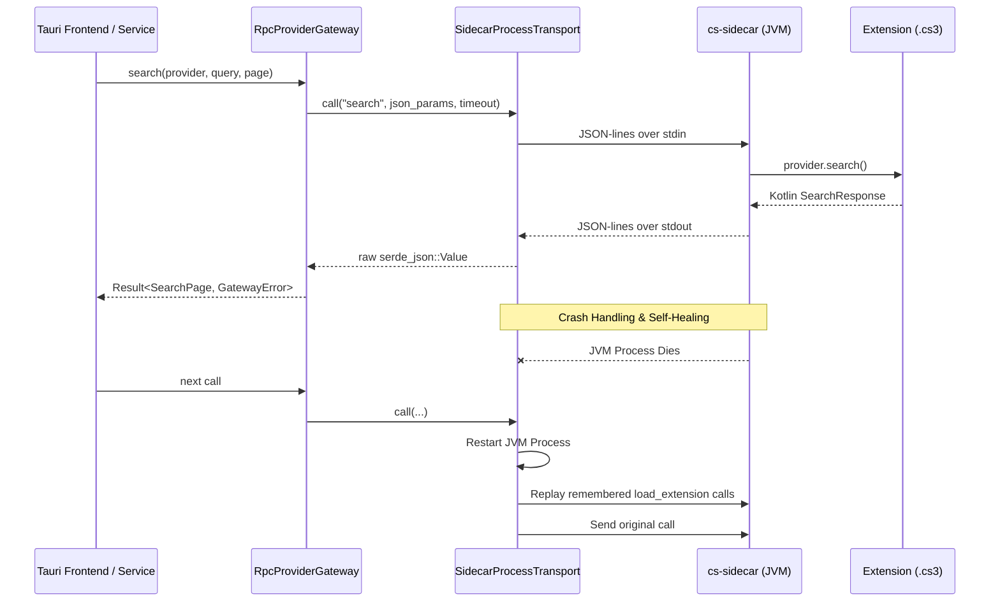

# AGENTS.md — Developer & AI Agent Codebase Guide

This document is the architectural index, navigation map, and modification handbook for the **CloudStream Rust rewrite (`cloudstream-rs`)**. It is kept up to date by hand, so it can lag behind: **when it and the code differ, the code wins**, and fixing this file is part of the change. Only the command table in section 4 is checked by a test (`crates/desktop_tauri/src/docs_drift_tests.rs`); file paths, symbols, limits and schemas elsewhere are not.

---

## Table of Contents

1. [Architecture & Workspace Overview](#1-architecture--workspace-overview)
2. [Crate & Package Map](#2-crate--package-map)
   - [Chunk 1: Foundational Models & Trait Contracts](#chunk-1-foundational-models--trait-contracts)
   - [Chunk 2: Persistence & Cache Infrastructure](#chunk-2-persistence--cache-infrastructure)
   - [Chunk 3: Extension Subsystem & Sidecar Protocol](#chunk-3-extension-subsystem--sidecar-protocol)
   - [Chunk 4: Video Player Engine (libmpv)](#chunk-4-video-player-engine-libmpv)
   - [Chunk 5: Application Services Layer](#chunk-5-application-services-layer)
   - [Chunk 6: Shells & UI Frontends](#chunk-6-shells--ui-frontends)
   - [Chunk 7: Scripts, Tooling & External Repositories](#chunk-7-scripts-tooling--external-repositories)
3. [Subsystem Lifecycles & Data Flow Diagrams](#3-subsystem-lifecycles--data-flow-diagrams)
   - [Extension Execution & Crash Recovery](#extension-execution--crash-recovery)
   - [Video Stream Resolution, Check Gate & Fallback](#video-stream-resolution-check-gate--fallback)
   - [Subtitle Ingestion & Local Normalization](#subtitle-ingestion--local-normalization)
4. [Tauri IPC Interface (68 Commands Reference)](#4-tauri-ipc-interface-68-commands-reference)
5. [Code Navigation Guide ("Where is X?")](#5-code-navigation-guide-where-is-x)
6. [Step-by-Step Modification Recipes ("How do I do X?")](#6-step-by-step-modification-recipes-how-do-i-do-x)
   - [Recipe 1: Adding a new Tauri IPC command (Rust + React)](#recipe-1-adding-a-new-tauri-ipc-command-rust--react)
   - [Recipe 2: Modifying or adding a React frontend component](#recipe-2-modifying-or-adding-a-react-frontend-component)
   - [Recipe 3: Adding or updating an Application Service](#recipe-3-adding-or-updating-an-application-service)
   - [Recipe 4: Adding a database migration and store method](#recipe-4-adding-a-database-migration-and-store-method)
   - [Recipe 5: Modifying stream checking or playback fallback](#recipe-5-modifying-stream-checking-or-playback-fallback)
   - [Recipe 6: Writing concurrent code and mandatory race tests](#recipe-6-writing-concurrent-code-and-mandatory-race-tests)
7. [Invariants, Quality Gates & Project Rules (RULES.md)](#7-invariants-quality-gates--project-rules-rulesmd)
8. [Developer Commands & Environment Variables](#8-developer-commands--environment-variables)

---

## 1. Architecture & Workspace Overview

`cloudstream-rs` is a high-performance desktop rewrite of **CloudStream** (the Android streaming application).

### Core Pillars
- **Extension Parity**: Runs real CloudStream `.cs3` plugins via out-of-process JVM sidecars (`sidecar/cs-sidecar`, one process per plugin) executing converted DEX bytecode against Android stubs behind the `ProviderGateway` trait.
- **Player Backend**: `libmpv` is the sole video player engine, loaded dynamically at runtime (`libmpv-2.dll` on Windows, `.so.2` on Linux, `.dylib` on macOS).
- **Decoupled One-Way Flow**: `ui -> services -> traits <- implementations`. Concrete implementations are only wired in `app_shell`.
- **Fault-Tolerant Resilience**: No unhandled panics (`unwrap`, `expect`, `panic!`, `indexing_slicing` denied). Fallible paths have explicit fallbacks or structured errors.
- **Dual Application Frontends**:
  1. `desktop_tauri`: Tauri v2 application shell hosting a React 18 + TypeScript + Vite + Tailwind CSS frontend with software-rendered libmpv frames over an HTML5 `<canvas>`.
  2. `app_shell` / `ui_app`: Native desktop shell running an immediate-mode `egui` GUI with blurred glass shaders and embedded mpv textures.

---

## 2. Crate & Package Map

### Chunk 1: Foundational Models & Trait Contracts

#### `crates/core_model`
- **Location**: `crates/core_model/`
- **Dependencies**: `serde`
- **Responsibility**: Pure domain types shared across the workspace. Zero I/O, zero network, fast compilation.
- **Public Types**:
  - `Bookmark`: `provider`, `url`, `title: name`, `poster_url`, `media_type`, `added_at: i64`.
  - `DiscoveredRepository`: `name`, `url`.
  - `HomePage`: `items: Vec<HomePageSection>`.
  - `HomePageSection`: `name: String`, `items: Vec<SearchResult>`.
  - `InstalledExtension`: `file_name`, `internal_name`, `repository_url: Option<String>`, `version: i32`, `trusted: bool`, `icon_url: Option<String>`, `installed_at_ms: i64` (0 when unknown / pre-migration).
  - `LinkSearchCursor`: `links: usize`, `subtitles: usize`.
  - `LinkSearchUpdate`: `links: Vec<PlayableLink>`, `subtitles: Vec<SubtitleTrack>`, `is_done: bool`, `next_link: usize`, `next_subtitle: usize`, `cursor() -> LinkSearchCursor`.
  - `LoadDetails`: Title `name`, `url`, `api_name`, `media_type`, `data_url`, `poster_url`, `year`, `plot`, `tags: Option<Vec<String>>`, `episodes: Vec<EpisodeInfo>`, `background_poster_url`, `rating: Option<i32>`, `duration: Option<i32>`, `actors: Vec<CastMember>`.
  - `EpisodeInfo`: `data: String` (provider payload), `name`, `season: Option<i32>`, `episode: Option<i32>`, `poster_url`, `description`.
  - `CastMember`: `name: String`, `image: Option<String>`, `role: Option<String>`.
  - `PlayableLink`: `source: String`, `name: String`, `url: String`, `referer: Option<String>`, `quality: Option<i32>`, `headers: Option<HashMap<String, String>>`, `is_m3u8: Option<bool>`.
  - `PlayableLinks`: `success: bool`, `links: Vec<PlayableLink>`, `subtitles: Vec<SubtitleTrack>`.
  - `SubtitleTrack`: Provider subtitle item (`lang: String`, `url: String`).
  - `PluginListing`: `name`, `internal_name`, `version: i32`, `authors: Vec<String>`, `description: Option<String>`, `url: String`, `icon_url: Option<String>`.
  - `ProviderInfo`: `name: String`, `main_url: String`, `lang: String`, `types: Vec<String>`, `has_main_page: bool`, `main_page: Vec<MainPageEntry>`.
  - `MainPageEntry`: `name: String`, `data: String`, `horizontal_images: bool`.
  - `RepositoryEntry`: `url: String`, `name: String`, `icon_url: Option<String>`.
  - `SearchResult`: `name`, `url`, `poster_url`, `api_name`, `media_type`, `year: Option<i32>`.
  - `SearchPage`: `items: Vec<SearchResult>`.
  - `WatchProgress`: `provider`, `media_key`, `title`, `detail_url`, `poster_url`, `position_ms: i64`, `duration_ms: i64`, `updated_at_ms: i64`, `season: Option<i32>`, `episode: Option<i32>`, `fraction_watched() -> f32`.
  - `ResumePointer`: `provider: String`, `detail_url: String`, `media_key: String`, `title: String`, `poster_url: Option<String>`, `season: Option<i32>`, `episode: Option<i32>`, `updated_at_ms: i64`.
  - `stable_key(text: &str) -> String`: Deterministic 16-character hex hash based on FNV constants for safe file/cache keys.
  - `redact_url(url: &str) -> String`: `host#fingerprint` of a stream address for logs (no path, query, credentials or port). Used by `desktop_tauri` and `player_mpv` wherever an address is logged.

#### `crates/extension_api`
- **Location**: `crates/extension_api/`
- **Dependencies**: `core_model`, `thiserror`
- **Responsibility**: Trait definitions and error types between the app core and extension runtimes.
- **Trait `ProviderGateway: Send + Sync`**:
 - `load_extension(path: &Path, trusted: bool) -> Result<Vec<ProviderInfo>, GatewayError>`
 - `unload_extension(path: &Path) -> Result<(), GatewayError>`: drops a loaded plugin so uninstall+reinstall registers providers again without restarting
 - `search(provider: &str, query: &str, page: u32) -> Result<SearchPage, GatewayError>`
  - `main_page(provider: &str, page: u32, entry: &MainPageEntry) -> Result<Option<HomePage>, GatewayError>`
  - `load(provider: &str, url: &str) -> Result<Option<LoadDetails>, GatewayError>`
  - `load_links(provider: &str, data: &str) -> Result<PlayableLinks, GatewayError>`
  - `start_link_search(provider: &str, data: &str) -> Result<String, GatewayError>`
  - `poll_link_search(id: &str, cursor: LinkSearchCursor, wait: Duration) -> Result<LinkSearchUpdate, GatewayError>`
  - `cancel_link_search(id: &str) -> Result<(), GatewayError>`
  - `extract(url: &str, referer: Option<&str>) -> Result<PlayableLinks, GatewayError>`
  - `take_added_repositories() -> Result<Vec<DiscoveredRepository>, GatewayError>`
  - `set_debug_logging(enabled: bool) -> Result<(), GatewayError>`
- **Error `GatewayError`**:
  - `Unavailable(String)`: Runtime not started or missing.
  - `Timeout { method: String, seconds: u64 }`: Call deadline exceeded.
  - `Transport(String)`: Process crash, closed pipe, or I/O failure.
  - `Remote { kind: String, message: String }`: Extension or runtime exception.
  - `Decode { method: String, reason: String }`: Reply schema mismatch.

#### `crates/player_api`
- **Location**: `crates/player_api/`
- **Dependencies**: `thiserror`
- **Responsibility**: Decoupled player contract between application services and video player engines.
- **Trait `VideoPlayer: Send + Sync`**:
  - `play(request: &PlaybackRequest) -> Result<(), PlayerError>`
  - `set_paused(paused: bool) -> Result<(), PlayerError>`
  - `seek_to(position_ms: i64) -> Result<(), PlayerError>`
  - `stop() -> Result<(), PlayerError>`
  - `set_volume(percent: u8) -> Result<(), PlayerError>`
  - `set_cache_limits(limits: CacheLimits) -> Result<(), PlayerError>` (bytes kept ahead of / behind the playing position)
  - `status() -> PlaybackStatus`
  - `tracks() -> Vec<MediaTrack>`
  - `select_track(kind: TrackKind, id: Option<i64>) -> Result<(), PlayerError>`
  - `add_subtitles(subtitles: &[SubtitleSource])`
  - `set_preferred_audio(language: Option<Language>)`
  - `set_preferred_subtitles(languages: &[Language])`
  - `is_embedded() -> bool`
  - `set_surface_size(width: u32, height: u32)`
  - `latest_frame(last_seen_serial: u64) -> Option<Arc<VideoFrame>>`
- **Types**:
  - `TrackKind`: Enum with `Audio`, `Subtitle`.
  - `SubtitleSource`: Local file path/URL and label for external subtitle attachment.
  - `PlaybackRequest`: Title, URL, `kind` (`StreamKind`: `Unknown`, `Video`, `Hls`, `Dash`, from the provider's link type by `build_request`), referer, custom HTTP headers, start position in ms, and initial subtitles.
  - `PlaybackStatus`: State (`PlaybackState`: `Idle`, `Loading`, `Playing`, `Paused`, `Ended`, `Failed`), duration, position, volume.
  - `Language`: ISO 639-1 / 639-2 codes, with helpers `all_languages()`, `find_language()`, and `ENGLISH`.
  - `VideoFrame`: Width, height, monotonically increasing `serial: u64`, and RGBA byte buffer.
  - `PlayerError`: `Unavailable(String)`, `Command { command: String, reason: String }`.

---

### Chunk 2: Persistence & Cache Infrastructure

#### `crates/storage`
- **Location**: `crates/storage/`
- **Dependencies**: `core_model`, `rusqlite = "0.41"`, `thiserror`, `tracing`
- **Database Path**: `<data_dir>/cloudstream.db` (enables SQLite WAL mode).
- **Schema Migrations (`schema_migrations.rs`)**:
  - *Version 1*:
    - `settings`: `(key TEXT PRIMARY KEY, value TEXT NOT NULL)`
    - `repositories`: `(url TEXT PRIMARY KEY, name TEXT NOT NULL, added_at INTEGER NOT NULL)`
    - `installed_extensions`: `(file_name TEXT PRIMARY KEY, internal_name TEXT NOT NULL, repository_url TEXT, version INTEGER NOT NULL, trusted INTEGER NOT NULL)`
    - `bookmarks`: `(provider TEXT NOT NULL, url TEXT NOT NULL, name TEXT NOT NULL, poster_url TEXT, media_type TEXT, added_at INTEGER NOT NULL, PRIMARY KEY (provider, url))`
    - `watch_progress`: `(provider TEXT NOT NULL, media_key TEXT NOT NULL, title TEXT NOT NULL, detail_url TEXT NOT NULL, poster_url TEXT, position_ms INTEGER NOT NULL, duration_ms INTEGER NOT NULL, updated_at INTEGER NOT NULL, PRIMARY KEY (provider, media_key))`
  - *Version 2*:
    - `ALTER TABLE repositories ADD COLUMN icon_url TEXT;`
    - `ALTER TABLE installed_extensions ADD COLUMN icon_url TEXT;`
  - *Version 3*:
    - `CREATE TABLE resume_pointers (provider TEXT NOT NULL, detail_url TEXT NOT NULL, media_key TEXT NOT NULL, title TEXT NOT NULL, poster_url TEXT, season INTEGER, episode INTEGER, updated_at INTEGER NOT NULL, PRIMARY KEY (provider, detail_url));`
    - Migrates latest watched episode per show from `watch_progress` into `resume_pointers`.
  - *Version 4*:
    - `ALTER TABLE installed_extensions ADD COLUMN installed_at INTEGER NOT NULL DEFAULT 0;`
- **Stores**:
  - `SettingsStore`: `get(key)`, `set(key, value)`, `remove(key)`.
  - `RepositoryStore`: `add(entry, added_at)`, `remove(url)`, `list()`, `set_icon_url(url, icon_url)`.
  - `InstalledExtensionStore`: `add(ext)`, `remove(file_name)`, `list()`, `set_trusted(file_name, trusted)`, `set_icon_url(file_name, icon_url)`.
  - `BookmarkStore`: `add(bookmark)`, `remove(provider, url)`, `contains(provider, url)`, `list()`.
  - `WatchProgressStore`: `save(progress)`, `get(provider, media_key)`, `recent(limit)`, `remove(provider, media_key)`, `episodes_for_show(provider, detail_url)`, `remove_for_show(provider, detail_url)`, `all_media_keys()`, `clear()`.
  - `ResumeStore`: `save(pointer)`, `get(provider, detail_url)`, `remove(provider, detail_url)`, `recent(limit)`, `all()`, `clear()`.
  - All stores wrap queries over `Arc<Database>`.
- **Error**: `StorageError` (`Io { path, source }`, `Sql { operation, source }`).
- **Clock Rule**: Callers pass timestamps explicitly; stores do not query the system clock directly.

#### `crates/subtitle_store`
- **Location**: `crates/subtitle_store/`
- **Dependencies**: `core_model`, `flate2 = "1"`, `serde`, `serde_json`, `thiserror`, `tracing`, `ureq = "3"`
- **Storage Location**: `<data_dir>/subtitles/<url_hash>.vtt` (default retention: 7 days).
- **Modules & Types**:
  - `normalize_subtitle.rs`: `normalize_subtitle(bytes) -> Result<NormalizedSubtitle, NormalizeError>`. Unpacks `.zip` archives, decompresses `.gz` streams, strips UTF-8 BOM, decodes UTF-16 LE/BE and Windows-1252 to UTF-8, rejects HTML error/challenge responses, parses SRT/VTT.
  - `hls_subtitles.rs`: `flatten_playlist(text, base_url, fetcher)` flattens segmented M3U8 subtitle playlists into a unified WebVTT stream.
  - `subtitle_cache.rs`: `SubtitleCache::new(dir, ttl)` manages on-disk storage with LRU and TTL pruning (`prune() -> usize`). Stores files as `<dir>/<sha256>.vtt`.
  - `subtitle_fetcher.rs`: Trait `SubtitleFetcher` and `UreqSubtitleFetcher` enforcing size limits and provider request headers.
  - `subtitle_loader.rs`: `SubtitleLoader` coordinates cache lookup -> HTTP fetch -> normalize -> disk save. `LoadOptions` (default 3 attempts, 400ms exponential backoff).
  - `subtitle_prefetch.rs`: `SubtitlePrefetch` multi-threaded background fetcher prioritizing tracks matching the user's preferred language rankings (`LanguageRank`), stoppable via `KeepGoing`. Ranks of `SKIP_DOWNLOAD_RANK` are not queued; the desktop app ranks non-preferred languages that way and attaches at most 12 external files per stream (`subtitle_attach_limits`).

#### `crates/title_cache`
- **Location**: `crates/title_cache/`
- **Dependencies**: `core_model`, `serde`, `serde_json`, `thiserror`, `tracing`
- **Storage Location**: `<data_dir>/sources/<hash of provider+media_key>.json`
- **Limits (`cache_limits.rs`)**:
  - `fresh_duration`: 20 minutes (links tried immediately without re-searching).
  - `stale_duration`: 24 hours (best 3 links tested with 3s probe timeout).
  - `max_titles`: 50 entries (LRU eviction).
  - `max_links_per_title`: 200 links.
  - `max_file_size`: 1 MB.
- **Provider switch**: `TitleCache::invalidate_now()` / `set_valid_from(secs)` make every save from before that time unusable (`Miss::Invalidated`, file removed by the next `prune`, counted in `PruneReport::invalidated`); notes (`mark_broken`, ...) never revive such a file. `desktop_tauri::provider_switch::apply_switch` (command `provider_switched`) calls it when the viewer picks a different provider, and stores the time in the `sources_valid_from` setting, which `sources_cleanup::open_title_cache` restores at start. The cleanup queue (`cleanup_start.rs`) prunes it hourly once the app has started.
- **Only the open video keeps its sources**: `TitleCache::keep_only(key)` removes every other title's file and hands out a `KeptTitle`; `save_kept` / `forget_kept` refuse once a newer `keep_only` was called (same write lock), so the background checks of a replaced video cannot bring its file back. `SourceManager::keep_only` (`desktop_tauri/src/source_notes.rs`) calls it, and `SubtitleCache::keep_only_title` (`subtitle_store/src/subtitle_cache_keep.rs`) for the subtitles, whenever a video is opened (`discover_with`); `LinkLedger` saves through its `KeptTitle`.
- **Atomic File Operations**: Writes to temporary `.tmp` files and renames into place, preventing corruption on app crash.
- **Types & Methods**:
  - `TitleCache`: `load(key) -> Lookup`, `save(key, title) -> Result<SaveReport, TitleCacheError>`, `update(key, fn)`, `mark_broken(key, url)`, `forget(key)`, `clear()`, `prune() -> PruneReport`.
  - `Lookup`: `Hit(CacheHit)` or `Miss(Miss)`. `CacheHit` carries `CachedTitle`, `Freshness` (`Fresh`, `Stale`), and `age`.
  - `CachedTitle`: `complete: bool`, `links: Vec<CachedLink>`, `last_good: Option<String>`. `playing_order() -> Vec<&CachedLink>`.
  - `CachedLink`: `link: PlayableLink`, `health: LinkHealth` (`Working`, `Broken`, `Unchecked`).

#### `crates/skip_times`
- **Location**: `crates/skip_times/`
- **Dependencies**: `serde`, `serde_json`, `thiserror`, `tracing`, `ureq = "3"`
- **Responsibility**: Finds the intro, recap and credits of an episode or film. Providers do not carry these times; like the reference app it asks community databases by the title's ids: AniSkip (anime, MyAnimeList id), TheIntroDB (TMDb or IMDb id), IntroDB (IMDb id). First database that knows wins.
- **Types**: `SkipLookup::find(&SkipQuery) -> Result<Vec<SkipSegment>, SkipError>` (answers remembered per run, at most 64; errors are not remembered), `ExternalIds::from_sync(sync_data, unique_url)` (validates ids so they are safe in a URL), `SkipFetcher` trait with `UreqSkipFetcher`.
- **Plumbing**: `core_model::LoadDetails.sync_data` / `unique_url` come from the sidecar's `load` reply; `desktop_tauri::catalog_commands::map_media_details` turns them into `imdb_id` / `tmdb_id` / `mal_id` on the title page; `skip_commands::get_skip_segments` runs the lookup (switch: setting `skip_lookup`).

---

### Chunk 3: Extension Subsystem & Sidecar Protocol

#### `crates/extension_runtime`
- **Location**: `crates/extension_runtime/`
- **Dependencies**: `core_model`, `extension_api`, `serde`, `serde_json`, `tracing`
- **Binary**: `fake_sidecar` (`src/bin/fake_sidecar.rs`, enabled via `test-support` feature).
- **Modules & Constants**:
  - `call_timeouts.rs`: `PROVIDER_CALL_TIMEOUT` (60s), `LINK_RESOLVE_TIMEOUT` (150s), `EXTENSION_LOAD_TIMEOUT` (180s for DEX bytecode conversion).
  - `sidecar_launch_config.rs`: `SidecarLaunchConfig` configures `CS_SIDECAR_HOME`, `CS_SIDECAR_JAVA_HOME`, data dir (`-Dcloudstream.data.dir=...`), UTF-8 I/O encoding, and Windows root certificates (`-Djavax.net.ssl.trustStoreType=Windows-ROOT`).
  - `sidecar_process_transport.rs`: `SidecarProcessTransport` manages child process over stdin/stdout JSON-lines RPC (`CREATE_NO_WINDOW` on Windows). On crash or timeout, kills process and restarts on next call, replaying `startup_calls` (`remember_for_restart`).
  - `rpc_transport.rs`: Trait `RpcTransport` (`call`, `remember_for_restart`, `remember_setting_for_restart`).
  - `rpc_provider_gateway.rs`: `RpcProviderGateway<T>` implements `ProviderGateway`. Flags slow calls (>10s) and filters repetitive background polls (`main_page`, `take_added_repositories`, `poll_link_search`) to debug logs.
  - `plugin_worker_pool.rs` / `plugin_worker_maps.rs`: `PluginWorkerPool` — one sidecar JVM per loaded `.cs3`; routes by provider / link-search id; `extract` fans out; wired from `app_shell` instead of a single shared transport.
  - `fake_link_search.rs` & `fake_search_runtime.rs`: Deterministic doubles for streaming link search protocol testing.

#### `crates/extension_repo`
- **Location**: `crates/extension_repo/`
- **Dependencies**: `core_model`, `serde`, `serde_json`, `thiserror`, `tracing`, `ureq = "3"`
- **Modules & Types**:
  - `repository_client.rs`: `RepositoryClient<F: HttpFetcher>` fetches manifests (`repo.json`) and plugin listings (`plugins.json`).
  - `extension_installer.rs`: `ExtensionInstaller<F: HttpFetcher>` downloads `.cs3` plugins to `<data_dir>/extensions/` using atomic `.cs3.part` writes and path sanitization (`safe_file_name.rs`).
  - `http_probe.rs`: Trait `HttpProbe` and `UreqProbe` (8s timeout, probes first 32 KB via HTTP `Range: bytes=0-32767` to verify video/playlist streams). Returns `ProbeResponse` (`status`, `content_type`, `head`, `total_bytes`).
  - `repo_error.rs`: `RepoError` (`Download { url, reason }`, `Invalid { url, reason }`, `Disk { path, source }`, `UnsafeName(String)`).

#### `sidecar/cs-sidecar`
- **Location**: `sidecar/cs-sidecar/`
- **Build System**: Gradle 8.x + Kotlin 2.1 (JVM Target 21).
- **Compatibility Bridge**: Converts Android DEX bytecode to JVM bytecode via `dex2jar` / `plugin-runtime` and provides fake Android environment classes (`android-stubs`).
- **Kotlin Modules (`src/main/kotlin/`)**:
  - `plugin-runtime` overlay `stubs/CloudflareSolver.kt` + `stubs/BrowserFetch.kt`, installed on every HTTP client by `sidecar/CloudflareSetup.kt`: Cloudflare challenge detection, the file exchange with the app, fail-fast `IOException`s with the reason, and the browser-window fallback (see "Cloudflare verification" under `desktop_tauri`). Tests: `CloudflareSolverTest.kt`.
  - `sidecar/SidecarMain.kt`: Entry point reading stdin JSON lines and dispatching RPC messages. Exits when stdin closes (plugin threads would otherwise keep the JVM alive, holding plugin files open); on Windows the Rust transport also ends the whole `cs-sidecar.bat` -> `java.exe` process tree when it discards the sidecar.
  - `sidecar/ProviderService.kt`: Executes extension calls (`search`, `main_page`, `load`, `load_links`, `extract`).
  - `sidecar/LinkSearches.kt`: Coordinates asynchronous streaming link searches and channel buffers.
  - `sidecar/AddedRepositories.kt`: Buffers repositories discovered/added dynamically by extensions.
  - `network/CloudflareKiller.kt`: Intercepts and resolves Cloudflare challenges.
  - `syncproviders/`: Stubs for CloudStream account and sync providers (`AccountManager`, `SyncStubs`, `SimklApi`).
- **Tests (`src/test/kotlin/`)**:
  - `sidecar/LinkSearchesTest.kt`: Multi-threaded race tests verifying streaming link search concurrency.
- **Build Script**: `scripts/setup_sidecar.ps1` clones the pinned reference client into `C:\cs3d\repo` and compiles the distribution.

#### `crates/stream_proxy`
- **Location**: `crates/stream_proxy/`
- **Dependencies**: `thiserror`, `tracing`, `ureq = "3"` (nothing internal; std sockets and threads for the server).
- **Responsibility**: A local HTTP proxy (`http://127.0.0.1:<port>/s/<token>/<id>.<ext>`) that the player opens instead of an HLS stream's own address. It fetches every playlist, segment and key with the provider's headers and referer, follows redirects, asks again without `Range` where a host refuses it (400/403/405/416), resolves relative addresses like the player would (RFC 3986, `resolve_reference.rs`) and rewrites playlists (`hls_rewrite.rs`) so that every address in them is its own. The addresses carry no part of the real URL (a signed link never reaches the player's log).
- **Why it exists (verified with the real libmpv)**: libmpv sends `Range: bytes=0-` on **every** request, playlists included. A host that refuses ranges cannot be played directly; through the proxy it plays (`app_shell/src/stream_proxy_live_tests.rs`). It is *not* needed for headers on every piece (mpv already sends them) or for disguised segment names (libmpv accepts them): measure before assuming a benefit.
- **API**: `StreamProxy::start(ProxyConfig)`, `open(&StreamSpec) -> proxied address`, `close()`, `shutdown()`, `port()`.
- **Behaviour worth knowing**: a playlist is always read whole from its host and the player's range is answered over the *rewritten* text (`playlist_response.rs`, `byte_range.rs`); an address labelled HLS that is a plain file is passed on as it is, ranges included; at most two streams are served (the newest and the one it replaced, `session_registry.rs`, so a source switch never cuts the stream the player is still reading); `http`/`https` upstream only, other schemes in a playlist fail it; cookies and credentials go only to the host the stream started on (`header_policy.rs`); loopback only, random per-stream token, `Host` check, at most 64 connections (`connection_gate.rs`).
- **Not here**: DASH to HLS and CENC decryption (HLS AES-128 needs nothing: the player decrypts, the proxy only carries the key request).
- **Verified with real providers** (Nov 15, dev build): two HLS hosts, `i-cdn-0.geffe448mik.com` (1080p) and `img1.fcxmb.com` ("Castle Auto"), played through it with hardware decoding; 47-60 requests each, hosts answered 200/206, no proxy warnings or errors, short seeks (+-5 s, served from the player's own cache). **Not verified**: a long seek outside the buffer, a host that refuses `Range` (only the fake origin and the real libmpv test with a local origin did), live HLS (a stream registering more than 20 000 addresses, about 11 hours, would fail), DASH. On `img1.fcxmb.com` mpv logged "Could not find codec parameters for stream 5/6 (Audio: aac)... unspecified sample rate" at load; whether that also happens with the proxy switched off was not compared.
- **Tests**: `cargo test -p stream_proxy` (T1 rules, T2 with a fake origin on real sockets, race tests for sessions, the gate and shutdown). Real libmpv: `CS_LIBMPV_PATH=... CS_TEST_TS_SEGMENT=<any .ts> cargo test -p app_shell --lib -- --ignored hls`.

#### `spikes/wasmtime_host`
- **Location**: `spikes/wasmtime_host/`
- **Status**: Feasibility spike testing Kotlin/Wasm GC compilation running in Wasmtime 50.0.1. Retained as reference for future pure-native WASM extension runtime.

---

### Chunk 4: Video Player Engine (libmpv)

#### `crates/player_mpv`
- **Location**: `crates/player_mpv/`
- **Dependencies**: `core_model` (`redact_url` for the log), `player_api`, `libloading = "0.8"`, `tracing`
- **Unsafe Scope**: Confined strictly to `src/mpv_api.rs` with `// SAFETY:` justifications.
- **Dynamic Locator (`libmpv_locator.rs`)**: Candidates in order: `CS_LIBMPV_PATH` (if the file exists), the directory of `current_exe()`, `current_dir()`, then (Linux/macOS) the bare names for the system loader. `MpvPlayer::auto_detect` tries each until one loads; `locate_libmpv()` returns the first. Looks for `libmpv-2.dll` / `mpv-2.dll` on Windows. When nothing is found the error lists every path searched.
- **Player Configuration (`player_configuration.rs`)**:
  - `PlayerOptions`: `headless: bool` (`vo=null, ao=null`), `embedded: bool` (`vo=libmpv`), `wid: Option<i64>` (`vo=gpu, hwdec=auto-safe`).
  - Sets common options: `idle=yes`, `keep-open=no`, `osc=no`, `input-default-bindings=no`, `hwdec=auto-copy-safe`, `ytdl=no`, `alang=eng,en`, `force-seekable=yes` (progressive HTTP streams often omit a size; without it seek-bar jumps fail while short arrow seeks still work from cache).
  - Debugging: setting `CS_MPV_LOG` passes `terminal=yes` and `msg-level=all=v` for native mpv console diagnostics and raises the mpv event-log level forwarded into `player-logs.txt`. The Settings debug-logging switch does not enable that flood.
- **Rendering Modes**:
  1. *Embedded Software Renderer*: Uses libmpv's render API (`vo=libmpv`) to blit frames into an RGBA memory buffer (`VideoFrame`). Enables frontend canvas/glass overlay.
  2. *Window Attachment (`vo=gpu`)*: Attaches directly to a native window handle (`wid: Option<i64>`).
  3. *Headless*: Plays audio/timing without video output for T4 automated integration testing.
- **Track & Subtitle Management**:
  - `preferred_audio.rs`: Automatically activates audio tracks matching ISO language preference (`AudioChoice::Switch { id }`).
  - `preferred_subtitles.rs`: Selects preferred subtitle languages once streams load without overriding manual user track picks, guarded by stream generation counters (`chosen_for`, `changed_by_viewer_for`).
  - Buffering: `PlaybackStatus.buffered_ms` / `is_buffering` / `buffer_percent` come from mpv's `paused-for-cache`, `cache-buffering-state` and `demuxer-cache-duration`; `StatusTracker` clears them when the stream ends or restarts. The page shows `BufferingIndicator.tsx` and the buffered stretch on `SeekBar.tsx`.
  - `cache_limits.rs`: `set_cache_limits` (`player_api::CacheLimits`: bytes ahead / behind, `demuxer-max-bytes` / `demuxer-max-back-bytes`, changeable while a stream is loaded) and per-stream read-ahead time (`apply_read_ahead`: 60/30 s for HLS/DASH against HTTP 429, 10 h for plain files). Real libmpv (`cache_limit_live_tests.rs`, `CS_CACHE_VIDEO`): a lowered behind limit trims at once; a lowered ahead limit keeps what was read; a raised one fills once playback goes on.
  - `pending_subtitles.rs`: Queues subtitle tracks arriving asynchronously while mpv is initializing.
  - Diagnostics: `diagnostics_timer.rs` (fires once per loaded stream after 30 s, injected clock) and `playback_diagnostics.rs` (reads `hwdec-current`, `video-codec`, `container-fps`, `estimated-vf-fps`, `video-params/w|h`, `current-vo`; one `info` line, a `warn` for software decoding) are driven from `event_worker.rs`. `hwdec_problem.rs` classifies mpv log lines about a lost graphics device or failed hardware decoding; `mpv_log::forward` returns it and `wait_event` hands it to the event thread as `MpvEvent::HardwareProblem`, which logs a `warn` (no shared state). Test with real libmpv: `tests/t4_playback_diagnostics.rs`.

---

### Chunk 5: Application Services Layer

#### `crates/app_services`
- **Location**: `crates/app_services/`
- **Dependencies**: `core_model`, `extension_api`, `extension_repo`, `player_api`, `storage`, `thiserror`, `tracing`
- **Public Services**:
  - `CatalogService`: `search(providers, query) -> Vec<ProviderSearchOutcome>`, `home(provider, entry) -> Result<Option<HomePage>>`, `details(provider, url) -> Result<LoadDetails>`.
  - `ExtensionService`: `install(listing, repo_url)`, `uninstall(file_name)`, `set_trusted(file_name, trusted)`, `load_installed(progress_cb)`, `providers()`, `installed()`, `set_debug_logging(enabled)`.
  - `RepositoryService`: `repositories()`, `add(url)`, `remove(url)`, `plugins(url)`, `import_discovered()`, `refresh_icons()`.
  - `PluginIndex`: In-memory searchable index of all plugins across all registered repositories.
  - `StreamResolver`: Initiates streaming link resolution via `ProviderGateway::start_link_search` with automatic retry logic; sorts candidates using `playable_links_best_first` and `link_rank`.
  - `StreamChecker`: Concurrently probes video streams via 12 worker threads (`WORKERS = 12`) using HTTP Range probes (`Range: bytes=0-32767`). Evaluates `LinkHealth` (`Working { size_bytes, subtitles }`, `Broken(String)`).
  - `CheckQueue`: Thread-safe priority queue sorting streams by resolution/quality (`push`, `close`, `stop`, `next`).
  - `PlaybackService`: Coordinates `VideoPlayer`, `WatchProgressStore`, and `ResumeStore`. Manages `start()`, `start_at()`, `resume_position_ms()`, `set_paused()`, `seek_to()`, `set_volume()`, `tracks()`, `select_track()`, `latest_frame()`. Progress automatically updates every 5,000 ms (`SAVE_EVERY_MS = 5_000`). Advances resume pointer to `next_episode` when progress reaches ≥ 90% (`NEXT_WATCH_EPISODE_PERCENTAGE = 0.90`), or removes pointer if last episode/movie; that rule is the pure `playback_resume::resume_change`.
  - `LibraryService`: Bookmarks, continue-watching, and resume pointers. `continue_watching()` returns one card per show, newest first, carrying season/episode and progress from `ResumeStore`. `resume_pointer(provider, detail_url)` finds resume position for details page. `remove_continue_watching(provider, detail_url)` and `clear_continue_watching()` remove resume pointers and episode progress rows. Max 20 items in continue-watching.
  - `SettingsService`: Typed getters/setters for disabled providers, audio language, subtitle language list (up to 3: `MAX_PREFERRED_SUBTITLES = 3`), auto-subtitles, and debug logging. One `impl SettingsService` per group of settings: `settings_service.rs` (providers, debug logging, autoplay, skip lookup, provider-switch time), `language_settings.rs` (audio, subtitles, auto-subtitles), `storage_cap_setting.rs`, `stream_proxy_setting.rs`, `video_cache_setting.rs` (`VideoCache`: size 256 MB-4 GB, default 256 MB, and ahead share 25/50/75/90 %, default 75; `while_watching()` / `while_away()` give the player's `CacheLimits`, away = `ahead_bytes: 0` and half behind).
  - `Clock` Trait: `SystemClock` for production, mockable clock for deterministic tests.
  - `RequestRouter` / `RoutedPlayer`: `RoutedPlayer` wraps any `VideoPlayer` and lets a `RequestRouter` change the request before every `play` (the stream proxy, wired in `app_shell`); `stop` stops the player first and then lets the router go. It forwards **every** method of `VideoPlayer`, defaults included: add new trait methods there too (`routed_player_tests.rs` lists them).
  - `SettingsService::stream_proxy()` / `set_stream_proxy()` (`stream_proxy_setting.rs`): the "Play HLS streams through a local helper" switch, on by default, option name `stream_proxy`.
  - `ServiceError`: Transparent error envelope wrapping `GatewayError`, `RepoError`, `StorageError`, `PlayerError`, and `NotFound(String)`.

---

### Chunk 6: Shells & UI Frontends

#### `crates/app_shell`
- **Location**: `crates/app_shell/`
- **Binary**: `cloudstream` (`src/main.rs`)
- **Key Modules & Paths**:
  - `app_paths.rs`: Locates data directory: `CS_DATA_DIR` -> `%LOCALAPPDATA%\CloudStreamRs` (Windows) -> `~/.local/share/cloudstream-rs` (Linux). Holds `database_file()`, `extensions_dir()`, `log_file()`.
  - `logging_setup.rs`: Initializes `tracing-subscriber` logging to `<data>/logs/cloudstream.log` and reloadable debug/problem category layers in `<data>/logs/debug/` (`DebugLogs`).
  - `sidecar_discovery.rs`: Locates JVM sidecar via `CS_SIDECAR_HOME` or default `C:\cs3d\repo\cs-sidecar\build\install\cs-sidecar`. Detects JDK 21 in `C:\Program Files\Java`, `Eclipse Adoptium`, `Microsoft`.
  - `data_wipe.rs`: the fallback of "Delete all saved data" when the helper cannot start. `request_wipe` writes `delete_all_data.pending`; `wipe_if_requested` (called first thing in both `main`s, before logging) removes everything in the data folder except the marker and the running program's own `runtime-*` folder (`running_folder_name`; older `runtime-*` folders go too), retrying for about 10 s while the old process exits, and removes the marker last so a halfway wipe repeats.
  - `unavailable_gateway.rs`: Graceful fallback gateway when sidecar is not installed so UI runs cleanly without crashing.
  - `service_wiring.rs`: Dependency injection constructor root (`build_services(&paths, &options) -> Result<UiServices>`). Degrades gracefully if sidecar or libmpv are missing. It wraps the mpv player in a `RoutedPlayer` (both shells).
  - `stream_proxy_router.rs`: the `RequestRouter` that sends HLS (provider says `Hls`, or the address ends in `.m3u8`) and progressive/unknown streams that carry custom headers or a referer through `stream_proxy` when the setting is on (never DASH). The proxy starts on the first such stream, the player gets the proxy's address and no headers, and a stream the proxy cannot open plays directly. This replaces plugin-local FlixProxy-style servers for header injection.
  - Plugin sandbox (defense in depth):
    - **Install:** `ExtensionInstaller` requires HTTPS, download host bound to the repository (or GitHub family / subdomain), ZIP magic (`PK`), and a matching published `file_size` when present (`plugin_download_guard`).
    - **Load path jail:** stored `file_name` must be `<safe>.cs3`; Rust `plugin_path_in` and sidecar `ExtensionPathJail` keep load/unload under `<data>/extensions`.
    - **Bytecode (untrusted):** cannot load real `java.net.ServerSocket` / `Socket` / `DatagramSocket`, `javax.net.ssl.SSLSocket*`, or `java.lang.Thread`. Remaps via `RawSocketRemapper` → loopback `ServerSocketStub`, deny-outbound `SocketStub`, capped `ThreadStub`. `CompatPluginClassLoader` **fails closed** if patches fail (no raw unpatched bytes). `ProcessBuilder`, NIO `Files`, and `ClassLoader` stay denied even for Trusted. Trusted skips static verify and widens the classloader — confirm in UI; reload applies immediately.
    - **OS job (Windows):** the sidecar process tree is assigned to a Job Object (1536 MB memory cap, kill-on-job-close, fail-closed if assign fails) in `extension_runtime::sidecar_job_object`.
    - **OS AppContainer (Windows):** each plugin worker JVM is started with `CreateProcess` inside AppContainer `CloudStream.PluginSidecar.v1` (internetClient capability), with ACLs on the JDK, install home, `<data>/sidecar` (modify), and sibling `<data>/extensions` (read+execute) (`sidecar_app_container_*`). `SECURITY_CAPABILITIES` and the stdio `HANDLE_LIST` stay alive on the heap until CreateProcess returns (`sidecar_app_container_attrs`). When `icacls` cannot change a path (typical for Program Files without admin), that tree is mirrored once under `<data>/sidecar/appcontainer/` (which already has modify rights) and the container runs from the copy (`sidecar_app_container_mirror`). `ExtensionPathJail` resolves host plugins as `<data>/extensions` while `cloudstream.data.dir` stays `<data>/sidecar`. `PluginPermissionAPI` is overlaid to file storage under the data dir (Windows `java.util.prefs` registry is denied in AppContainer). Fail-closed if the container cannot be prepared or the process cannot start.
    - **Per-plugin workers:** `PluginWorkerPool` (`extension_runtime`) implements `ProviderGateway` and spawns one sidecar JVM per loaded `.cs3` (AppContainer + Job on Windows; Landlock + rlimit + process group on Linux). Provider calls route by name; link searches by id; `extract` fans out (first useful reply wins); `take_added_repositories` merges. Each worker keeps `-Xmx512m` and a 1536 MB OS memory cap, so N plugins ≈ N × that budget. Wired from `app_shell::service_wiring::build_gateway`.
    - **Linux:** one out-of-process JVM **per plugin** with the bytecode sandbox, plus OS isolation when `cloudstream.data.dir` is set (same gate as Windows AppContainer): Landlock FS allow-list (RO: JDK, sidecar home, `<data>/extensions`, `/bin`/`/usr`/`/lib*`/`/etc`/`/proc`; RW: `<data>/sidecar`, `/tmp`, `/dev`), `RLIMIT_AS` 4096 MB (virtual; Windows Job 1536 MB is commit charge — HotSpot needs the headroom for compressed class space), `-XX:CompressedClassSpaceSize=256m`, `-Djava.awt.headless=true` (plugins like StreamPlay use Swing dispatchers; no X11 inside Landlock), `DISPLAY` cleared, new process group + `PR_SET_PDEATHSIG`, kill-on-drop of the group (`sidecar_linux_*`). Fail-closed if Landlock/rlimit cannot be applied. Tests/`fake_sidecar` without `data.dir` stay plain spawn.
    - **Threat model:** plugins are untrusted community code with intentional public HTTPS egress. Isolation aims to block process spawn, host filesystem escape, and raw sockets — not to make arbitrary `.cs3` “perfectly safe.” Plugins no longer share one JVM (a crash or escape in one worker does not take down another plugin’s process).

#### `crates/ui_app`
- **Location**: `crates/ui_app/`
- **Dependencies**: `egui = "0.37"`, `eframe = "0.37"`, `egui_extras`, `image`, `player_api`, `app_services`
- **Architecture**: Unidirectional reactive pattern:
  - `screens/` and `widgets/` render state and emit `UiAction`.
  - `actions/dispatcher.rs` executes use cases asynchronously on `TaskRunner`.
  - Resulting `UiEvent` values update `AppModel`.
  - `event_handler.rs` applies changes and triggers UI redraws.
- **Navigation & Screens**:
  - Top Tabs (`navigation.rs`): `Home`, `Search`, `Library`, `Downloads`, `Settings`.
  - Screens: `home_screen.rs`, `search_screen.rs`, `details_screen.rs`, `library_screen.rs`, `downloads_screen.rs`, `settings_screen.rs`, `player_screen.rs`, `extensions_panel.rs`.
  - Glass/Backdrop Blur: Stretches player frame down to 48px and scales up via GPU linear filtering (`video_presenter::blur_thumbnail`, `widgets::glass`). Hero banners stretch artwork to 24x36px (`ambient_backdrop`).
- **Input State**: `UiServices` bundle passed to `run_desktop_app(services)`.

#### `crates/desktop_tauri`
- **Location**: `crates/desktop_tauri/`
- **Backend Architecture (`src/`)**:
  - `main.rs`: Registers IPC commands (including `get_resume_pointer`) and sets up `AppState`, `SourceManager`, and `StartupTracker`.
  - `source_manager.rs`: Session-based coordinator managing stream search, checking queue, title caching, and subtitle prefetch.
  - `source_fallback.rs` & `source_fallback_steps.rs`: Monitors playback and automatically fails over to the next best source upon playback error.
  - `video_away.rs` + `video_cache_commands.rs`: leaving the player (`leave_playback`) keeps a video that holds a stream waiting: progress saved, paused, cache shrunk (`VideoCache::while_away`: zero ahead, half behind; mpv trims behind and reads no further ahead), sources kept, `ActiveSources.away` set. `play_media` for that same video first tries `come_back_to`: full cache, play, no search. Leave and come-back check the open list under the `Opening` lock, so a video that started opening is never paused or resumed instead. Playing another video or closing the app drops it.
  - `source_refresh.rs`: the player's "Refresh sources" (`refresh_sources`): removes the title's saved sources, restarts the list with only the playing stream (`SourceSession::restart_playing`, `source_session_restart.rs`) and runs a new search and checks while playback goes on. Refused while no stream plays, and when another video started opening (`SourceManager::restart_list` checks the `Opening`'s generation under its lock).
  - `check_gate.rs`: Manages wait limits: 30s cap for the first working source, 60s cap for complete search, or immediate playback on skip.
  - `library_commands.rs`: `get_bookmarks`, `add_bookmark`, `remove_bookmark`, `is_bookmarked`, `get_continue_watching`, `get_resume_pointer`, `remove_continue_watching`, `clear_continue_watching`. Purges title cache & subtitles via `SourceManager::forget_title`.
  - `native_video.rs`: native video on Windows. The main window is transparent (`tauri.conf.json`); mpv gets the window's own handle (`wid`, `vo=gpu`) and draws below the transparent web view, so the player screen (`PlayerOverlay.tsx`, see-through while `Playing`/`Paused`, `hooks/useNativeVideo.ts`) floats over the picture and no frame crosses the IPC. On Windows native is the only mode (no setting); other platforms, and a missing window handle, still use the canvas path. Plan: `docs/NATIVE_VIDEO_PLAN.md`.
  - Web view flags (`webview_browser_args.rs` applies platform args at start; `tauri.conf.json` keeps the Windows line, and Cloudflare check views on Windows read the same config): `--disable-gpu` on Windows only (since `9195eae`: a frozen mouse pointer in fullscreen), omitted on Linux so the WebView can composite on the GPU; both keep `--disable-background-timer-throttling --disable-renderer-backgrounding --disable-backgrounding-occluded-windows` with `CalculateNativeWinOcclusion` disabled. The last group exists because the native video window covers the web view: a couple of minutes into a video the page's timers were slowed to once per second (the page's status poll fell from 4 to 1 per second, `useStallWatch` logged a `page stalled for ~500 ms` line every second, one 6 s freeze ended when the window was resized). With the flags the poll stayed at 4 per second for a 9-minute 4K session, and for 6 min 22 s of hands-off windowed 4K playback with the controls hidden (no stalls in either). Check it with `get_playback_status` lines per second in `logs/debug/player-logs.txt`; remember that `useStallWatch` only logs while debug logging is on.
  - `video_commands.rs`: Delivers mpv RGBA frames to the frontend as binary data (`16-byte header: width, height, serial + pixels`).
  - `data_commands.rs`: `delete_all_data` (stops playback, starts the helper, closes the app).
  - `data_helper.rs`: the helper behind it: a PowerShell (Windows) or `sh` script written to the temp folder and started detached. It waits for the app's PID to exit, ends `java.exe` processes whose command line holds the data folder (the sidecar), deletes everything except the folder of the running program (`-KeepDir`, a `runtime-*` folder; older ones are deleted), retrying while files are in use, starts the app again (portable exe via `CS_PORTABLE_EXE`, AppImage via `APPIMAGE`, else the running program) and removes itself.
  - Cloudflare verification (`cloudflare_*.rs`): sites behind Cloudflare answer plugins with a "verify you are human" page. The sidecar (`CloudflareSolver`, `BrowserFetch`) detects it and asks the app through files in `<data>/sidecar/cloudflare` (`request-/result-` for verification, `fetch-/fetchresult-` for requests made in the browser). `cloudflare_watch.rs` answers for as long as the app runs: the check opens (`cloudflare_window.rs` waits for it, `cloudflare_open.rs` opens it, one per site, parked/hidden and kept after it passes) inside the app: `cloudflare_panel.rs` builds a second browser view in the main window (own profile `<data>/cloudflare_browser`, else the app's profile) that the page's `CloudflarePanel.tsx` frame places with `place_cloudflare_panel` (the `cloudflare-panel` event opens/closes the frame, `cancel_cloudflare_panel` cancels; `PanelControl` holds cancel and the placed rectangle); if no view can be built it falls back to a window of its own. After a pass, cloudflare_share.rs copies the check view's cookies (cf_* also for i.<host>, the image server) into the app's own browser so site pictures load; names/domains are logged, never values. Title details go through `utils/detailsLoader.ts` (`api.getDetails`): a title loaded in the last 30 min is answered from memory and a load already running is joined, because the extension runtime answers one call at a time and one slow load (92 s for One Piece) delayed playback; `useTitleDetails` retries a failed load when a Cloudflare check ends. Opening a title shows `DetailsLoading.tsx` with a Cancel button (also any tab or provider click cancels): `App.tsx` keeps a `createLatestRequest` ticket per open, so a late answer is dropped (the load itself keeps running in the sidecar and is kept by `detailsLoader` for the next open). If an action fails while a site still waits for the viewer's Verify, `App.tsx` `guard` shows `CloudflareAsk.tsx` (the Verify card as a dialog, `utils/failureAction.ts`) instead of the plugin's vague error and runs the action again after verifying. While a plugin keeps the browser busy, `cloudflare_patience.rs` holds its call past the 60 s timeout (10 min cap per burst) and `cloudflare_watch.rs` sends the `plugin-progress` event (requests, rate-limited count, seconds) that `DetailsLoading.tsx` shows after 5 s with an explanation. Placement, cancel, parking and every failure are logged to `cloudflare-logs.txt` (frontend lines via `webapp-logs.txt`: placed rectangle, heartbeat every 5 s). Because the main window has two views, look it up with `get_webview("main")`/`Window`, never `get_webview_window("main")`. The check opens only for a site the viewer allowed (`cloudflare_gate.rs`: picking the provider, or the Verify card on Home via `allow_cloudflare_host`); otherwise the page gets the `cloudflare-needed` event. Cloudflare rejects the passed cookies over the sidecar's own HTTP client (it checks the connection too), so the sidecar then sends that site's requests through the window (`cloudflare_fetch.rs`: `fetch` in the page, result read back with `eval_with_callback`). `cloudflare_exchange.rs` holds the file formats. Images: `utils/imageLog.ts` reports the first loaded/failed image per site to `report_image`, which logs the cookies the app's browser holds for it. Everything is logged to `cloudflare-logs.txt` (own debug category, also in the main log at info level); sidecar lines carry the tag `[cloudflare]`.
  - Cleanup queue (`cleanup_queue.rs`, `cleanup_start.rs`, `cleanup_tasks.rs`): every background cleanup is a task in one queue run by one thread. It does nothing until start-up has finished (extensions loaded), then waits 60 s, then runs one task at a time with 3 s between them, and waits while a video plays or loads. Tasks: older `runtime-*` folders (once), stale sidecar exchange files (> 1 h), saved stream sources and subtitles (the former own-thread cleanups), the main log (`cloudstream.log` cut to its newest 2 MB when over 8 MB), rotated `*.old` debug logs (> 3 days; the debug logs themselves rotate at 20 MB in `log_file.rs`), the check browser's cache (> 150 MB, cookies stay) and the storage limit. A panicking task is logged and skipped. Each start, finish, duration and deletion is logged.
  - Storage limit (`storage_cap*.rs`): Settings > General > "Storage limit" (`StorageCapCard.tsx`, drop-down 1-10 GB, default 2, setting `storage_cap_gb` in `SettingsService`). The card shows sizes for `logs/`, `subtitles/`, `sources/` and `updates/`. `storage_cap_scan.rs` lists what can be made again (older `runtime-*` folders, stale update downloads, finished debug logs, subtitles, saved sources, the check browser's cache), `storage_cap_plan.rs` (pure) picks the cheapest first, oldest first, only as much as needed, `storage_cap.rs` deletes and logs each one. Cleanup runs on home-after-ready and via `run_storage_cleanup` ("Clean up now", which resets the hourly schedule), as a cleanup-queue task (hourly, including stale updates), when the limit is changed, and whenever a measure finds the folder over the limit. The database, plugins, settings and the running program are never listed, so a folder can stay over the limit; that is logged and shown in red.
  - `shutdown.rs`: the closer. Runs on the main window's close request and on exit (once; later callers wait): closes every other window/view (a hidden Cloudflare check would keep the app alive), stops the player, ends every plugin worker (`ProviderGateway::shutdown` -> `PluginWorkerPool` drops each `SidecarProcessTransport`, which also blocks restarts), with a 10 s watchdog that ends the process. Every step is logged with its time (`closing: ...` lines in `app-logs.txt` and the main log).
  - `deadlock_tests.rs` (tests only): fails when a synchronous `#[tauri::command]` calls something that waits for the window's own thread (`cookies_for_url`, building a window or view, `eval_with_callback`) or blocks (`recv`, `join`, `sleep`, `block_on`): that freezes the whole app on Windows. Make such a command `async`. Also holds `finishes_within`, a watchdog for tests of shared state.
  - `update_commands.rs`: The self-updater (`check_for_updates`, `apply_update`). Reads the latest GitHub release and chooses the asset by name: `*-setup.exe` (installed Windows app), `*_portable.exe` (portable, replaced through `CS_PORTABLE_EXE`), `*.AppImage` whose name contains `x86_64` or `aarch64` (Linux). Keep the release file names (see `docs/RELEASING.md`). The command file only runs the work and turns `UpdateError` (`update_error.rs`) into text; the work is split by step: `update_version.rs` (tag comparison), `update_assets.rs` (release JSON, choosing the file), `update_download.rs` (GitHub requests, download with progress), `update_install.rs` (`InstallMethod`: the installed Windows app runs the downloaded installer with `/P /R /UPDATE`; the portable exe and the AppImage have the file moved over them), `update_helper_script.rs` (the `.bat`/`.sh` helper text with quoted paths, started by plain name from its own folder), `update_verify.rs` (minisign signature of the release's `SHA256SUMS`, checked with the key in `crates/desktop_tauri/update_signing_key.pub`, then the download's SHA-256), `update_folder.rs` (a fresh `<data>/updates/<attempt>/` per try, old ones removed), `update_prepare.rs` (the order: newer? file for this PC, signed list, download, hash; a failure removes the folder). `apply_update` takes no address: the backend picks the file. A release without `SHA256SUMS` + `SHA256SUMS.minisig`, or a build whose key file holds no key, installs nothing.
- **Frontend Architecture (`frontend/src/`)**:
  - `App.tsx`: Main application shell, keyboard shortcuts, and tab routing (`home`, `browse`, `search`, `library`, `settings`).
  - `screens/`: `HomeScreen.tsx`, `BrowseScreen.tsx`, `SearchScreen.tsx`, `DetailsScreen.tsx` (shows "Resume" button with time left, highlights/scrolls to resume episode), `LibraryScreen.tsx`, `SettingsScreen.tsx`, `PlayerOverlay.tsx`.
  - `screens/settings/`: `GeneralSettings.tsx`, `PreferencesPage.tsx`, `SubtitleLanguages.tsx`, `RepositoryPage.tsx`, `PluginsTab.tsx`, `ExtensionsPage.tsx`.
  - `components/`: `VideoCanvas.tsx` (canvas pixel renderer, non-Windows fallback), `ResolutionFilter.tsx` (1080p / 2160p toggles above the Sources list in the player, rule in `utils/resolutionFilter.ts`: 1080p = 1080p and lower, 2160p = anything above, including 1440p; based on the quality number the provider reports, not a measured resolution; sources with unknown quality are hidden while a group is toggled; while a group is toggled the list is sorted by file size, biggest first, and sources without a known size follow below; combines with the subtitle filter), `SourceMenuHeader.tsx` (top of the player's Sources menu: the "Refresh sources" button, enabled once the opening is over, rule in `utils/sourceRefresh.ts`, calling `refresh_sources` through `usePlayback.refreshSources`; then the resolution and subtitle filters), `SeekBar.tsx`, `SourceCheckPanel.tsx`, `OptionMenu.tsx`, `SubtitleFilter.tsx`, `PosterCard.tsx`, `BrowseCard.tsx`, `BrowseFilterBar.tsx`, `ContinueWatchingCard.tsx` (badge "S1 E3", progress bar), `ContextMenu.tsx`, `FeedbackPopup.tsx`, `DebugLoggingCard.tsx`, `StartupScreen.tsx`, `ResumeHero.tsx` (Home banner for the last unfinished title of the selected provider only: `pickResumeHero(list, provider)`; the Continue Watching row still lists every provider), `EpisodeButtons.tsx`, `UpdateIndicator.tsx` (nav bar update check) and `UpdateCard.tsx` (Settings > General update card), `NoPluginsPrompt.tsx` (Home's "add a plugin" card), `DeleteDataCard.tsx` (the "Delete all saved data" card at the bottom of Settings > General), `VideoCacheCard.tsx` (Settings > General > "Video cache": size and ahead share drop-downs, `get_video_cache` / `set_video_cache`, texts in `utils/videoCache.ts`). Leaving the player calls `leave_playback` (`usePlayback.leave`), not `stop_playback`.
  - `components/details/`: `CastRow.tsx`, `EpisodeSection.tsx` (supports `highlightedKey` and auto-scrolling).
  - `playback/`: `episodeLookup.ts` (`orderedEpisodes`, `findNextEpisode`, `findPreviousEpisode`, `findEpisodeForKey`, `movieAsEpisode`, `playbackTitle`), `autoAdvance.ts` (`shouldAutoAdvance`: next episode starts when a video ended at >= 90 %), `skipPrompt.ts` (Skip Intro / Next episode button), `skipRequest.ts`, `chapterSkips.ts` (skip segments from the playing file's own chapters: titles such as Opening, Ending, Recap, Next Time; no network, works with `skip_lookup` off; for every kind the chapters name they replace the online times, the online times fill the rest; `hooks/useChapterSkips.ts` merges them and keeps the list while its content is unchanged).
  - Player responsiveness: input acts at once and the screen shows it before the player confirms. `utils/playerShortcuts.ts` (Space pauses/plays, arrows, M, F; not while typing), `utils/clickSorter.ts` (a click pauses at once; a double click takes it back and goes fullscreen), `utils/seekScheduler.ts` (first arrow press jumps at once, later ones at most every 200 ms, every 500 ms for a held key, against HTTP 429), `utils/playIntent.ts` (a fresh pause/play wins over a late status answer for 1 s), `utils/seekTarget.ts` `shownPosition` (the seek bar shows a jump's target at once). The status is read every 250 ms (`usePlayback.ts`); `player_mpv::StatusTracker::set_paused` shows a pause at once and drops a reading taken before it (`Reading::pause_commands`). Timings against the real libmpv: `crates/player_mpv/tests/t4_responsiveness.rs` (needs `CS_BENCH_VIDEO`).
  - `utils/episodeMarks.ts`: episode marks on the title page (bar while started, Watched from 80 %).
  - `utils/homeEmptyState.ts`: `homeEmptyState()` decides when Home shows `NoPluginsPrompt`: `no-plugins` on a fresh start (nothing installed), `plugins-unavailable` when plugins are installed but none gives a provider.
  - `utils/`: `continueWatching.ts` (`watchedPercent`, `episodeBadgeText`, `formatRemainingTime`, `continueKey`), `browseFilters.ts` (`GENRES`, `RATINGS`, `YEARS`, `defaultBrowseFilters`, `pickBestSearchMatch`).
  - `components/extensions/`: `IconTile.tsx`, `InstalledExtensionList.tsx`, `PluginList.tsx`, `RepositoryPanel.tsx`.
  - `hooks/`: `usePlayback.ts`, `usePlayerControls.ts`, `usePlayerPreferences.ts`, `usePlayerShortcuts.ts`, `useExtensions.ts`, `useAllPlugins.ts`, `useDebugLogging.ts`, `useStallWatch.ts`, `useStartup.ts`, `useWindowFullscreen.ts`.
  - `services/api.ts`: Typed TypeScript client invoking backend Tauri commands.

#### `crates/portable_launcher`
- **Location**: `crates/portable_launcher/`
- **Responsibility**: The single-file Windows portable exe. The release script compiles a tar.gz of the whole app into it (`CS_PAYLOAD_ARCHIVE`, see `build.rs`); on start it unpacks to `%LOCALAPPDATA%\CloudStreamRs\runtime-<version>\` once and launches `desktop_tauri.exe` from there. `build.rs` embeds `desktop_tauri/icons/icon.ico` as its icon.

---

### Chunk 7: Scripts, Tooling & External Repositories

#### Automation Scripts (`scripts/`)
- `scripts/setup_sidecar.ps1`:
  - Clones `CS3-desktop-client-unofficial` at commit `2d5a86ce2e7466494a9084776dcddd3626f633dd` to `C:\cs3d\repo`.
  - Overlays `sidecar/cs-sidecar` and builds the sidecar distribution with JDK 21.
- `scripts/run_tauri.ps1`:
  - Starts the Vite frontend server on port `5173`.
  - Sets `CS_DATA_DIR`, `CS_LIBMPV_PATH`, `CS_SIDECAR_HOME`, `CS_SIDECAR_JAVA_HOME`.
  - Runs `cargo run -p desktop_tauri`.
- `scripts/test_sidecar.ps1`:
  - Runs JUnit test suites for the Kotlin sidecar.
- `scripts/record_sidecar_replies.py`:
  - Executes the JVM sidecar with CineStream extension and saves sanitized golden JSON responses to `crates/extension_runtime/tests/fixtures/sidecar_replies/`.

- `scripts/build_release.ps1` (Windows PC):
  - Builds `CloudStream_<ver>_x64-setup.exe` (NSIS installer) and `CloudStream_<ver>_x64_portable.exe` into `dist/` (`-Kind installer|portable`).
  - Stages `libmpv-2.dll`, `vulkan-1.dll`, the sidecar (start script repaired for the `cmd.exe` line limit) and a Java 21 runtime; stops if `vulkan-1.dll` is missing, not x64, or absent from the installer resources or portable payload.
- `scripts/check_file_lengths.py`: fails on a Rust file outside the tests over 300 lines (clippy only counts functions). Files that were already over are in `scripts/file_length_baseline.txt`: they may shrink, not grow, and their line must go once they are split. Tests: `scripts/check_file_lengths_test.py`.
- `scripts/sign_release.sh`: writes `SHA256SUMS` for the release files in a folder, signs it with minisign (`MINISIGN_SECRET_KEY`/`_FILE`, `MINISIGN_PASSWORD`) and checks it against `crates/desktop_tauri/update_signing_key.pub`. The in-app updater refuses releases without it. Run by `release.yml` on tags; by hand see `docs/RELEASING.md`.
- `scripts/build_release.sh` (Linux PC): builds `CloudStream-<ver>-<x86_64|aarch64>.AppImage` for the PC's CPU (`--install-deps` installs the tools on Debian/Ubuntu).
- `scripts/vendor/vulkan/`: the vendored x64 Vulkan loader (`vulkan-1.dll`), its Apache-2.0 license and rebuild steps. libmpv imports it; PCs without a GPU driver have none.

#### GitHub Actions (`.github/workflows/`)
- `ci.yml`: on every push and pull request to `main`: format, clippy and Rust tests on Windows; clippy and Rust tests on Linux (`rust-linux`, compiles the Unix-only code); `cargo deny` + `cargo audit` (`supply-chain`, also weekly); the file-length check (`project-rules`); frontend tests/build; sidecar tests. Same list as `just gates` and `RULES.md` §8.
- `release.yml`: builds the three release files on GitHub (Windows x64; AppImage on x86_64 and ARM runners) when a `v*` tag is pushed or when run by hand; a tag also drafts a release. See `docs/RELEASING.md`.

#### Sibling Reference Repositories
- `..\source code/`: Official CloudStream Android Kotlin codebase (`app/`, `library/`, `shared/`).
- `..\refrence code that can be copied from/codebase/`: Pinned `CS3-desktop-client-unofficial` codebase containing `android-stubs` and `plugin-runtime`.

---

## 3. Subsystem Lifecycles & Data Flow Diagrams

### Extension Execution & Crash Recovery



---

### Video Stream Resolution, Check Gate & Fallback

```mermaid
flowchart TD
    Start[User selects title / episode] --> CheckCache{TitleCache Lookup}
    
    CheckCache -- Fresh (<20 min) --> PlayCached[Play last good cached stream immediately]
    CheckCache -- Stale (20m - 24h) --> ProbeStale[Probe best 3 stale streams (3s cap)]
    CheckCache -- Miss --> FullSearch[Initiate streaming link search]
    
    ProbeStale -- One works --> PlayCached
    ProbeStale -- None work --> FullSearch
    
    PlayCached --> BgSearch[Fresh search runs in background]
    FullSearch --> Gate[CheckGate: 30s first working / 60s cap]
    Gate --> CheckQueue[CheckQueue: Priority sorted by resolution]
    CheckQueue --> StreamChecker[StreamChecker: HTTP HEAD / M3U8 check]
    
    Gate -- Stream verified OR user skips --> StartMpv[MpvPlayer::play]
    StartMpv --> Monitor[Playback Monitor]
    
    Monitor -- Stream error / sudden EOF --> Fallback[SourceFallback: Pick next verified stream]
    Fallback --> StartMpv
    
    BgSearch --> SaveCache[Save verified links to TitleCache on search completion]
```

---

### Subtitle Ingestion & Local Normalization


---

## 4. Tauri IPC Interface (68 Commands Reference)

All 67 commands registered in `crates/desktop_tauri/src/main.rs`. `docs_drift_tests.rs` fails when this table and that list differ: add a row with every new command.

| Category | Command Identifier | Description |
|---|---|---|
| **Startup** | `get_startup_status` | Status of sidecar, libmpv, and extension loading. |
| **Preferences** | `get_preferences` | Audio/subtitle language preferences & auto-subtitle flag. |
| | `set_preferred_audio` | Sets preferred audio language. |
| | `set_preferred_subtitles` | Sets ordered subtitle language preference list. |
| | `set_auto_subtitles` | Enables or disables automatic subtitle track activation. |
| **Debug Logs** | `get_debug_logging` | Checks if debug logging is enabled. |
| | `set_debug_logging` | Toggles verbose debug logging. |
| | `open_logs_folder` | Opens OS file explorer at `<data_dir>/logs/`. |
| | `log_from_webapp` | Writes frontend console log messages into the backend trace. |
| **Catalog** | `get_available_providers` | Lists active providers and capabilities. |
| | `get_home_sections` | Fetches homepage shelves and banners. |
| | `search_media` | Queries multiple providers simultaneously. |
| | `get_media_details` | Loads metadata, cast, and episode list for a title. |
| | `browse_catalog` | Queries TMDB Discover API (60 items/page) filtered by media type, year, sort/rating, and genre. |
| **Playback** | `play_media` | Starts opening flow (cache check -> verification -> mpv). |
| | `skip_source_check` | Bypasses remaining stream checks and plays first ready stream. |
| | `pause_playback` | Pauses playback. |
| | `resume_playback` | Resumes playback. |
| | `seek_to` | Seeks to millisecond position. |
| | `stop_playback` | Stops player and clears active session. |
| | `leave_playback` | The viewer left the player: a video that holds a stream waits paused and loaded with half its cache (`video_away.rs`); anything else is stopped. Opening it again with `play_media` plays on from memory. |
| | `get_video_cache` / `set_video_cache` | Settings > General > "Video cache": size (256 MB-4 GB) and ahead share (25-90 %); a change applies at once (half while the video waits). |
| | `get_playback_status` | Returns state, position, duration, and track list. |
| | `select_media_track` | Switches audio or subtitle track by ID. |
| | `set_volume` | Adjusts output volume percentage (0-130%). |
| **Sources** | `get_playback_sources` | Returns stream candidates and verification statuses. |
| | `switch_source` | Manually switches playback to another stream URL. |
| | `refresh_sources` | The Sources menu's Refresh: drops the title's saved sources and searches and checks again, the playing stream goes on (`source_refresh.rs`). |
| **Library** | `get_bookmarks` | Lists all bookmarked items. |
| | `add_bookmark` | Saves item to library. |
| | `remove_bookmark` | Removes item from library. |
| | `is_bookmarked` | Checks bookmark status. |
| | `get_continue_watching` | Returns in-progress watch history items. |
| | `get_resume_pointer` | Where a show or movie was left off (the title page's Resume button and highlighted episode). |
| | `remove_continue_watching`| Forgets progress and deletes cached sources for item. |
| | `clear_continue_watching` | Clears all continue-watching records. |
| **Settings** | `get_repositories` | Lists configured extension repositories. |
| | `add_repository` | Adds and probes a new extension repository. |
| | `remove_repository` | Removes an extension repository. |
| | `get_disabled_providers` | Lists provider IDs switched off by user. |
| | `set_provider_enabled` | Toggles provider enabled state. |
| **Extensions** | `get_installed_extensions` | Lists installed extensions and versions. |
| | `get_repository_plugins` | Lists plugins available in a repository. |
| | `refresh_repository_icons`| Background worker downloading repository icons. |
| | `install_plugin` | Downloads `.cs3` and registers extension. |
| | `uninstall_extension` | Deletes `.cs3` and removes providers. |
| | `set_extension_trusted` | Flags plugin as trusted (skips static bytecode verify and most classloader denies; hard denies like ProcessBuilder remain). Unloads and reloads the plugin immediately under the new mode. |
| **Plugin Catalog**| `prepare_plugin_catalog` | Pre-indexes all repository plugins. |
| | `list_all_plugins` | Returns indexed plugins with repository metadata. |
| **Episodes** | `get_show_progress` | Saved position of every episode of a show (episode marks on the title page). |
| | `get_skip_segments` | Intro, recap and credits of the playing video from online databases. |
| | `set_playback_option` | Switches `autoplay_next`, `skip_lookup` or `stream_proxy`. |
| | `provider_switched` | The viewer picked another provider: saved stream links from before are not used. |
| **Cloudflare** | `allow_cloudflare_host` | The viewer allowed the verification check for a site (and its subdomains) from now on. |
| | `place_cloudflare_panel` | The page says where the `CloudflarePanel.tsx` frame is; the check view moves over it. |
| | `cancel_cloudflare_panel` | The viewer pressed Cancel on the check frame. |
| | `report_image` | How an image from a site fared; the first few per site are logged with the cookies the app's browser holds for it. |
| **Video/Window** | `get_video_mode` | True when mpv draws into the main window itself (native video), so the page needs no canvas. |
| | `set_video_surface` | Informs player of viewport dimensions. |
| | `get_video_frame` | Returns binary header + RGBA pixels for canvas rendering. |
| | `set_window_fullscreen` | Toggles fullscreen window state. |
| **Updates** | `check_for_updates` | Asks GitHub for the latest release and picks the file for this PC (installer, portable exe or AppImage, by file name). |
| | `apply_update` | Finds that file itself (takes no address from the page), checks the release's signed `SHA256SUMS` and the download's SHA-256, then a helper script swaps it in for the running program (the portable exe via `CS_PORTABLE_EXE`, the AppImage via `APPIMAGE`) and restarts it. |
| **Data** | `get_storage_cap` / `set_storage_cap` | The data folder's size limit (1-10 GB) with the size used and per-folder breakdown; setting it applies it at once (`storage_cap.rs`). Over the limit on read also enforces and asks the cleanup queue to run soon. |
| | `run_storage_cleanup` | Tidies regenerable data (old runtimes, stale updates, sources, subtitles, logs, browser cache), enforces the storage limit, and resets the hourly cleanup schedule (`storage_cleanup.rs`). |
| | `delete_all_data` | Settings > General > "Delete all saved data": starts a separate helper process (`data_helper.rs`) and closes the app; the helper ends leftover sidecar Java processes, deletes everything in the data folder (except the running program's `runtime-*` folder) and starts the app again. Fallback if the helper cannot start: a marker file that the next start acts on (`app_shell::data_wipe`). |

---

## 5. Code Navigation Guide ("Where is X?")

| Component / Task | File Location |
|---|---|
| **Tauri Backend Commands** | `crates/desktop_tauri/src/*_commands.rs` |
| **Tauri Backend Main & State** | `crates/desktop_tauri/src/main.rs`, `app_state.rs` |
| **Tauri Source Verification & Session**| `crates/desktop_tauri/src/source_manager.rs`, `source_session.rs` |
| **Tauri Stream Fallback Controller** | `crates/desktop_tauri/src/source_fallback.rs`, `source_fallback_steps.rs` |
| **Tauri Wait Limit Gate** | `crates/desktop_tauri/src/check_gate.rs` |
| **Tauri Video Frame Encoder** | `crates/desktop_tauri/src/video_commands.rs` |
| **Frontend Root & Router** | `crates/desktop_tauri/frontend/src/App.tsx` |
| **Frontend Canvas Blitter** | `crates/desktop_tauri/frontend/src/components/VideoCanvas.tsx` |
| **Frontend Tauri API Wrapper** | `crates/desktop_tauri/frontend/src/services/api.ts` |
| **Frontend TypeScript Types** | `crates/desktop_tauri/frontend/src/types/index.ts` |
| **Native GUI (egui)** | `crates/ui_app/src/screens/`, `crates/ui_app/src/widgets/` |
| **Service Construction Root** | `crates/app_shell/src/service_wiring.rs` |
| **OS Data Folder & Logs Setup** | `crates/app_shell/src/app_paths.rs`, `logging_setup.rs` |
| **Sidecar Process Transport** | `crates/extension_runtime/src/sidecar_process_transport.rs` |
| **Local stream proxy** | `crates/stream_proxy/src/stream_proxy.rs`, `request_handler.rs`, `hls_rewrite.rs`; wiring in `crates/app_shell/src/stream_proxy_router.rs` |
| **Sidecar JSON-Lines RPC Gateway** | `crates/extension_runtime/src/rpc_provider_gateway.rs` |
| **Per-plugin worker pool** | `crates/extension_runtime/src/plugin_worker_pool.rs`, `plugin_worker_maps.rs` |
| **libmpv FFI & Loaders** | `crates/player_mpv/src/mpv_api.rs`, `libmpv_locator.rs` |
| **SQLite Schema Migrations** | `crates/storage/src/schema_migrations.rs` |
| **Subtitle Cleaner & Decompressor** | `crates/subtitle_store/src/normalize_subtitle.rs` |
| **Stream Title Disk Cache** | `crates/title_cache/src/title_cache.rs` |
| **Delete all saved data** | `crates/app_shell/src/data_wipe.rs`, `crates/desktop_tauri/src/data_commands.rs`, `frontend/src/components/DeleteDataCard.tsx` |
| **Self-updater** | `crates/desktop_tauri/src/update_commands.rs`, `update_*.rs` beside it |
| **Home "add a plugin" prompt** | `frontend/src/components/NoPluginsPrompt.tsx`, `frontend/src/utils/homeEmptyState.ts` |
| **Release scripts & workflow** | `scripts/build_release.ps1`, `scripts/build_release.sh`, `.github/workflows/release.yml`, `docs/RELEASING.md` |
| **Portable exe launcher** | `crates/portable_launcher/` |
| **Workspace Coding Invariants** | `RULES.md` |

---

## 6. Step-by-Step Modification Recipes ("How do I do X?")

### Recipe 1: Adding a new Tauri IPC command (Rust + React)

1. **Create or update DTO**: In `crates/desktop_tauri/src/dto.rs`, declare request/response structs with `#[derive(Serialize, Deserialize)]`.
2. **Implement command function**: In the appropriate `crates/desktop_tauri/src/*_commands.rs`:
   ```rust
   #[tauri::command]
   pub async fn sample_command(input: String, state: State<'_, AppState>) -> Result<SampleDto, String> {
       let services = state.read();
       // Invoke services.catalog, services.library, etc.
       Ok(SampleDto { ... })
   }
   ```
3. **Register in Tauri handler**: In `crates/desktop_tauri/src/main.rs`, append `sample_commands::sample_command` to `tauri::generate_handler![...]`.
   Add its row to the table in section 4 and raise the count in its heading; `docs_drift_tests.rs` fails until you do.
4. **Expose in frontend API**: In `crates/desktop_tauri/frontend/src/services/api.ts`:
   ```typescript
   export const api = {
     // ...
     sampleCommand: (input: string) => invokeTauri<SampleDto>('sample_command', { input }),
   };
   ```

---

### Recipe 2: Modifying or adding a React frontend component

1. **Location**: `crates/desktop_tauri/frontend/src/components/` or `screens/`.
2. **Tailwind CSS**: Use existing theme colors (`bg-[#0c0f17]`, `border-white/10`, `text-white/80`).
3. **State Management**: Consume hooks from `frontend/src/hooks/` or invoke backend commands via `api` from `services/api.ts`.
4. **Build Check**: In `crates/desktop_tauri/frontend`, run `npm run build` to verify TypeScript typing and JSX bundling.

---

### Recipe 3: Adding or updating an Application Service

1. **Location**: `crates/app_services/src/`.
2. **Design Limits**:
   - Files ≤ 300 lines. Functions ≤ 40 lines, ≤ 4 arguments.
   - Accept collaborators via traits (`Arc<dyn ProviderGateway>`, stores, `Arc<dyn Clock>`).
   - Log significant lifecycle steps with `tracing::info!` and warnings with `tracing::warn!`.
3. **Export**: Declare module and re-export in `crates/app_services/src/lib.rs`.
4. **Wire in Composition Root**: Update `build_services` in `crates/app_shell/src/service_wiring.rs` to construct the service.

---

### Recipe 4: Adding a database migration and store method

1. **Append Migration**: In `crates/storage/src/schema_migrations.rs`, append a new SQL string to `MIGRATIONS`:
   ```rust
   const MIGRATIONS: &[&str] = &[
       // ... existing migrations
       "ALTER TABLE bookmarks ADD COLUMN custom_tag TEXT;",
   ];
   ```
   *Never modify or reorder existing migrations.*
2. **Implement Store Query**: In the target store (e.g. `bookmark_store.rs`), implement methods using rusqlite named parameter bindings (`params![...]`).
3. **Write Unit Test**: Use `Database::open_in_memory()` to verify migration execution and query behavior.

---

### Recipe 5: Modifying stream checking or playback fallback

1. **Stream Checking**: In `crates/app_services/src/stream_checker.rs`. Probes HEAD/GET status codes and playlist availability.
2. **Wait Logic**: In `crates/desktop_tauri/src/check_gate.rs`. Configures `WaitLimits` (30s first working link timeout, 60s total search timeout).
3. **Fallback Logic**: In `crates/desktop_tauri/src/source_fallback.rs` and `source_fallback_steps.rs`. When playback reports `PlaybackState::Failed`, `FallbackController::on_status` invokes `fail_over`, uses `next_candidate(&active)` from `ActiveSources` (`source_session.rs`) to select the next working/unchecked stream, marks the failed stream broken via `sources.mark_broken`, starts the candidate at the previous position via `start_source`, and tracks limits via `FallbackLimits` (max 3 attempts or 20s cap). When a fallback stream plays successfully, `on_playing` records it via `sources.note_played`.

---

### Recipe 6: Writing concurrent code and mandatory race tests

> [!IMPORTANT]
> Any file introducing or modifying shared state across threads (`Mutex`, `RwLock`, atomics, channels, worker threads) **must include race tests** in the same change.

Required race test elements:
1. **Multi-threaded Stress Testing**: Spawn multiple threads running hundreds or thousands of iterations while asserting state invariants hold.
2. **Deterministic Interleaving**: Step through known race edge cases (e.g. source switch arriving precisely when stream probe finishes).
3. **Proof of Failure**: Verify that removing synchronization or generation guards causes the test to fail.
4. **Generation Counters**: Protect asynchronous requests with a generation `u64` to discard stale thread completions.

---

## 7. Invariants, Quality Gates & Project Rules (RULES.md)

All code must pass these quality gates before commit:

| Check | Tool / Rule | Constraint |
|---|---|---|
| **Formatting** | `cargo fmt --all -- --check` | Standard Rust formatting (`rustfmt.toml`). |
| **Lints** | `cargo clippy --workspace --all-targets -- -D warnings` | Zero warnings permitted across workspace. |
| **File Limit** | `python scripts/check_file_lengths.py` | ≤ 300 lines per non-test Rust file (clippy counts functions only). |
| **Function Limit**| Clippy `too_many_lines` | ≤ 40 lines per function. |
| **Parameter Limit**| Clippy `too_many_arguments` | ≤ 4 parameters per function (use structs for more). |
| **Complexity** | Clippy `cognitive_complexity` | ≤ 10 per function. |
| **Panics / Unwraps**| Clippy restrictions | Deny `unwrap_used`, `expect_used`, `panic`, `unreachable`, `todo`. |
| **Indexing** | Clippy `indexing_slicing` | Denied. Must use `.get()` or pattern matching. |
| **Unsafe Code** | `#![forbid(unsafe_code)]` | Forbidden everywhere except `player_mpv/src/mpv_api.rs`. |
| **Token Safety** | `core_model::redact_url` | Never log sensitive tokens or complete signed stream links. |
| **License Check** | `cargo deny check` | Validates GPL-3.0 compatibility and dependency advisories. |
| **Vulnerabilities** | `cargo audit` | Known security advisories for the locked dependencies. |

---

## 8. Developer Commands & Environment Variables

### Daily Developer Commands
```powershell
# Run every quality gate (fmt, clippy, tests, deny, audit, file lengths)
just gates

# Run all unit and integration tests across workspace
cargo test --workspace

# Run Tauri desktop app in dev mode (spins up Vite + Tauri)
powershell -File scripts/run_tauri.ps1

# Run native egui desktop shell
cargo run -p app_shell

# Build the Kotlin JVM extension sidecar
just sidecar

# Run Kotlin sidecar JUnit tests
powershell -File scripts/test_sidecar.ps1

# Windows x64 release files into dist/: NSIS installer + single-file portable exe (-Kind installer|portable)
powershell -File scripts/build_release.ps1

# Linux AppImage for this PC's CPU; first run: scripts/build_release.sh --install-deps
scripts/build_release.sh

# GitHub builds all of them: .github/workflows/release.yml (manual run, or a v* tag makes a draft release)
```

### Environment Variables
- `CS_DATA_DIR`: Base path for data storage (defaults to `%LOCALAPPDATA%\CloudStreamRs` on Windows, `~/.local/share/cloudstream-rs` on Linux).
- `CS_SIDECAR_HOME`: Directory containing `cs-sidecar` distribution (`bin/cs-sidecar.bat`).
- `CS_SIDECAR_JAVA_HOME`: JDK 21 installation path for the sidecar.
- `CS_LIBMPV_PATH`: Explicit file path to `libmpv-2.dll` / `libmpv.so`.
- `CS_MPV_LOG`: When set, enables verbose internal libmpv console logging (`terminal=yes, msg-level=all=v`) and forwards verbose mpv event logs into `player-logs.txt` (not tied to the Settings debug switch).
- `CS_TEST_CINESTREAM_CS3`: Path to CineStream `.cs3` extension file used by `scripts/record_sidecar_replies.py`.
- Packages (`scripts/build_release.ps1`) carry `libmpv-2.dll`, `sidecar\` and `jre\` next to the program; the app finds them there (`sidecar_discovery::bundled_install`). A `portable.txt` next to the program makes it keep its data in `data\` beside it (`app_paths::portable_data_dir`).
- `RUST_LOG`: Tracing filter directive (e.g. `RUST_LOG=cloudstream=debug,desktop_tauri=debug`).
