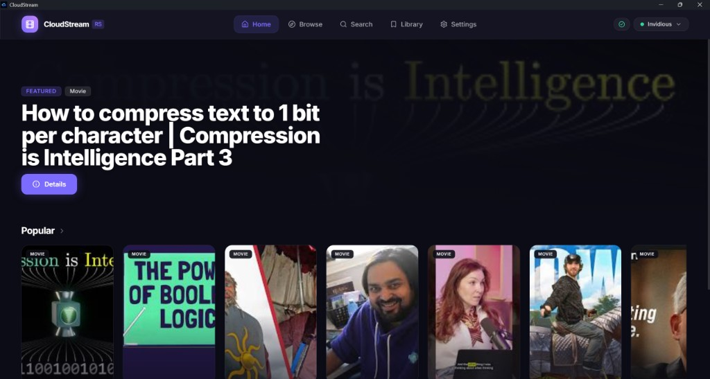
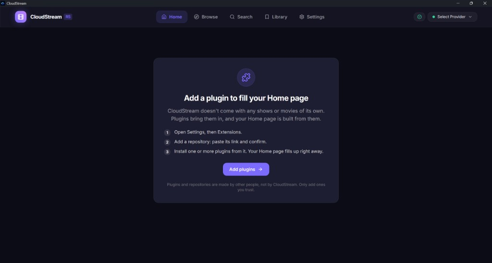
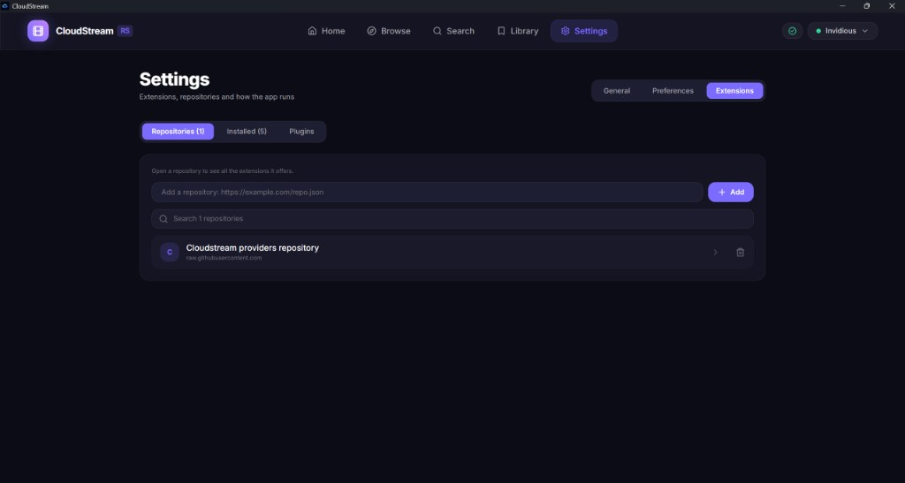

# CloudStream RS

> **Note:** This is a hobby project. It is under active development and may contain bugs. Use it at your own risk.

[](https://github.com/CeeSmag/cloudstream-desktop-unofficial/actions/workflows/ci.yml)
[](LICENSE)
[](https://github.com/CeeSmag/cloudstream-desktop-unofficial/releases/latest)

A desktop app for watching shows and movies through **plugins** you choose. It is a rewrite of [CloudStream](https://github.com/recloudstream/cloudstream) for Windows and Linux. Product builds ship the `cloudstream` binary from `app_shell` with a native **Slint** UI (`ui_slint`) and libmpv playback — no WebView / Tauri chrome.

<p align="center">
  
</p>

---

> **Disclaimer**  
> This is an independent, unofficial community project. It is **not** affiliated with, endorsed by, or maintained by the official CloudStream team.  
>  
> CloudStream RS does **not** host, scrape, bundle, or distribute media files or copyrighted material. You add your own plugin repositories. Plugins and repositories are made by other people — only add ones you trust.

---

## Download

Get the latest build from the [Releases page](https://github.com/CeeSmag/cloudstream-desktop-unofficial/releases/latest):

| File | For |
|---|---|
| `CloudStream_<version>_x64-setup.exe` | Windows (x64) — installer |
| `CloudStream_<version>_x64_portable.exe` | Windows (x64) — one file, nothing to install |
| `CloudStream-<version>-x86_64.AppImage` / `-aarch64.AppImage` | Linux (Intel/AMD or ARM) |

Everything the app needs (video player, plugin runtime, and Java) is included. After install, the app can check for updates itself under **Settings → General**.

---

## Getting started

CloudStream comes with **no shows or movies of its own**. Plugins bring them in, and your Home page is built from them.

<p align="center">
  
</p>

### 1. Open Extensions

On first launch you will see a short guide on Home. Click **Add plugins →**, or go to **Settings → Extensions**.

### 2. Add a repository

Paste a repository link (a `repo.json` URL) and confirm with **+ Add**.

<p align="center">
  
</p>

### 3. Install plugins

Open the repository, install one or more plugins, then pick a provider from the dropdown in the top bar. Home fills with shelves and a featured banner right away.

---

## What you can do

- **Home** — featured titles and rows from the provider you selected  
- **Browse** — filter and explore the catalog  
- **Search** — look up shows and movies across providers  
- **Library** — bookmarks and continue watching  
- **Player** — hardware-accelerated playback, subtitles, source switching, and skip intro when available  
- **Settings** — preferences, storage, updates, and extension management  

---

## Tips

- Switch providers with the dropdown in the top-right of the window.  
- If a stream fails, the app tries other working sources automatically.  
- Prefer trusted repositories only; you can remove a repository or uninstall a plugin anytime under **Settings → Extensions**.  
- **Delete all saved data** (Settings → General) closes the app and runs a background wipe helper to remove all local settings, plugins, history, and caches.

---

## For developers

Build instructions, architecture, and contribution rules live in:

- [AGENTS.md](AGENTS.md) — codebase map and how-to recipes  
- [RULES.md](RULES.md) — coding invariants and quality gates  
- [docs/RELEASING.md](docs/RELEASING.md) — how releases are built and signed  

Quality gates (same checks as CI):

```bash
just gates
```

Run the product UI (`cloudstream` from `app_shell` + Slint):

```powershell
# Windows: build the JVM sidecar once, then run
just sidecar
just run
# equivalent: cargo run -p app_shell
```

```bash
# Linux: build an AppImage once (caches sidecar + JRE under target/bundle-cache), then run
bash scripts/build_release.sh --install-deps   # Debian/Ubuntu; once
bash scripts/build_release.sh                  # AppImage → dist/
just run
# or: cargo run -p app_shell
# (just run reuses CS_SIDECAR_HOME / CS_SIDECAR_JAVA_HOME from target/bundle-cache when set)
```

Release artifacts (also built by `.github/workflows/release.yml` on a `v*` tag):

| OS | Command | Output in `dist/` |
|---|---|---|
| Windows | `powershell -File scripts/build_release.ps1` | installer + portable (`-Kind` for one) |
| Linux | `bash scripts/build_release.sh` | `CloudStream-<ver>-<arch>.AppImage` for this CPU |

`ui_app` (egui) and `archive/desktop_tauri` are reference-only; they are not the product shell.

---

## License

GNU General Public License v3.0 or later (GPL-3.0-or-later). See [LICENSE](LICENSE).
