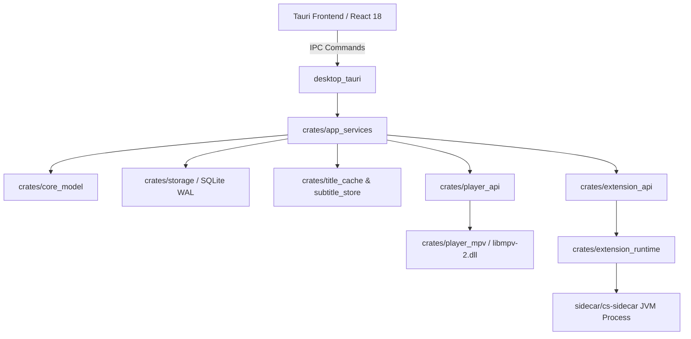

# CloudStream RS (Desktop)

[](https://github.com/CeeSmag/cloudstream-desktop-unofficial/actions/workflows/ci.yml)
[](LICENSE)
[](https://github.com/CeeSmag/cloudstream-desktop-unofficial/releases/latest)

A high-performance desktop rewrite of **CloudStream** built with **Rust**, **Tauri v2**, **React 18**, and **libmpv**.

---

> **Disclaimer:**
> This repository is an independent, unofficial community project. It is **not** officially affiliated with, endorsed by, or maintained by the official CloudStream team or upstream repository ([recloudstream/cloudstream](https://github.com/recloudstream/cloudstream)).
>
> CloudStream RS is an open-source media player and plugin runtime engine. **It does not host, scrape, bundle, or distribute any media files, video streams, or copyrighted material.** Users configure their own plugin repositories.

---

## Features

- **Full CloudStream Plugin Compatibility**: Executes real `.cs3` plugins via an out-of-process JVM sidecar (`cs-sidecar`) with comprehensive Android stubs and DEX bytecode translation.
- **3-Pillar Security Sandbox**: Untrusted extensions run in a restricted class loader sandbox preventing unauthorized file system, native process, and reflection abuse.
- **libmpv Video Engine**: High-fidelity media playback powered by `libmpv` with support for hardware decoding (`d3d11va`, `nvdec`, `vaapi`), subtitles, and embedded canvas rendering.
- **Live Stream & ClearKey DRM Support**: First-class support for live DASH (`.mpd`) and HLS (`.m3u8`) streams, including automatic ClearKey CENC decryption and stream option extraction.
- **Smart Link Resolver & Stream Checker**: Discovers and tests video links concurrently, sorts by quality and health, and provides transparent playback failover when a host drops.
- **Subtitle Normalization & Prefetching**: Automatically downloads, decompresses (`.zip`/`.gz`), converts encoding (UTF-16/Windows-1252 to UTF-8), and aligns subtitles to the viewer's preferred languages.
- **Modern Desktop UI**: Smooth desktop interface crafted with React 18, TypeScript, Tailwind CSS, Lucide icons, and Tauri v2 IPC.

---

## Download

Get the latest build from the [Releases page](https://github.com/CeeSmag/cloudstream-desktop-unofficial/releases/latest):

| File | For |
|---|---|
| `CloudStream_<version>_x64-setup.exe` | Windows (x64), installer |
| `CloudStream_<version>_x64_portable.exe` | Windows (x64), one file, nothing to install |
| `CloudStream-<version>-x86_64.AppImage` / `-aarch64.AppImage` | Linux (Intel/AMD or ARM) |

Everything the app needs (libmpv, the plugin runtime and Java) is inside, so it runs on a clean PC. The app checks
for updates itself (Settings > General).

**First run:** CloudStream comes with no plugins. Open Settings > Extensions, add a repository and install a plugin;
the Home page fills up from the plugins you install (the app shows a short guide until you do).

---

## Architecture Overview



---

## Building from Source

### Prerequisites

- **Rust**: `1.80+` (stable)
- **Node.js**: `20+` and `npm`
- **Java**: JDK 21 (for compiling and running the JVM extension sidecar)
- **libmpv**: `libmpv-2.dll` (Windows), `libmpv.so.2` (Linux), or `libmpv.dylib` (macOS)

### 1. Set up the Sidecar Bridge

```powershell
# Clones reference client, applies compatibility overlays, and builds sidecar distribution
powershell -ExecutionPolicy Bypass -File .\scripts\setup_sidecar.ps1
```

### 2. Install Frontend Dependencies

```bash
cd crates/desktop_tauri/frontend
npm install
cd ../../..
```

### 3. Run Development Build

```powershell
# Point to your libmpv library
$env:CS_LIBMPV_PATH = "C:\path\to\libmpv-2.dll"

# Launch the Tauri desktop app
powershell -ExecutionPolicy Bypass -File .\scripts\run_tauri.ps1
```

### 4. Build Release Packages

```powershell
# Windows PC: x64 installer + single-file portable exe in .\dist (-Kind installer|portable to build one)
powershell -ExecutionPolicy Bypass -File .\scripts\build_release.ps1
# Linux PC (run once with --install-deps): the AppImage for this PC's CPU (x86_64 or aarch64)
scripts/build_release.sh
```
GitHub builds all of them: Actions > "Release build" > Run workflow, or push a `v*` tag for a draft release.
The full release steps are in [docs/RELEASING.md](docs/RELEASING.md).

---

## Quality & Testing Gates

The repository strictly enforces safety, reliability, and code formatting invariants:

```bash
# Verify formatting
cargo fmt --all -- --check

# Strict lint checks (zero unwrap/panic allowed)
cargo clippy --workspace --all-targets -- -D warnings

# Execute test suite (Rust unit & race tests)
cargo test --workspace

# Frontend tests and type-checked build
cd crates/desktop_tauri/frontend && npm test && npm run build
```

More for contributors: [AGENTS.md](AGENTS.md) (code map and recipes), [RULES.md](RULES.md) (coding rules), [docs/](docs/) (releasing, notices).

---

## License

This project is licensed under the **GNU General Public License v3.0 or later (GPL-3.0-or-later)**. See the [LICENSE](LICENSE) file for the full license text.
